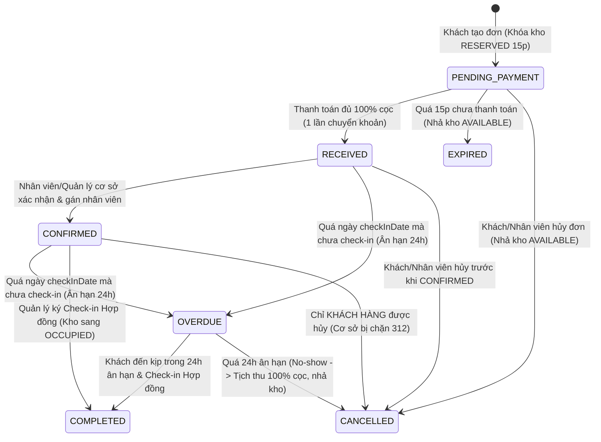
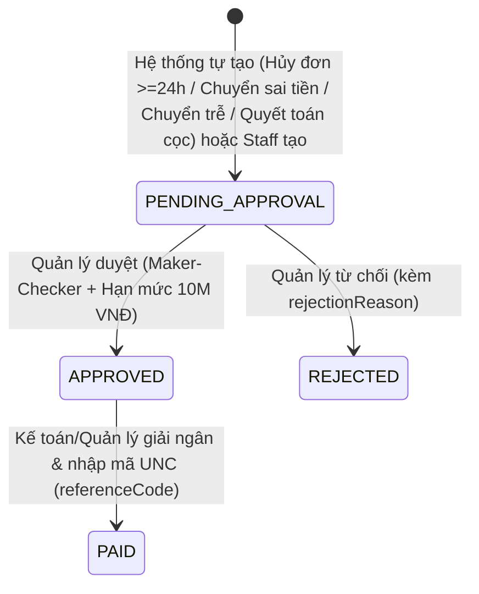
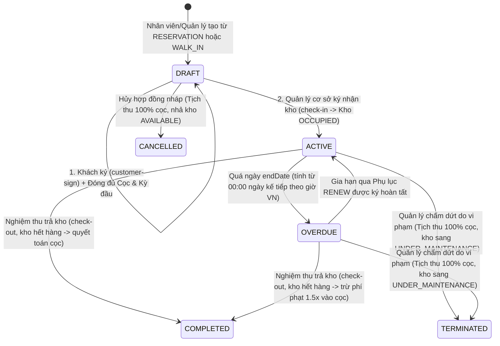

# Sổ Tay Tổng Hợp Quy Định Nghiệp Vụ Hệ Thống Self-Storage (Khách Hàng & Cơ Sở)

> **Single Source of Truth:** Tài liệu này tổng hợp **100% quy định nghiệp vụ đang có hiệu lực trong code thực tế** tính đến sau khi hoàn tất **Phase 0 (`T0.1`–`T0.6`)**, **Phase 1 (`T1.1`–`T1.8`)**, **Phân hệ Kệ & Tồn kho (`6A`–`6D`, `7A`, `7C`)**, và **Đồng bộ liên phân hệ (`X1`, `X2`, `X3`, `X6`)**.
>
> Tài liệu được trình bày song song theo **2 góc nhìn: Phía Khách hàng (`CUSTOMER`) và Phía Cơ sở / Nội bộ (`FACILITY_STAFF`, `FACILITY_MANAGER`, `BUSINESS_OPS_MANAGER`, `SYSTEM_ADMIN`)** để mọi thành viên trong team (Backend, Frontend, Mobile, QA) đọc và triển khai task mà không gặp xung đột nghiệp vụ.

---

## Mục Lục

1. [Tổng Quan 5 Vai Trò & Nguyên Tắc Phạm Vi Dữ Liệu (RBAC & Data Scoping)](#1-tổng-quan-5-vai-trò--nguyên-tắc-phạm-vi-dữ-liệu-rbac--data-scoping)
2. [Quy Định Đặt Chỗ (`Reservation`)](#2-quy-định-đặt-chỗ-reservation)
3. [Quy Định Thanh Toán (`Payment`) & Hoàn Tiền (`RefundRequest`)](#3-quy-định-thanh-toán-payment--hoàn-tiền-refundrequest)
4. [Quy Định Hợp Đồng Thuê Kho (`Contract`) & Tiền Cọc](#4-quy-định-hợp-đồng-thuê-kho-contract--tiền-cọc)
5. [Quy Định Phụ Lục Hợp Đồng (`ContractAddendum`: Gia Hạn `RENEW` & Đổi Kho `UNIT_CHANGE`)](#5-quy-định-phụ-lục-hợp-đồng-contractaddendum-gia-hạn-renew--đổi-kho-unit_change)
6. [Quy Định Phòng Kho (`StorageUnit`), Kệ Tầng (`StorageRack`/`RackTier`) & Giá Phân Khu (`Zone Pricing`)](#6-quy-định-phòng-kho-storageunit-kệ-tầng-storagerackracktier--giá-phân-khu-zone-pricing)
7. [Quy Định Danh Mục Hàng Hóa (`CustomerSku`) & Tồn Kho Tự Quản (`CustomerInventory`)](#7-quy-định-danh-mục-hàng-hóa-customersku--tồn-kho-tự-quản-customerinventory)
8. [Điểm Khác Biệt Giữa Tài Liệu Cũ & Code Hiện Tại (Team Cần Lưu Ý)](#8-điểm-khác-biệt-giữa-tài-liệu-cũ--code-hiện-tại-team-cần-lưu-ý)
9. [Bảng Tra Cứu Nhanh Mã Lỗi Nghiệp Vụ (`MESSAGE_CODE`)](#9-bảng-tra-cứu-nhanh-mã-lỗi-nghiệp-vụ-message_code)

---

## 1. Tổng Quan 5 Vai Trò & Nguyên Tắc Phạm Vi Dữ Liệu (RBAC & Data Scoping)

Hệ thống định nghĩa 5 vai trò trong [`src/common/enums/user.enum.ts`](../../src/common/enums/user.enum.ts) và kiểm tra phạm vi tài nguyên qua [`src/utils/caller.util.ts`](../../src/utils/caller.util.ts):

| Vai trò (`RoleEnum`)   | Nhóm người dùng        | Phạm vi dữ liệu (`Data Scope`)                 | Quyền hạn cốt lõi                                                                                                                                                                                                                                                                                                                                                  |
| :--------------------- | :--------------------- | :--------------------------------------------- | :----------------------------------------------------------------------------------------------------------------------------------------------------------------------------------------------------------------------------------------------------------------------------------------------------------------------------------------------------------------- |
| `CUSTOMER`             | Khách hàng thuê kho    | **Cá nhân (`customerId === caller.userId`)**   | Đặt chỗ, thanh toán QR, ký hợp đồng/phụ lục (bước 1), xác nhận/khiếu nại quyết toán cọc, tự quản lý SKU & nhập/xuất/chuyển/kiểm kê hàng hóa trong kho đang thuê.                                                                                                                                                                                                   |
| `FACILITY_STAFF`       | Nhân viên cơ sở        | **Nội bộ 1 cơ sở (`user.assignedFacilityId`)** | Tiếp nhận & xác nhận đơn đặt chỗ, tạo hợp đồng nháp, hỗ trợ kiểm tra kho & check-out, thu tiền thủ công (kèm ảnh chứng từ), tạo yêu cầu hoàn tiền, nhập liệu hộ danh mục SKU (`Staff Delegation`). **KHÔNG** có quyền ký pháp lý hợp đồng/phụ lục, **KHÔNG** được xem hay thao tác tồn kho của khách.                                                              |
| `FACILITY_MANAGER`     | Quản lý cơ sở          | **Nội bộ 1 cơ sở (`user.assignedFacilityId`)** | Toàn bộ quyền của Staff + **Ký pháp lý hợp đồng (`check-in`) và phụ lục (`staff-sign`)**, chấm dứt hợp đồng vi phạm (`terminate`), tạo phụ lục đổi kho (`UNIT_CHANGE`), duyệt hoàn tiền `< 10.000.000 VNĐ` (khác người tạo), bật/tắt bảo trì phòng kho, xem sơ đồ cây tồn kho (`Read-only`) của khách thuộc cơ sở mình, gửi yêu cầu phê duyệt (`ApprovalRequest`). |
| `BUSINESS_OPS_MANAGER` | Quản lý vận hành chuỗi | **Toàn hệ thống (Tất cả cơ sở)**               | Cấu hình bảng giá (`FacilityUnitTypeOffering` & `rackZonePricing`), phê duyệt `ApprovalRequest` của Quản lý cơ sở, duyệt hoàn tiền mọi hạn mức (bao gồm `>= 10.000.000 VNĐ`), xem và điều phối dữ liệu toàn chuỗi.                                                                                                                                                 |
| `SYSTEM_ADMIN`         | Quản trị viên hệ thống | **Toàn hệ thống (Tất cả cơ sở)**               | Toàn quyền quản trị người dùng, cơ sở, cấu hình hệ thống và nghiệp vụ toàn chuỗi.                                                                                                                                                                                                                                                                                  |

> **Quy tắc bắt buộc cho `FACILITY_STAFF` và `FACILITY_MANAGER`:**
> Nếu tài khoản nhân viên/quản lý **chưa được gán cơ sở (`assignedFacilityId` rỗng)** hoặc thao tác lên đơn đặt chỗ / hợp đồng / thanh toán / kho của **cơ sở khác**, hàm `assertFacilityAccess()` sẽ chặn ngay với lỗi `403 MESSAGE_CODE_103 (Access Denied)`.

---

## 2. Quy Định Đặt Chỗ (`Reservation`)

Nguồn code: [`src/modules/reservation/reservation.service.ts`](../../src/modules/reservation/reservation.service.ts), [`src/config/reservation.config.ts`](../../src/config/reservation.config.ts).

### 2.1. Vòng đời trạng thái Đặt chỗ (`ReservationStatusEnum`)

### 2.2. Bảng quy định chi tiết: Phía Khách hàng vs Phía Cơ sở

| Hạng mục                                                                      | Quy định phía Khách hàng (`CUSTOMER`)                                                                                                                                                                                                                                                                                                                                                                                                                                                                                                                                                                                                                                                                                                                                   | Quy định phía Cơ sở (`STAFF` / `MANAGER` / `OPS` / `ADMIN`)                                                                                                                                                                                                                                                                                                                                                                                                                                                                                                        |
| :---------------------------------------------------------------------------- | :---------------------------------------------------------------------------------------------------------------------------------------------------------------------------------------------------------------------------------------------------------------------------------------------------------------------------------------------------------------------------------------------------------------------------------------------------------------------------------------------------------------------------------------------------------------------------------------------------------------------------------------------------------------------------------------------------------------------------------------------------------------------- | :----------------------------------------------------------------------------------------------------------------------------------------------------------------------------------------------------------------------------------------------------------------------------------------------------------------------------------------------------------------------------------------------------------------------------------------------------------------------------------------------------------------------------------------------------------------- |
| **1. Tạo đơn đặt chỗ** (`POST /reservations`)                                 | - Chỉ `CUSTOMER` được tạo đơn cho chính mình. - Chọn cơ sở (`facilityId`), cấu hình loại kho (`offeringId`), phòng kho cụ thể (`storageUnitId` đang `AVAILABLE`), kỳ thuê (`WEEK`/`MONTH`), số kỳ (`duration`), ngày nhận kho (`checkInDate`), khung giờ (`checkInTimeSlot`) và tiện ích đi kèm (`amenities`). - **Giới hạn chống spam:** Tối đa **3 đơn** `PENDING_PAYMENT` cùng lúc và tối đa **5 đơn** đang hoạt động (`PENDING_PAYMENT`, `RECEIVED`, `CONFIRMED`, `OVERDUE`) (`400 MESSAGE_CODE_314`). - **Giới hạn ngày đặt trước:** `checkInDate` không quá **30 ngày** kể từ hiện tại (`400 MESSAGE_CODE_313`), không được ở quá khứ, và nếu đặt trong ngày hôm nay thì giờ kết thúc của `checkInTimeSlot` phải chưa trôi qua (`400 MESSAGE_CODE_315`). | - Cơ sở không tạo `Reservation` hộ khách; nếu khách đến trực tiếp tại quầy mà chưa đặt trước, nhân viên tạo thẳng Hợp đồng nguồn `WALK_IN` (`POST /contracts`). - Mỗi khung giờ `FacilityTimeSlot` có giới hạn sức chứa khách phục vụ (`maxCapacity`, mặc định 2 đơn/khung giờ). Hết chỗ trả về `400 MESSAGE_CODE_310`.                                                                                                                                                                                                                                         |
| **2. Giữ chỗ & Tiền cọc đặt chỗ**                                             | - Khi tạo đơn thành công: Phòng kho chuyển nguyên tử từ `AVAILABLE` sang `RESERVED`. - Thời gian giữ chỗ chờ thanh toán: **15 phút** (`holdingExpiredAt = now + 15m`). - **Số tiền phải thanh toán khi đặt chỗ (`depositAmount`):** Bằng **100% giá thuê cơ bản của 1 kỳ (`basePrice`)** (snapshot từ `FacilityUnitTypeOffering` tại thời điểm đặt, chưa cộng tiền tiện ích). - Quá 15 phút không thanh toán: Job BullMQ `expire_holding_reservation` tự chuyển đơn sang `EXPIRED` và nhả phòng kho về `AVAILABLE`.                                                                                                                                                                                                                                            | - Quản lý (`FACILITY_MANAGER`, `OPS`, `ADMIN`) có thể kích hoạt quét thủ công đơn hết hạn qua `POST /reservations/process-expired`.                                                                                                                                                                                                                                                                                                                                                                                                                                |
| **3. Sửa đơn đặt chỗ** (`PATCH /reservations/{id}`)                           | - Khách chỉ sửa được ghi chú/thông tin khi đơn còn ở `PENDING_PAYMENT` (`400 MESSAGE_CODE_302` nếu đã `RECEIVED`/`CONFIRMED`).                                                                                                                                                                                                                                                                                                                                                                                                                                                                                                                                                                                                                                          | - Nhân viên/Quản lý thuộc cơ sở của đơn có thể cập nhật khi đơn còn ở `PENDING_PAYMENT`.                                                                                                                                                                                                                                                                                                                                                                                                                                                                           |
| **4. Xác nhận đơn & Phân công nhân viên** (`POST /reservations/{id}/confirm`) | - Khách hàng không được gọi API này (`403`). Sau khi thanh toán xong, khách chờ cơ sở xác nhận hoặc đến cơ sở theo lịch hẹn.                                                                                                                                                                                                                                                                                                                                                                                                                                                                                                                                                                                                                                            | - **Ai được xác nhận:** Cả `FACILITY_STAFF` và `FACILITY_MANAGER` thuộc cơ sở của đơn (cùng `OPS`, `ADMIN`). - Chỉ xác nhận được đơn đang ở `RECEIVED` và `checkInDate` chưa qua ngày hôm nay theo giờ VN (`400 MESSAGE_CODE_319`). - Gán nhân viên phụ trách tiếp đón (`assignedStaffId` — nếu để trống và người gọi là `FACILITY_STAFF` thì tự gán chính mình). Đơn chuyển sang `CONFIRMED`.                                                                                                                                                               |
| **5. Đổi phòng kho khi có sự cố** (`POST /reservations/{id}/reassign-unit`)   | - Khách hàng không tự đổi kho trên đơn đặt chỗ (`403`). Quyền lợi của khách được bảo vệ: chỉ được đổi sang phòng kho **cùng hạng hoặc cao hạng hơn** mà **không phát sinh thêm phí**.                                                                                                                                                                                                                                                                                                                                                                                                                                                                                                                                                                                   | - Thực hiện bởi `FACILITY_STAFF`, `FACILITY_MANAGER` của cơ sở khi đơn đang `RECEIVED` hoặc `CONFIRMED` (chưa tạo hợp đồng active `MESSAGE_CODE_318`). - **Quy tắc nâng hạng miễn phí:** Phòng mới phải cùng cơ sở, đang `AVAILABLE`, có giá `newOffering.basePrice >= currentOffering.basePrice` (`400 MESSAGE_CODE_316`). Giữ nguyên `basePrice`, `depositAmount`, `totalEstimatedPrice` cũ của khách. - Phòng cũ được chuyển sang `UNDER_MAINTENANCE` (nếu `markOldUnitMaintenance = true`, mặc định `true`) hoặc `AVAILABLE`; phòng mới sang `RESERVED`. |
| **6. Chính sách Hủy đơn & Hoàn cọc** (`POST /reservations/{id}/cancel`)       | - Khách hủy khi `PENDING_PAYMENT`: Hủy ngay, không phát sinh hoàn tiền (`refundStatus = NONE`), nhả kho về `AVAILABLE`. - Khách hủy khi `RECEIVED` hoặc `CONFIRMED`:  + **Trước `checkInDate` từ 24 giờ trở lên (`hoursUntilCheckIn >= 24`):** Hoàn **100% tiền cọc** (`refundAmount = paidAmount`, `refundStatus = PENDING`), tự động tạo `RefundRequest` (`RESERVATION_CANCEL`).  + **Sát giờ `< 24 giờ` trước `checkInDate`:** **Khấu trừ 100% tiền cọc** (`refundAmount = 0`, `refundStatus = FORFEITED`).                                                                                                                                                                                                                                                 | - **Cơ sở hủy đơn:**  + **Bị chặn hủy đơn đã `CONFIRMED`** (`400 MESSAGE_CODE_312` — khi đã cam kết giữ kho xác nhận cho khách, cơ sở chỉ được dùng `reassign-unit` để đổi phòng khác cho khách).  + Nếu cơ sở hủy đơn đang `RECEIVED` (do lỗi vận hành bất khả kháng): Khách luôn được **hoàn 100% tiền cọc** (`refundAmount = paidAmount`) bất kể còn bao nhiêu giờ trước `checkInDate`.                                                                                                                                                                   |
| **7. Quá hạn nhận kho (`OVERDUE`) & Bỏ cọc (`No-show`)**                      | - Nếu qua hết ngày `checkInDate` mà khách chưa ký nhận kho (`check-in`), đơn chuyển sang `OVERDUE`. - Khách có **24 giờ ân hạn (`overdueGraceHours = 24`)** để đến cơ sở làm thủ tục hợp đồng. - Nếu quá 24 giờ ân hạn vẫn không đến (**No-show**): Đơn tự động bị hủy (`CANCELLED`), **tịch thu 100% tiền cọc** (`refundStatus = FORFEITED`, `refundAmount = 0`), phòng kho giải phóng về `AVAILABLE`.                                                                                                                                                                                                                                                                                                                                                           | - Cron job BullMQ `check_overdue_reservations` tự chạy mỗi 15 phút (hoặc `MANAGER`/`OPS`/`ADMIN` gọi `POST /reservations/process-overdue`). - Trong thời gian đơn đang `OVERDUE` (24h ân hạn), nhân viên cơ sở vẫn tạo được hợp đồng từ đơn đó nếu khách đến trễ.                                                                                                                                                                                                                                                                                               |

---

## 3. Quy Định Thanh Toán (`Payment`) & Hoàn Tiền (`RefundRequest`)

Nguồn code: [`src/modules/payment/payment.service.ts`](../../src/modules/payment/payment.service.ts), [`src/config/payment.config.ts`](../../src/config/payment.config.ts).

### 3.1. Nguyên tắc "Thanh Toán Đủ 1 Lần Duy Nhất" (`Single Payment Invariant` — `T1.8`)

> **Lưu ý quan trọng:** Không hỗ trợ trả góp / cộng dồn nhiều lần chuyển khoản (`PARTIALLY_PAID` đã bị loại bỏ khỏi luồng hoạt động). Mọi lệnh thanh toán (`Payment`) phải được thanh toán **đúng 100% số tiền yêu cầu (`transferAmount === payment.amount`) trong 1 giao dịch duy nhất**.

| Tình huống giao dịch ngân hàng (Webhook SePay)                                         | Cách hệ thống xử lý tự động (`processSepayWebhook`)                                                                                                                                                                                                                                                                                                                                                                                                                     |
| :------------------------------------------------------------------------------------- | :---------------------------------------------------------------------------------------------------------------------------------------------------------------------------------------------------------------------------------------------------------------------------------------------------------------------------------------------------------------------------------------------------------------------------------------------------------------------- |
| **1. Chuyển đúng số tiền (`transferAmount === payment.amount`) & trong hạn**           | - `Payment` chuyển sang `PAID`, `PaymentTransaction` chuyển sang `MATCHED`. - Kích hoạt đơn: Nếu là `RESERVATION_DEPOSIT` $\rightarrow$ đơn đặt chỗ sang `RECEIVED`; nếu là `CONTRACT_DEPOSIT` $\rightarrow$ ghi nhận `contract.depositPaidAt`; nếu là `RENT_FIRST_PERIOD` $\rightarrow$ ghi nhận `contract.firstPeriodPaidAt`.                                                                                                                                      |
| **2. Chuyển thiếu (`< payment.amount`) hoặc chuyển thừa (`> payment.amount`)**         | - **Từ chối khớp đơn (`AMOUNT_MISMATCH`):** `payment.paidAmount` giữ nguyên bằng `0`, trạng thái `Payment` giữ nguyên `PENDING` (để khách vẫn có thể chuyển lại đúng số tiền nếu còn hạn 15 phút). - Giao dịch `PaymentTransaction` được đánh dấu `AMOUNT_MISMATCH`. - Hệ thống **tự động tạo ngay 1 `RefundRequest` (`reason = AMOUNT_MISMATCH`, `status = PENDING_APPROVAL`) cho 100% số tiền giao dịch chuyển sai** để kế toán/quản lý hoàn trả lại cho khách. |
| **3. Chuyển tiền muộn sau khi đơn/lệnh thanh toán đã hết hạn (`EXPIRED`/`CANCELLED`)** | - **Ân hạn trễ Webhook 2 phút (`lateGraceMinutes = 2`):** Nếu `Payment` vẫn đang `PENDING` và giao dịch đến trễ không quá `expiresAt + 2 phút` (và phòng kho của đơn đặt chỗ chưa bị người khác đặt), hệ thống **chấp nhận thanh toán hợp lệ**. - Nếu trễ quá 2 phút hoặc lệnh thanh toán đã đóng (`EXPIRED`/`CANCELLED`/`PAID`): Giao dịch được ghi nhận `LATE_ORPHAN` và **tự động tạo `RefundRequest` (`reason = LATE_PAYMENT`) hoàn 100% số tiền chuyển muộn**.  |
| **4. Chuyển khoản sai nội dung (không có mã `SSM...` hoặc mã không tồn tại)**          | - Giao dịch được lưu vào `PaymentTransaction` với trạng thái `UNMATCHED` (không mất dấu dòng tiền). - Nhân viên/Quản lý cơ sở tra cứu qua `GET /payments/transactions/unmatched` và gán thủ công vào lệnh thanh toán đang chờ qua `POST /payments/transactions/{id}/assign` (bắt buộc số tiền giao dịch khớp 100% `payment.amount`, nếu lệch báo lỗi `400 MESSAGE_CODE_518`).                                                                                        |

### 3.2. Các loại thanh toán (`PaymentTypeEnum`) & Thứ tự thu tiền

1. **`RESERVATION_DEPOSIT` (Cọc giữ chỗ khi đặt online):**
   - Thu `depositAmount = basePrice` (1 kỳ thuê cơ bản).
   - Khi chuyển thành Hợp đồng (`source = RESERVATION`), hệ thống tự động kế thừa số tiền cọc này (`contract.depositPaidAt = reservation.paidAt`) — khách **không** phải đóng cọc lần 2.
2. **`CONTRACT_DEPOSIT` (Cọc hợp đồng cho khách Walk-in):**
   - Áp dụng khi tạo Hợp đồng trực tiếp tại quầy (`source = WALK_IN`). Thu `contract.depositAmount` (bằng 1 kỳ `rentalPrice`).
3. **`RENT_FIRST_PERIOD` (Tiền thuê kỳ đầu tiên của Hợp đồng — `T1.5`):**
   - Thu `contract.totalPeriodicPrice = rentalPrice + amenitiesPrice` của kỳ đầu tiên.
   - **Thứ tự bắt buộc:** Phải hoàn tất thanh toán Tiền cọc (`depositPaidAt != null`) trước khi tạo hoặc thu `RENT_FIRST_PERIOD` (`400 MESSAGE_CODE_520`).
   - **Điều kiện cứng trước khi Check-in Hợp đồng:** Cả `depositPaidAt` và `firstPeriodPaidAt` đều phải đã thanh toán (`400 MESSAGE_CODE_506` nếu thiếu cọc, `400 MESSAGE_CODE_519` nếu thiếu tiền thuê kỳ đầu).

### 3.3. Thu tiền thủ công tại quầy (`POST /payments/{id}/confirm-manual`)

- **Ai được thực hiện:** `FACILITY_STAFF`, `FACILITY_MANAGER` thuộc cơ sở của đơn (`assertFacilityAccess`), hoặc `BUSINESS_OPS_MANAGER`, `SYSTEM_ADMIN`. (`CUSTOMER` bị chặn `403`).
- **Chứng từ bắt buộc (`T0.3`):** Bắt buộc đính kèm `proofImageUrl` (URL ảnh biên lai thu tiền mặt / UNC ngân hàng hợp lệ). Nếu thiếu sẽ bị chặn lỗi `400 MESSAGE_CODE_509`.
- Ghi nhận `confirmedBy = caller.userId` để phục vụ kiểm soát chéo **Maker-Checker** nếu sau này phát sinh hoàn tiền.

### 3.4. Quy trình Hoàn tiền (`RefundRequest` — `T1.4`) & Bảo mật Tài khoản Ngân hàng

- **Quy tắc Kiểm soát Kép (`Maker-Checker` — `MESSAGE_CODE_320` / `514`):**
  - Người phê duyệt yêu cầu hoàn tiền (`approvedBy`) **bắt buộc phải khác** người tạo yêu cầu hoàn tiền (`requestedBy`) **VÀ khác** nhân viên đã xác nhận thu tiền thủ công (`payment.confirmedBy`).
- **Phân cấp Hạn mức Phê duyệt (`refund.opsApprovalThreshold = 10.000.000 VNĐ`):**
  - Khoản hoàn **`< 10.000.000 VNĐ`**: `FACILITY_MANAGER` của cơ sở đó (hoặc `BUSINESS_OPS_MANAGER`, `SYSTEM_ADMIN`) được quyền phê duyệt (`POST /refund-requests/{id}/approve`).
  - Khoản hoàn **`>= 10.000.000 VNĐ`**: Bắt buộc phải do **`BUSINESS_OPS_MANAGER` hoặc `SYSTEM_ADMIN`** phê duyệt (`FACILITY_MANAGER` gọi sẽ bị chặn `403 MESSAGE_CODE_103`).
- **Xác nhận Đã Giải ngân (`POST /refund-requests/{id}/mark-paid`):**
  - Thực hiện bởi `FACILITY_MANAGER` (cùng cơ sở), `BUSINESS_OPS_MANAGER`, hoặc `SYSTEM_ADMIN` khi đơn đang `APPROVED`.
  - Bắt buộc nhập mã tham chiếu giao dịch ngân hàng `referenceCode` (`400 MESSAGE_CODE_515`). Sau khi `PAID`, bản ghi hoàn tiền bị khóa bất biến (`400 MESSAGE_CODE_516`).
- **Bảo mật Thông tin Ngân hàng của Khách (`bankName`, `accountNumber`, `accountHolder`):**
  - Lưu trữ trong DB dưới dạng **mã hóa AES-256-GCM** (`encryption.util.ts`).
  - Khi trả về qua API: Tự động che số tài khoản thành `****1234` đối với `CUSTOMER` và `FACILITY_STAFF`; chỉ giải mã đầy đủ cho `FACILITY_MANAGER` (cùng cơ sở), `BUSINESS_OPS_MANAGER` và `SYSTEM_ADMIN` để thực hiện chuyển khoản hoàn tiền.

---

## 4. Quy Định Hợp Đồng Thuê Kho (`Contract`) & Tiền Cọc

Nguồn code: [`src/modules/contract/contract.service.ts`](../../src/modules/contract/contract.service.ts), [`src/config/contract.config.ts`](../../src/config/contract.config.ts).

### 4.1. Vòng đời trạng thái Hợp đồng (`ContractStatusEnum`)

### 4.2. Bảng quy định chi tiết Hợp đồng: Phía Khách hàng vs Phía Cơ sở

| Giai đoạn                                                                                      | Quy định phía Khách hàng (`CUSTOMER`)                                                                                                                                                                                                                                                                                                                                                                                                                                                                                                         | Quy định phía Cơ sở (`STAFF` / `MANAGER` / `OPS` / `ADMIN`)                                                                                                                                                                                                                                                                                                                                                                                                                                                                                                                                                                                                                                                                                                                                                                                      |
| :--------------------------------------------------------------------------------------------- | :-------------------------------------------------------------------------------------------------------------------------------------------------------------------------------------------------------------------------------------------------------------------------------------------------------------------------------------------------------------------------------------------------------------------------------------------------------------------------------------------------------------------------------------------- | :----------------------------------------------------------------------------------------------------------------------------------------------------------------------------------------------------------------------------------------------------------------------------------------------------------------------------------------------------------------------------------------------------------------------------------------------------------------------------------------------------------------------------------------------------------------------------------------------------------------------------------------------------------------------------------------------------------------------------------------------------------------------------------------------------------------------------------------------- |
| **1. Khởi tạo hợp đồng nháp** (`POST /contracts`)                                              | - Khách hàng **không** tự tạo hợp đồng (`403`). - Khách kiểm tra nội dung hợp đồng nháp (`DRAFT`) trên ứng dụng sau khi nhân viên khởi tạo.                                                                                                                                                                                                                                                                                                                                                                                                | - Chỉ `FACILITY_STAFF`, `FACILITY_MANAGER` (thuộc cơ sở), `OPS`, `ADMIN` được tạo. - **Nguồn `RESERVATION`:** Đơn đặt chỗ phải đang ở `CONFIRMED` hoặc `OVERDUE` (`400 MESSAGE_CODE_406`). Kế thừa nguyên vẹn phòng kho, kỳ hạn, giá snapshot, và tiền cọc đã đóng từ `Reservation`. - **Nguồn `WALK_IN`:** Phòng kho phải đang `AVAILABLE` (`400 MESSAGE_CODE_402`), hệ thống khóa phòng sang `RESERVED` và trừ tồn kho tiện ích (`FacilityAmenity`).                                                                                                                                                                                                                                                                                                                                                                                     |
| **2. Ký hợp đồng — Bước 1 (Khách ký)** (`POST /contracts/{id}/customer-sign`)                  | - **Chỉ `CUSTOMER` là chủ hợp đồng (`contract.customerId === caller.userId`)** được ký. - Bắt buộc truyền `termsAccepted: true` (`400 MESSAGE_CODE_411`). - Sau khi khách ký: `customerSigned = true`, hợp đồng vẫn ở `DRAFT` chờ thu đủ tiền (nếu chưa đóng kỳ đầu) và chờ Quản lý cơ sở ký bàn giao.                                                                                                                                                                                                                                  | - Nhân viên/Quản lý không được ký thay bước của khách hàng (`403 MESSAGE_CODE_103`).                                                                                                                                                                                                                                                                                                                                                                                                                                                                                                                                                                                                                                                                                                                                                             |
| **3. Ký bàn giao nhận kho — Bước 2 (Quản lý ký Check-in)** (`POST /contracts/{id}/check-in`)   | - Khách hàng không gọi API này. - **Chốt lại ngày bắt đầu & kết thúc nếu nhận kho trễ (`[OPEN D6]`):** Nếu khách check-in trễ hơn `startDate` dự kiến (tính theo ngày lịch VN), hệ thống tự động dịch `startDate` sang thời điểm check-in thực tế và cộng bù `endDate` để **bảo toàn đủ 100% số ngày/tháng thuê** khách đã trả tiền.                                                                                                                                                                                                       | - **Ai được ký:** Chỉ **`FACILITY_MANAGER` của cơ sở đó**, `BUSINESS_OPS_MANAGER`, hoặc `SYSTEM_ADMIN` (`FACILITY_STAFF` bị chặn `403`). - **3 Điều kiện tiên quyết bắt buộc trước khi Check-in:**  1. Khách hàng đã ký trước (`customerSigned === true`, nếu chưa báo `400 MESSAGE_CODE_414`).  2. Đã thanh toán tiền cọc (`depositPaidAt != null`, nếu chưa báo `400 MESSAGE_CODE_506`).  3. Đã thanh toán tiền thuê kỳ đầu (`firstPeriodPaidAt != null`, nếu chưa báo `400 MESSAGE_CODE_519`). - Khi ký xong: Hợp đồng sang `ACTIVE`, phòng kho sang `OCCUPIED`, đơn đặt chỗ (nếu có) sang `COMPLETED`.                                                                                                                                                                                                                        |
| **4. Hủy hợp đồng nháp** (`POST /contracts/{id}/cancel`)                                       | - Chủ hợp đồng (`CUSTOMER`) có thể hủy khi hợp đồng còn đang `DRAFT`. - **Chế tài hủy hợp đồng `DRAFT`:** Khấu trừ 100% tiền cọc (`depositStatus = FORFEITED`, `refundAmount = 0`).                                                                                                                                                                                                                                                                                                                                                        | - `FACILITY_STAFF`, `FACILITY_MANAGER` của cơ sở (hoặc `OPS`, `ADMIN`) có thể hủy khi hợp đồng đang `DRAFT`. - Giải phóng phòng kho về `AVAILABLE`, hoàn trả số lượng tiện ích `FacilityAmenity`, chuyển đơn đặt chỗ gốc (nếu có) sang `CANCELLED`.                                                                                                                                                                                                                                                                                                                                                                                                                                                                                                                                                                                           |
| **5. Quá hạn hợp đồng (`OVERDUE`) & Công thức tính phí phạt (`T1.7`)**                         | - Ngày `endDate` được tính **trọn ngày theo múi giờ Việt Nam (`Asia/Ho_Chi_Minh`, inclusive)**: Hợp đồng có `endDate = 10/04` thì khách được sử dụng đến hết `23:59:59` ngày `10/04`. Bắt đầu từ `00:00:00` ngày `11/04` mới tính là quá hạn 1 ngày. - Khi hợp đồng `OVERDUE`: Khách **vẫn được xuất hàng (`OUT`) và dời kệ (`MOVE`)** để dọn kho trả phòng, nhưng **bị chặn nhập thêm hàng mới (`IN`) và kiểm kê (`ADJUST`)** (`400 MESSAGE_CODE_630`).                                                                                   | - **Công thức tính phí quá hạn (`calculateOverdueMetrics`):**  + Với kỳ `MONTH`: `dailyRate = Math.round(rentalPrice / 30)`  + Với kỳ `WEEK`: `dailyRate = Math.round(rentalPrice / 7)`  + Đơn giá phạt mỗi ngày: `penaltyDailyRate = Math.round(dailyRate * 1.5)` (**150% đơn giá ngày**)  + Tổng phí quá hạn: `overdueFee = overdueDays * penaltyDailyRate`.                                                                                                                                                                                                                                                                                                                                                                                                                                                                       |
| **6. Nghiệm thu trả kho (`Check-out`) & Quyết toán cọc** (`POST /contracts/{id}/check-out`)    | - **Điều kiện bắt buộc phía khách hàng (`X3`):** Khách phải **xuất hết 100% hàng hóa khỏi phòng kho (`quantity = 0`)** trước khi trả kho. Nếu còn bất kỳ mặt hàng nào trong kho, hệ thống chặn Check-out với lỗi `400 MESSAGE_CODE_420`. - Sau khi cơ sở check-out, khách có quyền:  + **Xác nhận đồng ý bảng quyết toán cọc:** `POST /contracts/{id}/settlement/confirm`  + **Khiếu nại bảng quyết toán cọc:** `POST /contracts/{id}/settlement/dispute` (kèm lý do `reason` $\rightarrow$ chuyển `depositStatus` sang `DISPUTED`). | - Thực hiện bởi `FACILITY_STAFF`, `FACILITY_MANAGER` (cùng cơ sở), `OPS`, `ADMIN` trên hợp đồng đang `ACTIVE` hoặc `OVERDUE`. - **Bắt buộc ảnh nghiệm thu khi có phạt hư hại (`T1.6`):** Nếu nhập `damageFee > 0`, bắt buộc phải đính kèm ít nhất 1 ảnh hiện trường trong `inspectionPhotos` (`400 MESSAGE_CODE_418`). - **Công thức quyết toán cọc:**  + `totalDeductions = damageFee + overdueFee`  + `refundAmount = Math.max(0, depositAmount - totalDeductions)`  + `additionalPaymentRequired = Math.max(0, totalDeductions - depositAmount)` (nếu tiền phạt vượt quá tiền cọc). - Nếu `refundAmount > 0`, hệ thống **tự động tạo `RefundRequest` (`DEPOSIT_SETTLEMENT`)** để hoàn phần cọc dư cho khách. - Phòng kho chuyển về `AVAILABLE`, hoàn trả số lượng tiện ích `FacilityAmenity`, hợp đồng sang `COMPLETED`. |
| **7. Chấm dứt hợp đồng trước hạn do vi phạm (`Terminate`)** (`POST /contracts/{id}/terminate`) | - Áp dụng khi khách vi phạm nghiêm trọng điều khoản (lưu trữ hàng cấm, bỏ kho quá hạn dài ngày không liên lạc được...). - **Chế tài:** Tịch thu 100% tiền cọc (`depositStatus = FORFEITED`, `refundAmount = 0`).                                                                                                                                                                                                                                                                                                                           | - **Ai được thực hiện:** Chỉ **`FACILITY_MANAGER` của cơ sở**, `BUSINESS_OPS_MANAGER`, hoặc `SYSTEM_ADMIN` (`FACILITY_STAFF` và `CUSTOMER` bị chặn `403`). - Hợp đồng chuyển sang `TERMINATED`. - **Cơ chế bảo vệ hàng tồn kho khi cưỡng chế chấm dứt (`X1` + `X3`):**  + Cho phép `terminate` ngay cả khi trong kho vẫn còn hàng của khách (ghi nhận số dòng tồn kho `remainingInventoryItems` vào Audit Log).  + Phòng kho **bắt buộc chuyển sang `UNDER_MAINTENANCE`** (không về `AVAILABLE`) để niêm phong/xử lý tài sản tồn đọng. Quản lý không thể mở lại kho (`toggleMaintenance(false)`) cho đến khi hàng tồn được xử lý về `0` (`400 MESSAGE_CODE_629`).                                                                                                                                                                    |

### 4.3. Vòng đời 6 trạng thái Tiền cọc Hợp đồng (`ContractDepositStatusEnum`)

| Trạng thái (`depositStatus`) | Ý nghĩa nghiệp vụ                                                                                                       |
| :--------------------------- | :---------------------------------------------------------------------------------------------------------------------- |
| `HELD`                       | Đang giữ cọc (mặc định khi hợp đồng ở `DRAFT`, `ACTIVE`, `OVERDUE`).                                                    |
| `REFUNDED`                   | Hoàn trả 100% tiền cọc khi `check-out` (không có `damageFee` và không có `overdueFee`).                                 |
| `PARTIALLY_REFUNDED`         | Hoàn trả một phần tiền cọc khi `check-out` (`0 < totalDeductions < depositAmount`).                                     |
| `APPLIED`                    | Toàn bộ tiền cọc đã được cấn trừ hết vào phí hư hại + phí quá hạn khi `check-out` (`totalDeductions >= depositAmount`). |
| `FORFEITED`                  | Tịch thu 100% tiền cọc (khi hủy hợp đồng `DRAFT` hoặc bị chấm dứt hợp đồng `TERMINATED` do vi phạm).                    |
| `DISPUTED`                   | Khách hàng gửi khiếu nại quyết toán cọc (`POST /contracts/{id}/settlement/dispute`).                                    |

---

## 5. Quy Định Phụ Lục Hợp Đồng (`ContractAddendum`: Gia Hạn `RENEW` & Đổi Kho `UNIT_CHANGE`)

Nguồn code: [`src/modules/contract/contract.service.ts`](../../src/modules/contract/contract.service.ts), [`src/modules/contract/contractAddendum.model.ts`](../../src/modules/contract/contractAddendum.model.ts).

> **Chú ý:** Endpoint gia hạn trực tiếp cũ `POST /contracts/{id}/renew` **đã bị khóa hoàn toàn** và luôn trả về lỗi `400 MESSAGE_CODE_416`. Mọi nghiệp vụ gia hạn hoặc đổi phòng kho trong kỳ thuê đều phải đi qua **Phụ lục Hợp đồng (`ContractAddendum`)** để đảm bảo chữ ký pháp lý của cả 2 bên.

### 5.1. So sánh quy trình 2 loại Phụ lục (`RENEW` vs `UNIT_CHANGE`)

| Tiêu chí                                                           | Phụ lục Gia hạn (`type = RENEW`)                                                                                                                                                                                                                                                                                                                                                                                                    | Phụ lục Đổi phòng kho (`type = UNIT_CHANGE`)                                                                                                                                                                                                                                                                                                                                                                                                                                                                                                                                                                               |
| :----------------------------------------------------------------- | :---------------------------------------------------------------------------------------------------------------------------------------------------------------------------------------------------------------------------------------------------------------------------------------------------------------------------------------------------------------------------------------------------------------------------------- | :------------------------------------------------------------------------------------------------------------------------------------------------------------------------------------------------------------------------------------------------------------------------------------------------------------------------------------------------------------------------------------------------------------------------------------------------------------------------------------------------------------------------------------------------------------------------------------------------------------------------- |
| **Mục đích**                                                       | Kéo dài thời hạn thuê (`extensionPeriods` kỳ) cho hợp đồng đang `ACTIVE` hoặc `OVERDUE`.                                                                                                                                                                                                                                                                                                                                            | Đổi sang phòng kho khác cùng cơ sở (`newStorageUnitId`) cho hợp đồng đang `ACTIVE`.                                                                                                                                                                                                                                                                                                                                                                                                                                                                                                                                        |
| **Ai được tạo** (`POST /contracts/{id}/addendums`)                 | - `CUSTOMER` (chủ hợp đồng), `FACILITY_STAFF` (cùng cơ sở) $\rightarrow$ tạo ở trạng thái **`PENDING_APPROVAL`** (chờ Quản lý duyệt). - `FACILITY_MANAGER` (cùng cơ sở), `OPS`, `ADMIN` $\rightarrow$ tạo thẳng ở trạng thái **`DRAFT`** (sẵn sàng cho khách ký).                                                                                                                                                                | - **Chỉ `FACILITY_MANAGER` (cùng cơ sở), `BUSINESS_OPS_MANAGER`, `SYSTEM_ADMIN`** (`CUSTOMER` và `FACILITY_STAFF` bị chặn `403`). - Tạo thẳng ở trạng thái **`DRAFT`**, đồng thời **khóa nguyên tử phòng kho mới** từ `AVAILABLE` sang `RESERVED`.                                                                                                                                                                                                                                                                                                                                                                      |
| **Bước duyệt yêu cầu** (`approve` / `reject`)                      | - Nếu đang `PENDING_APPROVAL`: Chỉ `FACILITY_MANAGER` (cùng cơ sở), `OPS`, `ADMIN` được duyệt (`POST .../approve` $\rightarrow$ sang `DRAFT`) hoặc từ chối (`POST .../reject` $\rightarrow$ sang `REJECTED`).                                                                                                                                                                                                                       | - Không qua `PENDING_APPROVAL` vì do chính `FACILITY_MANAGER` khởi tạo.                                                                                                                                                                                                                                                                                                                                                                                                                                                                                                                                                    |
| **Bước ký thứ 1 (Khách hàng ký)** (`POST .../customer-sign`)       | - **Chỉ `CUSTOMER` (chủ hợp đồng)** được ký khi phụ lục đang `DRAFT` (`termsAccepted: true`). - Sau khi ký: `customerSigned = true`, trạng thái vẫn là `DRAFT`.                                                                                                                                                                                                                                                                  | - **Chỉ `CUSTOMER` (chủ hợp đồng)** được ký khi phụ lục đang `DRAFT` (`termsAccepted: true`). - Sau khi ký: `customerSigned = true`, trạng thái vẫn là `DRAFT`.                                                                                                                                                                                                                                                                                                                                                                                                                                                         |
| **Bước ký thứ 2 & Kích hoạt (Quản lý ký)** (`POST .../staff-sign`) | - **Chỉ `FACILITY_MANAGER` (cùng cơ sở), `OPS`, `ADMIN`** được ký (`FACILITY_STAFF` bị chặn `403`). - Bắt buộc khách phải đã ký trước (`customerSigned === true`, nếu chưa báo `400 MESSAGE_CODE_415`). - **Hiệu lực tức thì:** Phụ lục sang `ACTIVE`, cộng thêm `extensionPeriods` vào `contract.duration` & `contract.endDate`. Nếu hợp đồng đang `OVERDUE` và `newEndDate > now`, hợp đồng **tự động chuyển về `ACTIVE`**. | - **Chỉ `FACILITY_MANAGER` (cùng cơ sở), `OPS`, `ADMIN`** được ký. - Bắt buộc khách đã ký trước (`400 MESSAGE_CODE_415`). - **Chốt chặn Hàng tồn kho ở kho cũ (`X6`):** Trước khi kích hoạt, hệ thống kiểm tra tồn kho tại phòng cũ (`oldStorageUnitId`). Nếu khách **chưa dọn hết hàng khỏi kho cũ (`countRemainingByStorageUnit > 0`)**, chặn ngay với lỗi **`400 MESSAGE_CODE_629`**. - **Hiệu lực khi kho cũ đã trống:** Phụ lục sang `ACTIVE`, `contract.storageUnitId` đổi sang phòng mới, phòng mới sang `OCCUPIED`, phòng cũ sang `UNDER_MAINTENANCE` (hoặc `AVAILABLE` tùy cờ `markOldUnitMaintenance`). |
| **Hủy phụ lục** (`POST .../cancel`)                                | - Chủ hợp đồng (`CUSTOMER`) hoặc `STAFF`/`MANAGER`/`OPS`/`ADMIN` được hủy khi phụ lục đang ở `PENDING_APPROVAL` hoặc `DRAFT`.                                                                                                                                                                                                                                                                                                       | - Chủ hợp đồng (`CUSTOMER`) hoặc `STAFF`/`MANAGER`/`OPS`/`ADMIN` được hủy khi đang ở `DRAFT` $\rightarrow$ **tự động nhả phòng kho mới** từ `RESERVED` về `AVAILABLE`.                                                                                                                                                                                                                                                                                                                                                                                                                                                     |

---

## 6. Quy Định Phòng Kho (`StorageUnit`), Kệ Tầng (`StorageRack`/`RackTier`) & Giá Phân Khu (`Zone Pricing`)

Nguồn code: [`src/modules/storageUnit/storageUnit.service.ts`](../../src/modules/storageUnit/storageUnit.service.ts), [`src/modules/storageRack/storageRack.service.ts`](../../src/modules/storageRack/storageRack.service.ts), [`src/modules/facilityUnitTypeOffering/facilityUnitTypeOffering.service.ts`](../../src/modules/facilityUnitTypeOffering/facilityUnitTypeOffering.service.ts).

### 6.1. Phân loại 4 nhóm phòng kho (`UnitTypeCategoryEnum`) & Tự động sinh Kệ tầng (`Task 6A`)

1. **`LOCKER`** ($S < 1.5\,\text{m}^2$): Tủ cá nhân nhỏ, không có kệ.
2. **`SMALL`** ($1.5\,\text{m}^2 \le S < 6\,\text{m}^2$): Phòng kho nhỏ để đồ gia đình/phòng trọ, để sàn, không có kệ.
3. **`LARGE`** ($6.0\,\text{m}^2 \le S < 15\,\text{m}^2$): Phòng kho lớn chứa nội thất, để sàn, không có kệ.
4. **`WAREHOUSE_RACK`** ($S \ge 15.0\,\text{m}^2$): Kho hàng thương mại có trang bị hệ thống **Kệ (`StorageRack`) & Tầng kệ (`RackTier`)**.
   - Khi tạo mới một `StorageUnit` thuộc loại `WAREHOUSE_RACK`, hệ thống **tự động sinh (auto-provision)** các kệ `R01`, `R02`... và các tầng `T01`, `T02`... theo `defaultRackConfig` của `StorageUnitType` trong cùng `@Transactional()`.
   - Khi xóa mềm hoặc khôi phục `StorageUnit`, toàn bộ Kệ và Tầng trực thuộc được xóa mềm / khôi phục đồng bộ (Cascade).
   - **Quy chuẩn nhãn vị trí 4 cấp:** `{FacilityCode}-{UnitNumber}-{RackCode}-{TierCode}` (ví dụ: `HN01-A101-R01-T02`), hoặc `{FacilityCode}-{UnitNumber}-FLOOR` đối với hàng để dưới sàn.

### 6.2. Quy tắc Bật/Tắt Bảo trì Phòng kho (`PATCH /storage-units/{id}/maintenance` — `X1`)

- **Ai được thực hiện:** `FACILITY_MANAGER` (thuộc cơ sở), `BUSINESS_OPS_MANAGER`, `SYSTEM_ADMIN` (hoặc qua luồng duyệt `ApprovalRequest`).
- **Bật bảo trì (`isUnderMaintenance: true`):** Chỉ thực hiện được khi phòng kho đang ở trạng thái **`AVAILABLE`** (`AVAILABLE -> UNDER_MAINTENANCE`). Không thể đưa phòng đang `RESERVED` hoặc `OCCUPIED` vào bảo trì trực tiếp.
- **Tắt bảo trì để mở bán lại (`isUnderMaintenance: false`):**
  - Chuyển phòng kho từ `UNDER_MAINTENANCE` về `AVAILABLE`.
  - **Chốt chặn an toàn tài sản (`X1` — `MESSAGE_CODE_629`):** Nếu phòng kho (ví dụ sau khi `terminate` hợp đồng hoặc đổi kho sự cố) vẫn còn bản ghi tồn kho của khách (`countRemainingByStorageUnit > 0`), hệ thống **chặn tuyệt đối việc tắt bảo trì** với lỗi `400 MESSAGE_CODE_629 (Storage Unit Still Contains Customer Inventory)`.

### 6.3. Cấu hình Bảng giá & Giá theo Phân khu Kệ (`Rack Zone Pricing` — `Task 7A`)

- Trong [`src/modules/facilityUnitTypeOffering/facilityUnitTypeOffering.model.ts`](../../src/modules/facilityUnitTypeOffering/facilityUnitTypeOffering.model.ts), ngoài `basePrice` theo kỳ (`WEEK`/`MONTH`), hệ thống hỗ trợ cấu hình mảng `rackZonePricing` gồm 3 phân khu vị trí kệ/kho:
  - `PRIME`: Vị trí ưu tiên (gần cửa xuất nhập, tầng thấp dễ bốc dỡ).
  - `STANDARD`: Vị trí tiêu chuẩn.
  - `ECONOMY`: Vị trí tiết kiệm (tầng cao hoặc sâu bên trong).
- **Phân quyền Quản lý Giá (`Offering`):**
  - Chỉ **`BUSINESS_OPS_MANAGER` và `SYSTEM_ADMIN`** mới có quyền tạo/sửa/xóa trực tiếp `FacilityUnitTypeOffering`.
  - **`FACILITY_MANAGER`** muốn thay đổi cấu hình tại cơ sở mình phải gửi yêu cầu qua phân hệ **`ApprovalRequest`** (`POST /approval-requests`) để `BUSINESS_OPS_MANAGER` hoặc `SYSTEM_ADMIN` phê duyệt.
- **Nguyên tắc Snapshot giá:** Khi `FacilityUnitTypeOffering` thay đổi giá, mọi `Reservation` và `Contract` đã tạo trước đó **giữ nguyên giá đã snapshot** (`basePrice`, `rentalPrice`, `depositAmount`), không bị ảnh hưởng hồi tố.

---

## 7. Quy Định Danh Mục Hàng Hóa (`CustomerSku`) & Tồn Kho Tự Quản (`CustomerInventory`)

Nguồn code: [`src/modules/customerSku/customerSku.service.ts`](../../src/modules/customerSku/customerSku.service.ts), [`src/modules/customerInventory/customerInventory.service.ts`](../../src/modules/customerInventory/customerInventory.service.ts), [`src/config/contract.config.ts`](../../src/config/contract.config.ts).

### 7.1. Quyền riêng tư Self-Storage vs Ủy quyền Nhân viên nhập liệu SKU (`Task 6B` & `Task 7C`)

> **Nguyên tắc phân tách giữa Danh mục mã hàng (`CustomerSku`) và Số lượng tồn kho thực tế (`CustomerInventory`):**
>
> - **Với Danh mục SKU (`CustomerSku` — `Task 7C`):** Khách hàng có thể tự tạo trên App, **HOẶC nhờ Nhân viên/Quản lý tại cơ sở nhập liệu hộ danh mục mã hàng (`Staff Delegation`)** khi khách mang hàng tới kho.
> - **Với Biến động Tồn kho (`CustomerInventory` — `IN`, `OUT`, `MOVE`, `ADJUST`):** Là tài sản tự quản của khách hàng trong phòng kho riêng. **`FACILITY_STAFF` và `FACILITY_MANAGER` bị chặn tuyệt đối (`403 MESSAGE_CODE_103`) không được tự ý nhập/xuất/chuyển/kiểm kê tồn kho của khách**.

| Thao tác                                                                                              | Khách hàng (`CUSTOMER`)                                                                      | Nhân viên cơ sở (`FACILITY_STAFF`)                                                                                                                    | Quản lý cơ sở (`FACILITY_MANAGER`)                                                                                                                    | Quản lý chuỗi / Admin (`OPS` / `ADMIN`)                |
| :---------------------------------------------------------------------------------------------------- | :------------------------------------------------------------------------------------------- | :---------------------------------------------------------------------------------------------------------------------------------------------------- | :---------------------------------------------------------------------------------------------------------------------------------------------------- | :----------------------------------------------------- |
| **Tạo / Sửa / Xem SKU** (`POST`, `PATCH`, `GET /customer-skus`)                                       | ✅ Toàn quyền trên SKU của chính mình (`caller.id`).                                         | ✅ **Được phép làm hộ khách (`Task 7C`)** khi truyền `customerId` của khách đang có hợp đồng (`DRAFT`, `ACTIVE`, `OVERDUE`) tại `assignedFacilityId`. | ✅ **Được phép làm hộ khách (`Task 7C`)** khi truyền `customerId` của khách đang có hợp đồng (`DRAFT`, `ACTIVE`, `OVERDUE`) tại `assignedFacilityId`. | ✅ Toàn quyền (truyền `customerId`).                   |
| **Xóa mềm / Khôi phục SKU** (`DELETE`, `POST .../restore`)                                            | ✅ Chỉ xóa được khi tổng tồn kho của SKU đó bằng `0` (`400 MESSAGE_CODE_613` nếu `qty > 0`). | ❌ Bị chặn `403 MESSAGE_CODE_103`.                                                                                                                    | ❌ Bị chặn `403 MESSAGE_CODE_103`.                                                                                                                    | ✅ Được phép (khi tổng tồn kho của SKU bằng `0`).      |
| **Nhập / Xuất / Chuyển kệ / Kiểm kê** (`POST /customer-inventories/in`, `out`, `move`, `adjust`)      | ✅ Toàn quyền trên hợp đồng của chính mình (tuân theo ma trận trạng thái hợp đồng mục 7.2).  | ❌ **Bị chặn tuyệt đối `403`** (Bảo mật Self-Storage).                                                                                                | ❌ **Bị chặn tuyệt đối `403`** (Bảo mật Self-Storage).                                                                                                | ✅ Được phép thao tác hỗ trợ kỹ thuật/đối soát.        |
| **Xem Tồn kho, Sổ cái, Sơ đồ cây vị trí kho** (`GET /customer-inventories/...`, `.../unit/{id}/tree`) | ✅ Xem tồn kho, lịch sử biến động và sơ đồ cây của kho mình đang thuê.                       | ❌ **Bị chặn tuyệt đối `403`** (Nhân viên không được soi hàng trong kho khách).                                                                       | 👁️ **Chỉ đọc (`Read-only`)** đối với các phòng kho / hợp đồng thuộc cơ sở mình quản lý (`assignedFacilityId`).                                        | ✅ Xem toàn hệ thống (hỗ trợ lọc theo `?customerId=`). |

### 7.2. Ma trận Thao tác Tồn kho theo Trạng thái Hợp đồng (`INVENTORY_OPS_BY_CONTRACT_STATUS` — `PR X2`)

Mọi thao tác tồn kho của khách hàng đều kiểm tra trạng thái hiện tại của Hợp đồng (`ContractStatusEnum`) và khóa chống xung đột (`touchIfStatusAtomic` cập nhật `contract.lastInventoryActivityAt` trong cùng Transaction):

| Trạng thái Hợp đồng (`ContractStatusEnum`) | Nhập hàng (`IN`) | Xuất hàng (`OUT`) | Chuyển vị trí kệ (`MOVE`) | Kiểm kê điều chỉnh (`ADJUST`) | Xem sơ đồ cây tồn kho (`GET .../tree`) | Lý do nghiệp vụ & Mã lỗi khi bị chặn                                                                                                                                                                                                                                            |
| :----------------------------------------- | :--------------: | :---------------: | :-----------------------: | :---------------------------: | :------------------------------------: | :------------------------------------------------------------------------------------------------------------------------------------------------------------------------------------------------------------------------------------------------------------------------------ |
| **`ACTIVE`**                               |   ✅ Cho phép    |    ✅ Cho phép    |        ✅ Cho phép        |          ✅ Cho phép          |              ✅ Cho phép               | Hợp đồng đang trong kỳ hạn hiệu lực bình thường.                                                                                                                                                                                                                                |
| **`OVERDUE`**                              | ❌ Chặn (`630`)  |  ✅ **Cho phép**  |      ✅ **Cho phép**      |        ❌ Chặn (`630`)        |            ✅ **Cho phép**             | Hợp đồng đã quá hạn: Khách **được phép xem sơ đồ kho, gom hàng và xuất hàng (`OUT`/`MOVE`)** để dọn trả phòng kho (vì `check-out` yêu cầu kho phải trống hàng), nhưng **không được nhập thêm hàng mới (`IN`) hoặc tự sửa số liệu kiểm kê (`ADJUST`)** (`400 MESSAGE_CODE_630`). |
| **`DRAFT`**                                | ❌ Chặn (`622`)  |  ❌ Chặn (`622`)  |      ❌ Chặn (`622`)      |        ❌ Chặn (`622`)        |         ❌ Chặn (`404`/`622`)          | Hợp đồng chưa bàn giao phòng kho (`check-in`).                                                                                                                                                                                                                                  |
| **`COMPLETED`**                            | ❌ Chặn (`622`)  |  ❌ Chặn (`622`)  |      ❌ Chặn (`622`)      |        ❌ Chặn (`622`)        |                ❌ Chặn                 | Hợp đồng đã thanh lý và trả kho.                                                                                                                                                                                                                                                |
| **`TERMINATED`**                           | ❌ Chặn (`622`)  |  ❌ Chặn (`622`)  |      ❌ Chặn (`622`)      |        ❌ Chặn (`622`)        |                ❌ Chặn                 | Hợp đồng đã bị chấm dứt do vi phạm, kho đang bị niêm phong (`UNDER_MAINTENANCE`).                                                                                                                                                                                               |
| **`CANCELLED`**                            | ❌ Chặn (`622`)  |  ❌ Chặn (`622`)  |      ❌ Chặn (`622`)      |        ❌ Chặn (`622`)        |                ❌ Chặn                 | Hợp đồng nháp đã hủy.                                                                                                                                                                                                                                                           |

### 7.3. Quy tắc Tự động Đồng bộ Trạng thái Tầng Kệ (`RackTier`) & Hàng Để Sàn (`Unracked Items`)

1. **Khi thao tác trên tầng kệ (`rackTierId != null`):**
   - Tầng kệ phải thuộc đúng phòng kho của hợp đồng (`400 MESSAGE_CODE_624`) và không ở trạng thái `INACTIVE` hay `MAINTENANCE` (`400 MESSAGE_CODE_625`).
   - Khi `IN` hoặc `MOVE` hàng vào tầng kệ $\rightarrow$ tầng kệ tự động chuyển sang **`OCCUPIED`**.
   - Khi `OUT`, `MOVE` hàng đi, hoặc `ADJUST` về `0` $\rightarrow$ hệ thống tính tổng số lượng tồn của mọi SKU còn lại trên tầng kệ đó; nếu tổng bằng `0`, tầng kệ tự động giải phóng về **`AVAILABLE`**.
2. **Khi thao tác Hàng để sàn (`rackTierId: null` — `Unracked Floor Items`):**
   - Áp dụng cho phòng kho không có kệ (`LOCKER`, `SMALL`, `LARGE`) hoặc hàng cồng kềnh đặt dưới sàn của kho `WAREHOUSE_RACK`.
   - Không làm thay đổi trạng thái tầng kệ, và được gom vào mảng `unrackedItems` trên API sơ đồ cây `GET /customer-inventories/unit/{storageUnitId}/tree`.

---

## 8. Điểm Khác Biệt Giữa Tài Liệu Cũ & Code Hiện Tại (Team Cần Lưu Ý)

Nếu thành viên trong team đọc các file mô tả cũ trước Phase 0/Phase 1/X1–X6, hãy lưu ý **7 thay đổi quan trọng sau đã được áp dụng vào code**:

|   #   | Chủ đề                                                           | Mô tả trong tài liệu cũ (Đã lỗi thời)                                            | Quy định thực tế trong Code hiện tại (Đang áp dụng)                                                                                                                                                                                                                          |
| :---: | :--------------------------------------------------------------- | :------------------------------------------------------------------------------- | :--------------------------------------------------------------------------------------------------------------------------------------------------------------------------------------------------------------------------------------------------------------------------- |
| **1** | **Chuyển khoản thiếu / thừa (SePay)**                            | Cộng dồn vào `PARTIALLY_PAID` hoặc giữ tiền thừa trong `overpaidAmount`.         | **Bỏ `PARTIALLY_PAID`.** Bắt buộc chuyển đúng 100% trong 1 lần (`Single Payment Invariant`). Chuyển thiếu hoặc thừa đều bị từ chối khớp đơn (`AMOUNT_MISMATCH`) và tự động tạo `RefundRequest` hoàn lại 100% giao dịch đó.                                                   |
| **2** | **Tiền cần đóng trước khi Check-in Hợp đồng**                    | Chỉ cần đóng tiền cọc (`CONTRACT_DEPOSIT`).                                      | Bắt buộc đóng đủ **CẢ Tiền cọc (`CONTRACT_DEPOSIT`) LẪN Tiền thuê kỳ đầu (`RENT_FIRST_PERIOD`)** trước khi `FACILITY_MANAGER` ký `POST /contracts/{id}/check-in` (`MESSAGE_CODE_506`, `519`, `520`).                                                                         |
| **3** | **Quy trình Hoàn tiền**                                          | Gọi `POST /reservations/{id}/confirm-refund` trực tiếp, không lưu STK ngân hàng. | Mọi khoản hoàn tiền đều đi qua thực thể **`RefundRequest`** (`PENDING_APPROVAL -> APPROVED -> PAID`), áp dụng **Maker-Checker** và ngưỡng phê duyệt **`10.000.000 VNĐ`**, STK ngân hàng được mã hóa AES-256-GCM.                                                             |
| **4** | **Gia hạn Hợp đồng**                                             | Gọi `POST /contracts/{id}/renew` hoặc tạo phụ lục tiện ích.                      | `POST /contracts/{id}/renew` đã bị khóa (`400 MESSAGE_CODE_416`). Mọi gia hạn bắt buộc tạo **Phụ lục `RENEW`** (`POST /contracts/{id}/addendums`) và ký 2 bước (Khách ký trước $\rightarrow$ Quản lý cơ sở ký sau).                                                          |
| **5** | **Trả kho (`Check-out`) & Đổi kho (`UNIT_CHANGE`) khi còn hàng** | Chưa kiểm tra hàng tồn kho trong `CustomerInventory`.                            | - `check-out` hợp đồng bị chặn lỗi **`400 MESSAGE_CODE_420`** nếu kho còn hàng (`quantity > 0`). - Kích hoạt phụ lục `UNIT_CHANGE` hoặc tắt bảo trì kho (`toggleMaintenance(false)`) bị chặn lỗi **`400 MESSAGE_CODE_629`** nếu kho cũ/kho bảo trì còn hàng.              |
| **6** | **Thao tác tồn kho khi Hợp đồng `OVERDUE`**                      | Chặn toàn bộ thao tác tồn kho khi hợp đồng không phải `ACTIVE`.                  | Khi hợp đồng `OVERDUE`, khách **vẫn được phép `OUT`, `MOVE` và xem sơ đồ cây tồn kho (`tree`)** để dọn hàng trả kho; chỉ chặn `IN` và `ADJUST` (`400 MESSAGE_CODE_630`).                                                                                                     |
| **7** | **Nhân viên tạo SKU hộ khách (`CustomerSku`)**                   | `FACILITY_STAFF` và `FACILITY_MANAGER` bị chặn `403` khi tạo/sửa SKU.            | Theo **Task `7C` (`Staff Delegation`)**, `FACILITY_STAFF` và `FACILITY_MANAGER` **được phép tạo/sửa/xem danh mục `CustomerSku` hộ khách** (khi truyền `customerId` có hợp đồng tại cơ sở mình), nhưng vẫn bị chặn xóa SKU và bị chặn tuyệt đối thao tác `CustomerInventory`. |

---

## 9. Bảng Tra Cứu Nhanh Mã Lỗi Nghiệp Vụ (`MESSAGE_CODE`)

Nguồn: [`src/common/consts/messageCode.const.ts`](../../src/common/consts/messageCode.const.ts).

| Nhóm                                     | Mã lỗi                     | Thông điệp chuẩn                                                | Tình huống xảy ra                                                                                                                       |
| :--------------------------------------- | :------------------------- | :-------------------------------------------------------------- | :-------------------------------------------------------------------------------------------------------------------------------------- |
| **Chung & Phân quyền**                   | `MESSAGE_CODE_102`         | `Unauthorized Access`                                           | Chưa đăng nhập hoặc thiếu thông tin định danh Caller (401).                                                                             |
|                                          | `MESSAGE_CODE_103`         | `Access Denied`                                                 | Sai role, thao tác chéo cơ sở (`assignedFacilityId`), hoặc khách thao tác tài nguyên của người khác (403).                              |
| **Đặt chỗ (`300`–`321`)**                | `MESSAGE_CODE_305`         | `Storage Unit Is Not Available For Reservation`                 | Phòng kho không ở trạng thái `AVAILABLE`.                                                                                               |
|                                          | `MESSAGE_CODE_309`         | `Storage Unit Has Just Been Booked By Another Customer`         | Xung đột đồng thời (Race condition): phòng kho vừa bị người khác khóa `RESERVED`.                                                       |
|                                          | `MESSAGE_CODE_310`         | `Time Slot Has Reached Maximum Capacity`                        | Khung giờ nhận kho (`checkInTimeSlot`) đã đủ số lượng khách tối đa.                                                                     |
|                                          | `MESSAGE_CODE_312`         | `Facility Cannot Cancel A Confirmed Reservation`                | Nhân viên/Quản lý cơ sở cố hủy đơn đã `CONFIRMED` (phải dùng `reassign-unit`).                                                          |
|                                          | `MESSAGE_CODE_313`         | `Check-in Date Is Too Far In The Future`                        | Ngày `checkInDate` vượt quá 30 ngày kể từ hiện tại.                                                                                     |
|                                          | `MESSAGE_CODE_314`         | `Too Many Pending Reservations`                                 | Khách vượt quá 3 đơn `PENDING_PAYMENT` hoặc 5 đơn active cùng lúc.                                                                      |
|                                          | `MESSAGE_CODE_316`         | `Replacement Unit Tier Is Lower Than Reserved`                  | Đổi phòng kho sự cố sang phòng có mức giá cơ bản thấp hơn phòng khách đã đặt.                                                           |
|                                          | `MESSAGE_CODE_318`         | `Reservation Has An Active Linked Contract`                     | Đổi phòng kho trên đơn đặt chỗ đã sinh hợp đồng đang hoạt động.                                                                         |
|                                          | `MESSAGE_CODE_319`         | `Check-in Date Has Already Passed, Cannot Confirm Reservation`  | Cơ sở bấm xác nhận đơn khi ngày `checkInDate` đã trôi qua.                                                                              |
|                                          | `MESSAGE_CODE_320`         | `Refund Confirmer Must Be Different From Payment Confirmer`     | Vi phạm nguyên tắc Maker-Checker khi duyệt hoàn tiền.                                                                                   |
| **Hợp đồng (`400`–`420`)**               | `MESSAGE_CODE_406`         | `Reservation Must Be Confirmed Or Completed To Create Contract` | Tạo hợp đồng từ đơn đặt chỗ chưa ở trạng thái `CONFIRMED` hoặc `OVERDUE`.                                                               |
|                                          | `MESSAGE_CODE_411`         | `Contract Terms Must Be Accepted`                               | Khách hoặc Quản lý ký hợp đồng/phụ lục nhưng `termsAccepted !== true`.                                                                  |
|                                          | `MESSAGE_CODE_412`         | `Party Has Already Signed`                                      | Khách hoặc Quản lý bấm ký lại lần 2.                                                                                                    |
|                                          | `MESSAGE_CODE_414`         | `Customer Must Sign Contract Before Check-In`                   | Quản lý cơ sở bấm `check-in` khi khách hàng chưa ký (`customerSigned === false`).                                                       |
|                                          | `MESSAGE_CODE_415`         | `Customer Must Sign Contract Addendum Before Staff Sign`        | Quản lý cơ sở bấm `staff-sign` phụ lục khi khách hàng chưa ký trước.                                                                    |
|                                          | `MESSAGE_CODE_416`         | `Direct Contract Renewal Is Deprecated...`                      | Gọi API cũ `POST /contracts/{id}/renew` thay vì tạo Phụ lục `RENEW`.                                                                    |
|                                          | `MESSAGE_CODE_418`         | `Contract Inspection Photos Required For Damage Assessment`     | Check-out có nhập tiền phạt hư hại (`damageFee > 0`) nhưng thiếu ảnh `inspectionPhotos`.                                                |
|                                          | `MESSAGE_CODE_419`         | `Deposit Settlement Already Confirmed`                          | Khách bấm xác nhận hoặc khiếu nại quyết toán cọc sau khi đã xác nhận trước đó.                                                          |
|                                          | `MESSAGE_CODE_420`         | `Cannot Check Out Contract While Customer Inventory Remains`    | Nghiệm thu trả kho (`check-out`) khi trong kho vẫn còn hàng của khách (`quantity > 0`).                                                 |
| **Thanh toán & Hoàn tiền (`500`–`521`)** | `MESSAGE_CODE_506`         | `Contract Deposit Not Paid`                                     | Check-in hợp đồng khi chưa thanh toán tiền cọc (`depositPaidAt == null`).                                                               |
|                                          | `MESSAGE_CODE_509`         | `Proof Image Is Required For Manual Payment Confirmation`       | Xác nhận thu tiền thủ công (`confirm-manual`) nhưng không gửi `proofImageUrl`.                                                          |
|                                          | `MESSAGE_CODE_513`         | `Total Refund Amount Exceeds Net Settled Amount`                | Tổng số tiền các yêu cầu hoàn vượt quá số tiền thực thu của giao dịch.                                                                  |
|                                          | `MESSAGE_CODE_514`         | `Refund Approver Cannot Be Requester`                           | Người duyệt `RefundRequest` trùng với người tạo hoặc người xác nhận thu tiền thủ công.                                                  |
|                                          | `MESSAGE_CODE_515`         | `Reference Code Is Required For Paid Refund`                    | Đánh dấu `PAID` cho khoản hoàn tiền nhưng thiếu mã giao dịch ngân hàng `referenceCode`.                                                 |
|                                          | `MESSAGE_CODE_518`         | `Payment Transaction Amount Mismatch`                           | Gán giao dịch `UNMATCHED` vào lệnh thanh toán nhưng số tiền không khớp 100%.                                                            |
|                                          | `MESSAGE_CODE_519`         | `Contract First Period Rent Not Paid`                           | Check-in hợp đồng khi chưa thanh toán tiền thuê kỳ đầu (`firstPeriodPaidAt == null`).                                                   |
|                                          | `MESSAGE_CODE_520`         | `Contract Deposit Must Be Paid Before First Period Rent`        | Tạo lệnh thu tiền thuê kỳ đầu trước khi thu tiền cọc hợp đồng.                                                                          |
| **Kệ, SKU & Tồn kho (`600`–`630`)**      | `MESSAGE_CODE_604`         | `Storage Unit Does Not Support Rack Layout`                     | Tạo kệ tầng cho phòng kho không thuộc nhóm `WAREHOUSE_RACK`.                                                                            |
|                                          | `MESSAGE_CODE_611` / `612` | `Customer SKU Code / Barcode Already Exists`                    | Trùng mã `skuCode` hoặc `barcode` trong phạm vi cùng 1 khách hàng.                                                                      |
|                                          | `MESSAGE_CODE_613`         | `Cannot Delete SKU With Active Inventory`                       | Xóa mềm SKU khi tổng số lượng tồn kho của SKU đó vẫn `> 0`.                                                                             |
|                                          | `MESSAGE_CODE_621`         | `Insufficient Inventory Quantity`                               | Xuất kho (`OUT`) hoặc chuyển kệ (`MOVE`) vượt quá số lượng tồn hiện có tại vị trí đó.                                                   |
|                                          | `MESSAGE_CODE_622`         | `Contract Must Be Active To Perform Inventory Operations`       | Thao tác tồn kho trên hợp đồng đang ở `DRAFT`, `COMPLETED`, `TERMINATED`, `CANCELLED`.                                                  |
|                                          | `MESSAGE_CODE_625`         | `Rack Tier Is Inactive Or Under Maintenance`                    | Nhập/chuyển hàng vào tầng kệ đang bị khóa hoặc bảo trì.                                                                                 |
|                                          | `MESSAGE_CODE_629`         | `Storage Unit Still Contains Customer Inventory`                | Tắt bảo trì phòng kho (`toggleMaintenance(false)`) hoặc kích hoạt đổi kho (`UNIT_CHANGE`) khi kho cũ vẫn còn hàng tồn (`quantity > 0`). |
|                                          | `MESSAGE_CODE_630`         | `Contract Status Does Not Allow This Inventory Operation`       | Khách cố tình nhập hàng (`IN`) hoặc kiểm kê (`ADJUST`) khi hợp đồng đang quá hạn (`OVERDUE`).                                           |
