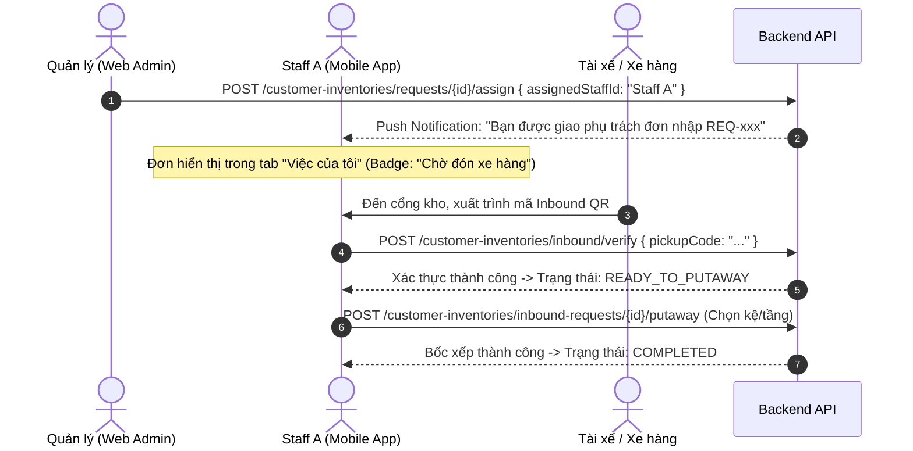
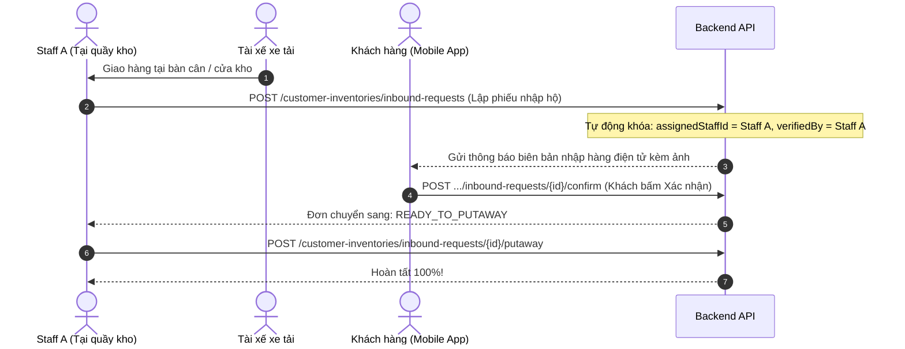
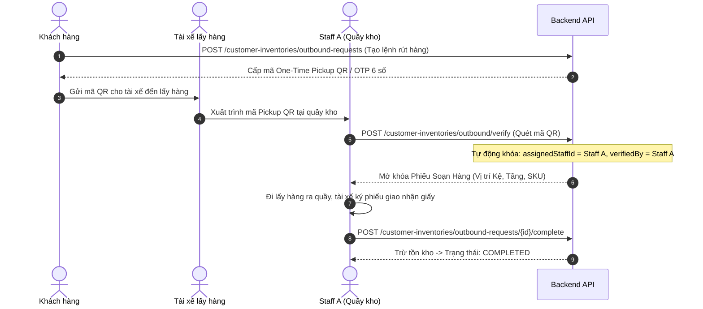

# HƯỚNG DẪN TÍCH HỢP FRONTEND — QUY TRÌNH PHÂN CÔNG & ĐIỀU PHỐI TASK TẠI CƠ SỞ

> **Dành cho:** Frontend Agent / Frontend Team (Web Admin Chi nhánh & Mobile App Nhân viên / Khách hàng)  
> **Phân hệ liên quan:** `customer-inventory`, `support`, `incident`, `reservation`  
> **Nguyên tắc cốt lõi:** Chuỗi bảo quản một đầu mối (Single Point of Responsibility / Chain of Custody) — Nhân viên tiếp nhận chịu trách nhiệm xuyên suốt nguyên luồng, chống nhận trùng task.

---

## I. TỔNG QUAN 3 VAI TRÒ & PHÂN VÙNG GIAO DIỆN

```
┌────────────────────────────────────────────────────────────────────────────────────────┐
│                                 PHÂN HỆ GIAO DIỆN HỆ THỐNG                             │
├──────────────────────────┬─────────────────────────────┬───────────────────────────────┤
│ 1. KHÁCH HÀNG (CUSTOMER) │ 2. NHÂN VIÊN KHO (STAFF)    │ 3. QUẢN LÝ CƠ SỞ (FM)         │
│ (Mobile App / Web Khách) │ (Mobile App Kho / Quầy tiếp)│ (Web Admin Chi nhánh / Tablet)│
├──────────────────────────┼─────────────────────────────┼───────────────────────────────┤
│ • Tạo lệnh Xuất/Nhập kho │ • Tab "Việc của tôi" (Giao) │ • Trung tâm điều phối task    │
│ • Nhận mã QR / OTP đối   │ • Tab "Hàng đợi tiếp nhận"  │ • Nút phân công nhân viên     │
│   soát tại quầy          │ • Quét mã QR, chụp ảnh kiện │ • Đổi người phụ trách         │
│ • Xác nhận điện tử biên  │ • Chụp ảnh biên bản giấy    │ • Ký pháp lý bàn giao kho     │
│   bản giao nhận          │ • Bốc xếp hàng lên kệ tầng  │   (Check-in)                  │
└──────────────────────────┴─────────────────────────────┴───────────────────────────────┘
```

---

## II. CHI TIẾT 6 LUỒNG VẬN HÀNH TASK CHUẨN

---

### LUỒNG 1: YÊU CẦU NHẬP KHO CÓ BÁO TRƯỚC (PRE-ADVISED INBOUND)

> **Kịch bản 1 (Có kế hoạch):** Khách tạo đơn báo trước trên App $\rightarrow$ Quản lý phân công Staff A $\rightarrow$ Staff A đón xe hàng, quét mã đối soát và bốc hàng lên kệ.



#### Đặc tả UI/UX:

1. **Trên Web Admin của Quản lý:**
   - Cột Trạng thái đơn `PENDING` hiển thị dropdown: **[👤 Phân công nhân viên]** (danh sách Staff thuộc cơ sở).
   - Sau khi phân công: Hiển thị badge `👤 Phụ trách: Nguyễn Văn A` kèm nút `[Đổi người]`.
2. **Trên Mobile App của Staff A (Được phân công):**
   - Nhận Push Notification $\rightarrow$ Task xuất hiện trong tab **"Việc của tôi"**.
   - Nút hành động chính: **[📷 Quét mã QR tiếp nhận xe hàng]**.
   - Sau khi quét mã thành công $\rightarrow$ Nút chuyển sang: **[📦 Bốc xếp lên kệ tầng (Putaway)]**.
3. **Trên Mobile App của Staff B (Không được phân công):**
   - Nếu Staff B cố tình quét mã đơn này $\rightarrow$ Toast cảnh báo:  
     `⛔ Đơn hàng này đã được Quản lý phân công cho Nguyễn Văn A. Bạn không có quyền thao tác.`

---

### LUỒNG 2: NHẬP HÀNG HỘ TẠI QUẦY (STAFF-ASSISTED INBOUND — WALK-IN)

> **Kịch bản 2 (Tức thời / Hộ khách):** Khách không tạo đơn trước, xe hàng chở thẳng đến kho $\rightarrow$ Staff A tại quầy lập phiếu nhập hộ và tự động đi trọn nguyên luồng từ đầu đến cuối.



#### Đặc tả UI/UX:

1. **Màn hình Staff A tạo phiếu tại quầy:**
   - Nút bấm: **[+ Tạo phiếu nhập hàng hộ]**.
   - **Form nhập liệu:**
     - Khách hàng & Hợp đồng (chọn qua SĐT hoặc mã phòng/kệ).
     - Thông tin xe hàng: Tên tài xế, SĐT, biển số xe, công ty giao vận.
     - Số lượng kiểm đếm thực tế từng món SKU (kiện nguyên, kiện rách/móp).
     - **Bằng chứng đối soát:**
       - `[📷 Chụp ảnh kiện hàng hiện trường]` (Tối thiểu 3 ảnh).
       - `[📷 Chụp ảnh Phiếu giao nhận giấy có chữ ký tài xế]` _(Upload URL vào `signatureUrl` — **Không cần vẽ canvas trên màn hình!**)_.
   - Bấm **[Tạo phiếu & Gửi khách duyệt]**.
2. **Khóa trách nhiệm tự động:**
   - Hệ thống tự động gán `assignedStaffId = Staff A`.
   - Trạng thái đơn: `PENDING_CUSTOMER_CONFIRMATION` (Chờ khách duyệt).
3. **Màn hình Khách hàng (Mobile App):**
   - Khách mở app thấy Popup: Biên bản nhận hàng kèm ảnh chụp kiện hàng & ảnh phiếu giấy của tài xế $\rightarrow$ Bấm **[✅ Xác nhận nhận hàng]**.
4. **Màn hình Staff A bốc xếp lên kệ:**
   - Staff A nhận thông báo $\rightarrow$ Nút **[📦 Bốc xếp lên kệ tầng (Putaway)]** sáng lên.
   - **Khóa quyền:** Chỉ Staff A mới thấy nút bốc xếp. Staff khác chỉ thấy badge `👤 Đang xử lý: Staff A` (nút bị ẩn/disable).

---

### LUỒNG 3: YÊU CẦU XUẤT KHO / RÚT HÀNG (OUTBOUND HANDOVER)

> **Nguyên tắc:** Khách tạo lệnh rút hàng trên App $\rightarrow$ Staff A quét mã Pickup QR tại quầy $\rightarrow$ Staff A đi lấy hàng từ kệ ra bàn giao, chụp ảnh phiếu giấy có chữ ký và hoàn tất.



#### Đặc tả UI/UX:

1. **Màn hình Khách hàng:**
   - Chọn mặt hàng & số lượng cần rút $\rightarrow$ Bấm [Tạo lệnh rút hàng].
   - Màn hình hiển thị: **Mã Pickup QR lớn** (kèm OTP 6 số bên dưới dự phòng) + Thời gian hiệu lực 24h.
2. **Màn hình Staff A quét mã:**
   - Bấm **[📷 Quét mã Pickup QR của tài xế]**.
   - Quét thành công $\rightarrow$ Hệ thống khóa đơn cho Staff A, mở ra **Phiếu Soạn Hàng**:
     - Danh sách mặt hàng cần rút.
     - Vị trí lưu kho chi tiết: `{Cơ sở} ➔ Phòng {Unit} ➔ Kệ {Rack} ➔ Tầng {Tier}`.
3. **Màn hình Hoàn tất xuất kho (`completeOutboundHandover`):**
   - Nút: `[📷 Chụp ảnh kiện hàng bàn giao]` (Tối thiểu 1 ảnh).
   - Nút: `[📷 Chụp ảnh Phiếu xuất kho giấy có chữ ký tài xế]` (Lưu vào `signatureUrl`).
   - Bấm **[Hoàn tất xuất kho]** $\rightarrow$ Trừ tồn kho.
   - **Khóa quyền:** Staff B không thể bấm hoàn tất thay cho Staff A.

---

### LUỒNG 4: YÊU CẦU HỖ TRỢ / CSKH (`SUPPORT TICKET`)

> **Nguyên tắc:** Staff tự nhận hoặc Quản lý gán $\rightarrow$ Khóa chống Staff khác cướp ticket khi đang xử lý.

#### Đặc tả UI/UX:

1. **Danh sách Ticket chờ (`PENDING`):**
   - Badge màu vàng: `🟡 Chờ tiếp nhận`.
   - Nhân viên trực quầy bấm: **[✋ Tiếp nhận xử lý]** (Hệ thống tự động gán `assignedStaffId = caller.id`).
2. **Khóa chống cướp ticket:**
   - Ticket chuyển sang `🔵 Đang xử lý`, hiển thị tag: `👤 Phụ trách: Staff A`.
   - **Trên màn hình Staff B:** Nút [Tiếp nhận] biến mất, nút [Đóng ticket] bị vô hiệu hóa kèm tooltip:  
     `Task đang do Staff A xử lý.`
   - Staff B không thể gọi API ghi đè.
3. **Quản lý chuyển giao (Override):**
   - Chỉ Quản lý (`FACILITY_MANAGER`) mới có nút **[🔄 Đổi người phụ trách]** để chuyển ticket sang Staff khác khi cần.
4. **Màn hình Đóng ticket (`completeTicket`):**
   - Chỉ đúng Staff A (hoặc Quản lý) mới mở được modal: Nhập nội dung phản hồi `responseMessage` + đính kèm ảnh $\rightarrow$ Bấm **[Gửi phản hồi & Đóng ticket]**.

---

### LUỒNG 5: SỰ CỐ KHO BÃI (`INCIDENT`)

> **Nguyên tắc:** 100% do Quản lý cơ sở đánh giá mức độ và chỉ định thợ kỹ thuật.

#### Đặc tả UI/UX:

1. **Giao diện Quản lý:**
   - Nhận thông báo sự cố mới (`REPORTED`).
   - Bấm nút: **[🔧 Phân công kỹ thuật]** $\rightarrow$ Chọn thợ phụ trách (`assignedStaffId`).
2. **Giao diện Thợ kỹ thuật được gán:**
   - Mở mục: **"Sự cố kỹ thuật của tôi"**.
   - Bước 1: Bấm **[Khảo sát hiện trường]** $\rightarrow$ Nhập ghi chú khảo sát, tùy chọn đưa kho vào bảo trì (`putUnitUnderMaintenance: true`).
   - Bước 2: Bấm **[Báo cáo hoàn thành sửa chữa]** $\rightarrow$ Nhập chi phí sửa chữa, chọn bên chịu trách nhiệm (`CUSTOMER` / `FACILITY`), đính kèm ảnh sau khi sửa.
3. **Khóa quyền:** Nhân viên khác không phải thợ được gán không có quyền cập nhật.

---

### LUỒNG 6: CHECK-IN ĐÓN KHÁCH NHẬN PHÒNG KHO (`RESERVATION`)

> **Nguyên tắc:** Quản lý phân công nhân viên đón tiếp $\rightarrow$ Nhân viên hỗ trợ thủ tục $\rightarrow$ Quản lý ký pháp lý nhận kho.

#### Đặc tả UI/UX:

1. **Quản lý xác nhận đơn:**
   - Sau khi khách đóng cọc, Quản lý bấm **[Xác nhận đơn & Phân công đón khách]** $\rightarrow$ Chọn Staff phụ trách.
2. **Nhân viên đón khách:**
   - Staff đón khách theo khung giờ hẹn `checkInTimeSlot` $\rightarrow$ Hướng dẫn mã PIN/thẻ từ, dẫn khách khảo sát kho.
   - Nếu khách cần nhập liệu: Staff mở tính năng **"Tạo SKU hộ khách tại quầy"** (`POST /customer-skus`).
3. **Ký bàn giao nhận kho:**
   - Khách bấm ký hợp đồng trên App (`customer-sign`).
   - **Trên Web Admin của Quản lý:** Nút xanh sáng lên: **[✍️ Ký bàn giao kho (Check-in)]** $\rightarrow$ Chuyển hợp đồng sang `ACTIVE` và kho sang `OCCUPIED`.

---

## III. HỆ THỐNG BADGE TRẠNG THÁI & QUY TẮC HIỂN THỊ NÚT BẤM (UI DESIGN SYSTEM)

| Trạng thái Backend | Tên hiển thị trên UI            |     Màu sắc Badge      | Quy tắc hiển thị nút hành động cho Staff                                     |
| :----------------- | :------------------------------ | :--------------------: | :--------------------------------------------------------------------------- |
| `PENDING`          | **Chờ tiếp nhận**               |  Vàng cam (`#F59E0B`)  | Nút [Tiếp nhận] hiển thị cho mọi Staff; hoặc Quản lý bấm [Phân công].        |
| `ASSIGNED`         | **Đã phân công: [Tên Staff]**   | Xanh dương (`#3B82F6`) | Chỉ Staff được gán mới thấy nút hành động. Staff khác chỉ xem (`Read-only`). |
| `PROCESSING`       | **Đang xử lý: [Tên Staff]**     |  Tím nhạt (`#8B5CF6`)  | Khóa chặt cho Staff phụ trách. Ẩn nút với các Staff khác.                    |
| `READY_TO_PUTAWAY` | **Chờ xếp lên kệ: [Tên Staff]** | Xanh ngọc (`#10B981`)  | Chỉ duy nhất Staff đã tiếp nhận lô hàng đó mới thấy nút [Bốc xếp lên kệ].    |
| `COMPLETED`        | **Đã hoàn tất**                 |  Xanh lá (`#22C55E`)   | Đã đóng. Hiển thị thông tin người hoàn thành và ảnh biên bản.                |

---

## IV. BẢNG DANH MỤC API ENDPOINTS CHO FRONTEND

| Thao tác trên giao diện                  | Method | Endpoint URL                                                                | Request Body chính                                                                 |
| :--------------------------------------- | :----: | :-------------------------------------------------------------------------- | :--------------------------------------------------------------------------------- |
| **Manager phân công đơn Nhập/Xuất**      | `POST` | `/api/v1/customer-inventories/requests/{id}/assign`                         | `{ "assignedStaffId": "string" }`                                                  |
| **Staff lập phiếu nhập hộ tại quầy**     | `POST` | `/api/v1/customer-inventories/inbound-requests`                             | `{ contractId, items, transporterInfo, evidenceImages, signatureUrl, staffNotes }` |
| **Quét mã QR đối soát Inbound/Outbound** | `POST` | `/api/v1/customer-inventories/outbound/verify`<br>hoặc `.../inbound/verify` | `{ "pickupCode": "string" }`                                                       |
| **Staff bốc xếp lên kệ tầng (Putaway)**  | `POST` | `/api/v1/customer-inventories/inbound-requests/{id}/putaway`                | `{ "placements": [ { skuId, quantity, storageRackId, rackTierId } ] }`             |
| **Staff hoàn tất xuất kho bàn giao**     | `POST` | `/api/v1/customer-inventories/outbound-requests/{id}/complete`              | `{ evidenceImages, signatureUrl, actualItems }`                                    |
| **Tiếp nhận / Gán Ticket CSKH**          | `POST` | `/api/v1/support-tickets/{id}/process`                                      | `{ "assignedStaffId"?: "string" }` _(Staff gọi bỏ trống để tự gán)_                |
| **Đóng Ticket CSKH**                     | `POST` | `/api/v1/support-tickets/{id}/complete`                                     | `{ "responseMessage": "string", "attachments": [] }`                               |
| **Manager phân công thợ sửa sự cố**      | `POST` | `/api/v1/incidents/{id}/assign`                                             | `{ "assignedStaffId": "string" }`                                                  |

---

## V. 3 NGUYÊN TẮC VÀNG CHO DEVELOPER FRONTEND

1. **Về Chữ Ký:** Không cần cài đặt Canvas để vẽ chữ ký cảm ứng. Chỉ cần component **Upload ảnh/file chụp tờ Phiếu giao nhận giấy có chữ ký sống của tài xế** đưa vào trường `signatureUrl`.
2. **Khóa Nút Bấm Dựa Vào `assignedStaffId`:**
   - Lấy `assignedStaffId` từ chi tiết đơn so sánh với `currentUser.id`.
   - Nếu trùng khớp HOẶC `currentUser.role === 'facility_manager'`: **Hiển thị nút hành động**.
   - Nếu không trùng: **Disable nút bấm hoặc ẩn nút**, kèm thông báo: _"Đơn này đang do [Tên nhân viên] phụ trách"_.
3. **Chống Click Đúp (Double Submit):**
   - Luôn bật `loading = true` và disable nút ngay khi người dùng bấm gửi request để tránh trường hợp mạng chậm nhân viên bấm 2 lần liên tiếp.
