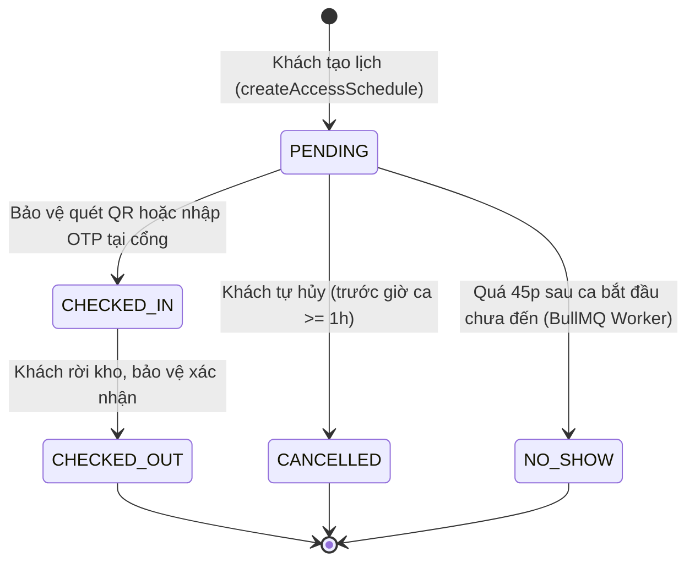
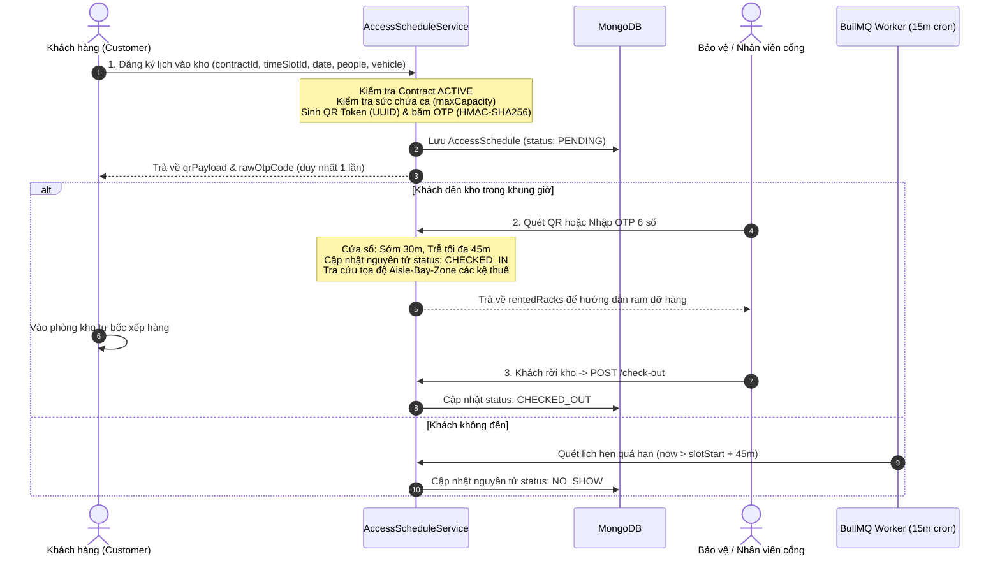
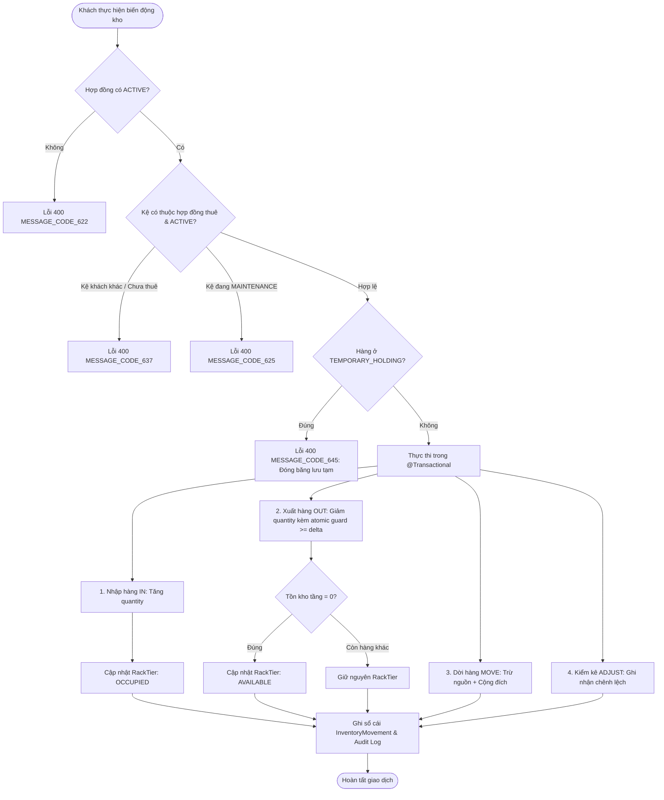
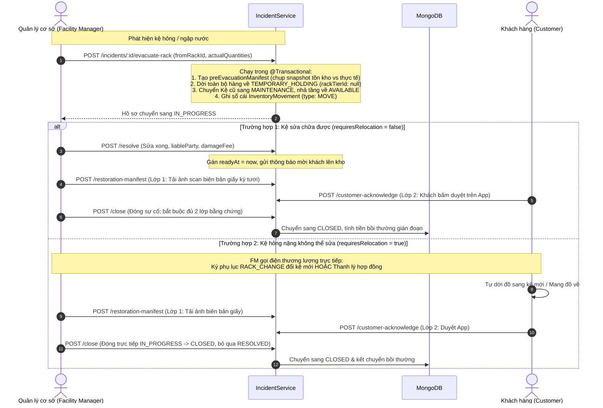

# TÀI LIỆU KIẾN TRÚC & LUỒNG HOẠT ĐỘNG CÁC PHÂN HỆ MỚI NHẤT (SYSTEM MODULE WORKFLOWS)

> **Dự án**: `self-storage-system-be`  
> **Phiên bản tài liệu**: 2.0 (Cập nhật sau hoàn tất chuỗi T-SMR.1 - T-SMR.5, Statistics & Support)  
> **Phạm vi**: `customerInventory` (`accessSchedule`), `incident`, `contract` (rack change & settlement), `supportTicket`, `statistics`, `customerSku`.

---

## 1. Định Hướng Kiến Trúc Tổng Thể

Hệ thống đã chuyển dịch toàn diện sang mô hình **Kho Kệ Tự Quản (Self-Managed Warehouse Rack)**:

- **Khách hàng (`CUSTOMER`) làm chủ 100%**: Khách tự quản lý danh mục hàng hóa cá nhân (`CustomerSku`), tự đăng ký lịch hẹn vào kho (`AccessSchedule`), tự bốc xếp và cập nhật tồn kho (`CustomerInventory` qua `IN`, `OUT`, `MOVE`, `ADJUST`).
- **Chính sách Không Chạm Nhân Viên (Zero-Touch Staff Policy)**: Nhân viên chi nhánh (`FACILITY_STAFF`, `FACILITY_MANAGER`) bị chặn tuyệt đối quyền thao tác dữ liệu tồn kho và danh mục SKU của khách (`403 MESSAGE_CODE_103`). Trách nhiệm của nhân sự cơ sở là bảo đảm an ninh cổng, PCCC, vận hành hạ tầng và ứng phó sự cố.
- **Tính Bền Vững & Toàn Vẹn Giao Dịch**: Mọi luồng biến động phức tạp đều được bọc trong `@Transactional()`, ghi nhận sổ cái biến động `InventoryMovement` và Audit Log với khả năng capture context tự động.

```
       +-------------------------------------------------------+
       |                 Khách hàng (CUSTOMER)                 |
       +-------------------------------------------------------+
            |                 |                   |         |
    (1. Đặt lịch)      (2. Tự bốc dỡ)       (3. Duyệt App) (4. Ký phụ lục)
            |                 |                   |         |
            v                 v                   v         v
     [AccessSchedule]  [CustomerInventory]   [Incident]   [Contract & Billing]
            |                 |                   ^         ^
    (Check-in QR/OTP)  (Zero-Touch Guard)         |         |
            |                 |            (Sơ tán tạm)   (Đổi kệ & Quyết toán)
            v                 v                   |         |
       +-------------------------------------------------------+
       |               Nhân viên & Quản lý cơ sở               |
       |      (Bảo vệ cổng, Giám sát an toàn, PCCC, Khắc phục) |
       +-------------------------------------------------------+
```

---

## 2. Phân Hệ Lịch Ra Vào Kho & Kiểm Soát Cổng (`AccessSchedule`)

Thay thế hoàn toàn cơ chế duyệt phiếu trung gian cũ bằng luồng đặt lịch theo ca tự chủ tại cổng bảo vệ.

### 2.1. Vòng đời Trạng thái Lịch Hẹn (`AccessScheduleStatusEnum`)



### 2.2. Trình tự Luồng Nghiệp Vụ (Sequence Diagram)



### 2.3. Quy tắc cốt lõi

1. **Xác thực 1-trong-2 tại cổng (`checkIn`)**:
   - Chấp nhận HOẶC quét mã QR (`ACCESS:<scheduleCode>:<token>`) HOẶC nhập mã OTP 6 số. Không bắt buộc cả hai.
2. **Cửa sổ thời gian (Timing Rules)**:
   - **Check-in sớm**: Tối đa **30 phút** trước giờ bắt đầu ca (`startTime - 30m`). Đến sớm hơn báo lỗi `400 MESSAGE_CODE_654`.
   - **Ân hạn trễ**: Tối đa **45 phút** sau giờ bắt đầu ca (`startTime + 45m`). Quá 45 phút, lịch bị hủy chuyển `NO_SHOW` (`400 MESSAGE_CODE_655`).
   - **Hạn chót tự hủy**: Khách hàng được tự hủy lịch trước giờ bắt đầu ca tối thiểu **1 tiếng** (`startTime - 1h`). Sát giờ hơn bị khóa nút hủy (`400 MESSAGE_CODE_656`).
3. **Bảo mật mã OTP**:
   - Khách chỉ nhận `rawOtpCode` 1 lần duy nhất lúc tạo lịch; cơ sở dữ liệu chỉ lưu chuỗi băm HMAC-SHA256 (`otpHash`).
4. **Hướng dẫn điều phối mặt bằng kho**:
   - Khi check-in thành công, API trả về danh sách các kệ thuê (`rentedRacks`) kèm tọa độ `aisle`, `bay`, `zone` để nhân viên hướng dẫn khách di chuyển xe vào đúng khu vực ram bốc dỡ.
5. **Tự động hóa BullMQ**:
   - Worker chạy lặp lại mỗi 15 phút (`*/15 * * * *`) quét các lịch hẹn quá hạn 45 phút chưa check-in để cập nhật tự động sang `NO_SHOW`.

---

## 3. Phân Hệ Tồn Kho Kệ Tự Quản (`CustomerInventory` & `CustomerSku`)

### 3.1. Phân Quyền & Zero-Touch Staff Policy

| Thao tác                       | API                                 |  Customer   |    Staff / FM     | Ops / Admin | Ghi chú                        |
| :----------------------------- | :---------------------------------- | :---------: | :---------------: | :---------: | :----------------------------- |
| **Tạo / Sửa / Xóa SKU**        | `/customer-sku`                     |     ✅      |     ❌ (403)      |     ✅      | Khách tự quản danh mục hàng    |
| **Nhập kho (IN)**              | `POST /customer-inventories/in`     |     ✅      |     ❌ (403)      |     ✅      | Tự chủ đưa hàng lên kệ thuê    |
| **Xuất kho (OUT)**             | `POST /customer-inventories/out`    |     ✅      |     ❌ (403)      |     ✅      | Giảm tồn kho, tự nhả tầng kệ   |
| **Chuyển tầng (MOVE)**         | `POST /customer-inventories/move`   |     ✅      |     ❌ (403)      |     ✅      | Chuyển hàng giữa các tầng thuê |
| **Kiểm kê (ADJUST)**           | `POST /customer-inventories/adjust` |     ✅      |     ❌ (403)      |     ✅      | Cân chỉnh số lượng kiểm đếm    |
| **Xem sơ đồ cây kho (`tree`)** | `GET /unit/{id}/tree`               | ✅ (Scoped) | ✅ (Scoped cơ sở) |     ✅      | Xem mặt bằng, PCCC & an ninh   |
| **Tìm vị trí SKU / Barcode**   | `/sku/{id}/locations`               | ✅ (Scoped) | ✅ (Scoped cơ sở) |     ✅      | Tra cứu khoang chứa nhanh      |

### 3.2. Luồng Biến Động Kho & Đồng Bộ State Machine Tầng Kệ



### 3.3. Các cơ chế an toàn kỹ thuật

- **Atomic Guard chống Race Condition**: Mọi thao tác trừ số lượng dùng query có điều kiện `{ quantity: { $gte: abs(delta) } }` ngăn chặn hoàn toàn âm kho khi có nhiều yêu cầu đồng thời.
- **Độc lập đa kệ (Multi-Rack Isolation)**: Khách thuê nhiều kệ vẫn được phép thao tác bình thường trên các kệ `ACTIVE` khác dù có 1 kệ đang bị sự cố phong tỏa `MAINTENANCE`.
- **Đóng băng lưu tạm (Full Freeze)**: Hàng đang dời về `TEMPORARY_HOLDING` bị chặn hoàn toàn các thao tác `in`, `out`, `move`, `adjust` trực tiếp (`400 MESSAGE_CODE_645`), bảo đảm tính vẹn toàn cho đến khi có biên bản đối soát.
- **Scoped READ bảo vệ riêng tư**: Khách xem sơ đồ cây kho (`/tree`) chỉ thấy hàng hóa của chính mình; các kệ của khách khác trong cùng phòng kho lớn sẽ được ẩn hoàn toàn chi tiết danh mục hàng (`items: []`).

---

## 4. Phân Hệ Quản Lý Sự Cố & Nghiệm Thu 2 Lớp (`Incident`)

Chuyên trách ứng phó thiên tai, ngập nước, chập điện hoặc hỏng kệ, bảo đảm đầy đủ bằng chứng pháp lý đối soát.

### 4.1. Luồng Ứng Phó Sự Cố Kệ Kho



### 4.2. Cơ chế Nghiệm Thu 2 Lớp (Two-Layer Acknowledgment)

Khi một sự cố từng thực hiện sơ tán hàng (`preEvacuationManifest` tồn tại), hàm `closeIncident` bắt buộc phải có đầy đủ 2 bằng chứng:

1. **Lớp 1 (Vật lý)**: Bắt buộc có `restorationManifestDocUrl` (ảnh chụp biên bản nghiệm thu bàn giao có chữ ký tươi mực sống của 2 bên). Thiếu báo lỗi `400 MESSAGE_CODE_712`.
2. **Lớp 2 (Số hóa)**: Bắt buộc có `customerAcknowledgedAt` (khách hàng xác nhận nghiệm thu in-app). Thiếu báo lỗi `400 MESSAGE_CODE_713`.

---

## 5. Phân Hệ Phụ Lục Đổi Kệ & Quyết Toán Bồi Thường (`Contract` & `Billing`)

### 5.1. Phụ Lục Đổi Kệ (`ContractAddendumTypeEnum.RACK_CHANGE`)

- **Tạo phụ lục (`createAddendum`)**: Nhận `previousRackId` và `newRackId`. Kệ mới phải cùng cơ sở, cùng số lượng tầng (`tierCount`) và đang `AVAILABLE`. Hệ thống tự động **giữ chỗ nguyên tử** kệ mới (`findAndReserveRacksAtomic`).
- **Hủy/Từ chối phụ lục (`cancelAddendum` / `rejectAddendum`)**: Giải phóng kệ mới về lại `AVAILABLE` (`vacateRacksAtomic`).
- **Ký duyệt phụ lục (`signAddendumInternal`)**: Khi cả 2 bên hoàn tất ký:
  - Kệ mới chính thức chuyển `status: RENTED`.
  - Cập nhật danh sách `contract.rentedRackIds`.
  - Kệ cũ: Giữ `MAINTENANCE` nếu hỏng, hoặc trả về `AVAILABLE` nếu đổi kệ thông thường.

### 5.2. Công Thức Tính Gián Đoạn Lưu Kho Thuần (`interruptedDays.util.ts`)

- **Miễn trừ bảo trì nhẹ**: Thời gian gián đoạn $< 8\text{ giờ} \rightarrow 0\text{ ngày}$ bồi hoàn.
- **Từ 8h đến 24h**: Tính là **$1\text{ ngày}$**.
- **Mỗi 24h tiếp theo**: Cộng thêm **$1\text{ ngày}$** (làm tròn lên theo block 24h).
- **Cutoff Cap chống trục lợi (`readyAt + 48h`)**: Mốc kết thúc tính gián đoạn tối đa là 48 giờ kể từ khi cơ sở thông báo kệ đã sẵn sàng (`readyAt`).

$$\text{Số tiền hoàn gián đoạn} = \text{round}\left( \frac{\text{Giá thuê tháng}}{30} \times \text{Số ngày gián đoạn} \right)$$

### 5.3. Quyết Toán Thanh Lý Kho (`checkOutContract`)

Khi thanh lý trả kho, hệ thống tự động cấn trừ đa chiều giữa quyền lợi và nghĩa vụ tài chính:

```
[TỔNG TÍN CÓ (TOTAL CREDIT)]
  = Tiền cọc ban đầu (depositAmount)
  + Bồi hoàn gián đoạn sự cố (accumulatedInterruptedRefund)
  + Bồi thường hư hại do cơ sở (accumulatedFacilityDamageFee)

[TỔNG KHẤU TRỪ (TOTAL DEDUCTIONS)]
  = Phí phạt hư hại do khách làm hỏng (damageFee)
  + Phí chậm trả / quá hạn (overdueFee)

[SỐ TIỀN HOÀN THỰC NHẬN] = Math.max(0, TOTAL CREDIT - TOTAL DEDUCTIONS)
```

_(Hệ thống `RefundRequestService` đã hỗ trợ số tiền hoàn thực nhận vượt quá số tiền cọc ban đầu khi có bồi thường lớn từ cơ sở)_.

---

## 6. Phân Hệ Yêu Cầu Hỗ Trợ CSKH (`SupportTicket`)

- **Vòng đời 4 trạng thái**: `PENDING` $\rightarrow$ `PROCESSING` $\rightarrow$ `COMPLETED` (hoặc `CANCELLED`).
- **Mô hình Request - Resolution Note**: Không dùng chat trực tiếp cồng kềnh; tập trung ghi nhận kết luận giải quyết vấn đề (đổi kho, quên mã PIN, thắc mắc cọc, hóa đơn).
- **Chống Tranh Chấp Xử Lý (Anti-Collision Guard)**: Nhân viên đầu tiên tiếp nhận bấm `process` sẽ khóa ticket; nhân viên khác cố tình can thiệp sẽ bị chặn với mã lỗi `400 MESSAGE_CODE_728`.

---

## 7. Phân Hệ Thống Kê & Phân Tích Vận Hành (`Statistics`)

Dành riêng cho `BUSINESS_OPS_MANAGER` và `SYSTEM_ADMIN` phân tích toàn chuỗi:

| Endpoint                                 | Chức năng chính                                                                                      |
| :--------------------------------------- | :--------------------------------------------------------------------------------------------------- |
| `GET /statistics/overview`               | Tổng quan: Tỷ lệ lấp đầy kho (Occupancy Rate), tổng doanh thu, số hợp đồng đang thuê, số kho bảo trì |
| `GET /statistics/rental-trends`          | Phân tích xu hướng thuê/trả theo chu kỳ ngày, tuần, tháng, quý                                       |
| `GET /statistics/facilities-kpi`         | Xếp hạng và đo lường KPI giữa các chi nhánh: công suất, doanh số, sự cố                              |
| `GET /statistics/financial-analytics`    | Dòng tiền: cọc, doanh thu thuê, bồi hoàn gián đoạn, nợ quá hạn                                       |
| `GET /statistics/product-and-operations` | Báo cáo hiệu suất theo quy cách kho (`UnitType`), phân khu kệ (`RackZone`), tốc độ xử lý sự cố       |

---

## 8. Bảng Mã Lỗi Nghiệp Vụ Cốt Lõi

| Mã lỗi             | Ý nghĩa nghiệp vụ                                                                          |
| :----------------- | :----------------------------------------------------------------------------------------- |
| `MESSAGE_CODE_103` | Từ chối truy cập (Vi phạm chính sách Zero-Touch hoặc truy cập chéo cơ sở/khách hàng)       |
| `MESSAGE_CODE_622` | Hợp đồng không ở trạng thái `ACTIVE`, không được phép thao tác tồn kho                     |
| `MESSAGE_CODE_625` | Kệ kho đang bảo trì (`MAINTENANCE`), không thể nhập hàng                                   |
| `MESSAGE_CODE_637` | Vi phạm sở hữu kệ: Kệ chọn thao tác không nằm trong hợp đồng thuê của khách                |
| `MESSAGE_CODE_645` | Hàng hóa đang ở khu lưu tạm `TEMPORARY_HOLDING`, bị đóng băng không thể xuất/dời trực tiếp |
| `MESSAGE_CODE_652` | Khung giờ hẹn vào kho đã hết sức chứa tiếp nhận (`maxCapacity`)                            |
| `MESSAGE_CODE_654` | Check-in quá sớm (trước giờ mở cửa ca trên 30 phút)                                        |
| `MESSAGE_CODE_655` | Check-in quá muộn (sau giờ bắt đầu ca trên 45 phút, lịch đã bị hủy `NO_SHOW`)              |
| `MESSAGE_CODE_656` | Khách tự hủy lịch quá sát giờ hẹn (dưới 1 tiếng trước giờ bắt đầu ca)                      |
| `MESSAGE_CODE_659` | Mã QR hoặc mã OTP check-in tại cổng không hợp lệ hoặc đã sử dụng                           |
| `MESSAGE_CODE_710` | Kệ đã được sơ tán trước đó trong cùng hồ sơ sự cố, không thể sơ tán trùng lặp              |
| `MESSAGE_CODE_712` | Đóng sự cố thất bại: Thiếu ảnh chụp biên bản giấy có chữ ký tươi mực sống                  |
| `MESSAGE_CODE_713` | Đóng sự cố thất bại: Khách hàng chưa bấm xác nhận nghiệm thu trên ứng dụng                 |
| `MESSAGE_CODE_728` | Phiếu yêu cầu CSKH đã có nhân viên khác tiếp nhận xử lý                                    |
