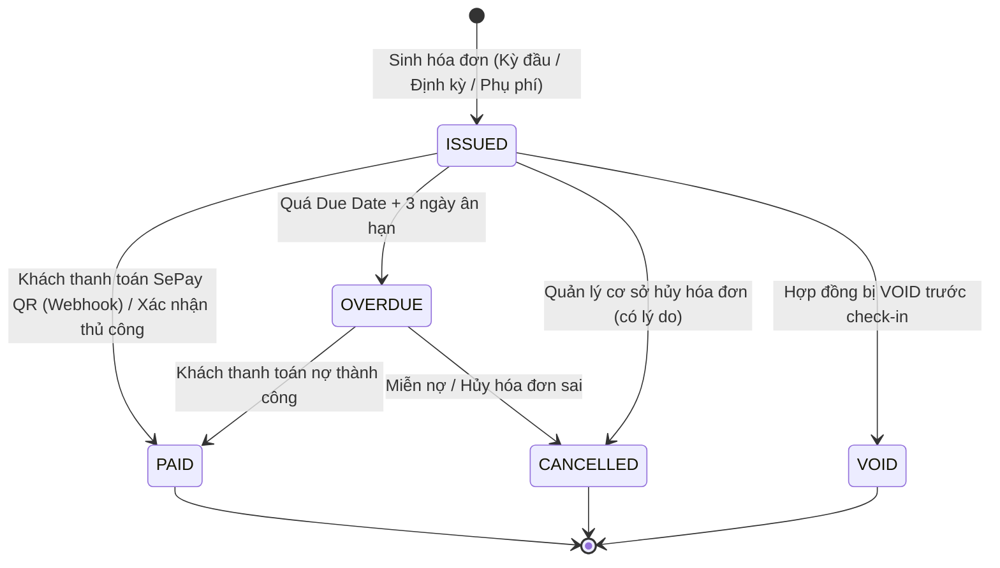
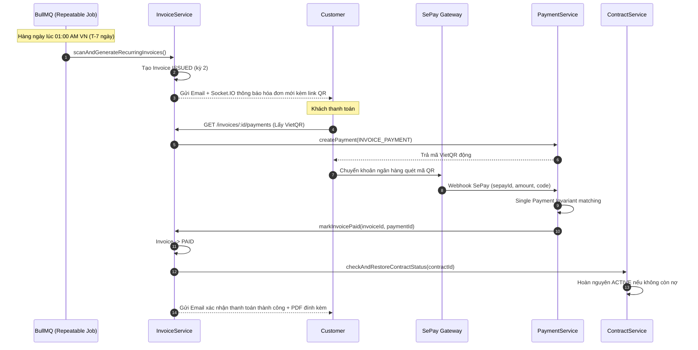

# Kế Hoạch Nghiệp Vụ & Thiết Kế Task: Phân Hệ Hóa Đơn & Thanh Toán Định Kỳ (Invoice & Billing)

> Tổng hợp từ kiến trúc hiện tại của hệ thống Self-Storage (`Reservation`, `Contract`, `Payment`, `RefundRequest`, `BullMQ`, `SePay`), các phân tích từ phiên làm việc ngày 31/10/2026.  
> Tài liệu này thiết lập toàn bộ quy trình nghiệp vụ, lộ trình task, ma trận phân quyền, state machine và bộ quy tắc tính toán cho phân hệ **Invoice & Billing**.

---

## 1. Mục Tiêu & Phạm Vi Phân Hệ

### 1.1. Mục tiêu

- **Lấp đầy khoảng trống thanh toán định kỳ:** Hiện tại hệ thống chỉ mới thu tiền cọc và tiền thuê kỳ đầu (`RENT_FIRST_PERIOD`). Hợp đồng thuê dài hạn (nhiều tháng hoặc nhiều ngày) chưa có cơ chế thu tiền các kỳ tiếp theo (kỳ 2, 3, N...).
- **Minh bạch tài chính & Chứng từ hợp lệ:** Cung cấp thực thể `Invoice` (Hóa đơn) theo dõi chi tiết từng dòng mục (tiền kho, tiền tiện ích, phí quá hạn, phí bồi thường hư hại), trạng thái thanh toán, hạn thanh toán và xuất file PDF hóa đơn chuẩn A4.
- **Tự động hóa chu kỳ thu tiền (Recurring Automation):** Dùng BullMQ Queue & Worker tự động quét hợp đồng sắp sang kỳ mới để sinh hóa đơn trước $T-7$ ngày, tự động nhắc hạn thanh toán, và tự động chuyển trạng thái quá hạn (`OVERDUE`) kèm thông báo đa kênh.
- **Tích hợp thanh toán SePay VietQR:** Mỗi hóa đơn có thể thanh toán trực tiếp qua mã QR động SePay, nhận Webhook khớp tiền tức thì, đồng thời hỗ trợ nhân viên xác nhận tiền mặt/chuyển khoản thủ công tại quầy (Maker-Checker).

### 1.2. Quy ước nhãn task

- **P0:** Bảo mật, phân quyền 2 lớp, toàn vẹn giao dịch tiền tệ và chống race condition.
- **P1:** Nghiệp vụ cốt lõi, State Machine hóa đơn, tích hợp thanh toán SePay và vòng đời thu tiền.
- **P2:** Tự động hóa ngầm BullMQ, xuất file PDF hóa đơn, xử lý phụ lục và quyết toán trả kho.
- **[OPEN Dx]:** Quyết định nghiệp vụ chờ chốt; Agent áp dụng giá trị mặc định đề xuất qua file config.

---

## 2. Quy Tắc Làm Việc Cho Agent

1. **Tuân thủ AGENTS.md:** ESM với đuôi `.ts`, `strict: true`, không dùng `any`, Zod validation tại HTTP boundary, DI container wiring.
2. **Khảo sát trước khi sửa:** Code là sự thật (`Single Source of Truth`). Đối chiếu logic `Contract`, `Payment`, `FacilityUnitTypeOffering` trước khi viết code.
3. **Phân quyền 2 lớp (Rule 14):**
   - Route gate: `@Security` (tạm ẩn trong dev kèm `// TODO: Role authorization:`).
   - Resource Scoping (không hoãn): `CUSTOMER` chỉ xem/thao tác hóa đơn của chính mình; `FACILITY_STAFF`, `FACILITY_MANAGER` chỉ thao tác hóa đơn thuộc cơ sở được phân công (`assertFacilityAccess`); `BUSINESS_OPS_MANAGER`, `SYSTEM_ADMIN` phạm vi toàn hệ thống.
4. **Conditional Updates & Transaction (Rule 20):** Đổi trạng thái hóa đơn dùng `findOneAndUpdate` kèm điều kiện trạng thái hiện tại. Thao tác nhiều bản ghi bọc trong `@Transactional()`.
5. **Side effects chỉ chạy sau commit (Rule 20):** Socket.IO, Email, BullMQ enqueue phải đưa vào `runAfterCommit(cb)`.
6. **Audit Logging (Rule 19):** Ghi audit cho mọi thao tác mutation (`GENERATE_INVOICE`, `PAY_INVOICE`, `CANCEL_INVOICE`, `VOID_INVOICE`, `CONFIRM_PAYMENT`).
7. **Quy tắc tiền & thời gian (Rule 21):** Tiền VND là số nguyên làm tròn `Math.round()`. Ngày tháng chuẩn giờ Việt Nam (`startOfDayVN`, `endOfDayVN`, múi giờ Asia/Ho_Chi_Minh).
8. **Kiểm thử đầy đủ:** Mỗi task đi kèm integration tests (ca dương, ca âm, chéo cơ sở, chéo khách hàng, race condition).

---

## 3. Quyết Định Nghiệp Vụ Cần Chốt (`[OPEN Dx]`)

|     ID      | Câu hỏi / Vấn đề                                                 | Đề xuất mặc định (Áp dụng ngay)                                                                                                                                                            | Đặt ở đâu                                                                 |   Chặn Task    |
| :---------: | :--------------------------------------------------------------- | :----------------------------------------------------------------------------------------------------------------------------------------------------------------------------------------- | :------------------------------------------------------------------------ | :------------: |
| **D-INV.1** | Khi nào tự động sinh hóa đơn cho kỳ thanh toán tiếp theo?        | Trước ngày bắt đầu kỳ mới **7 ngày** ($T-7$ ngày lúc 00:00 VN)                                                                                                                             | `billing.config.ts` (`invoiceLeadDays: 7`)                                |     `T2.2`     |
| **D-INV.2** | Hạn thanh toán (Due Date) của hóa đơn kỳ tiếp theo là khi nào?   | Đúng ngày bắt đầu kỳ mới ($T-0$ ngày lúc 23:59:59 VN)                                                                                                                                      | `billing.config.ts` (`dueDaysFromPeriodStart: 0`)                         | `T1.1`, `T2.2` |
| **D-INV.3** | Hóa đơn quá hạn thanh toán xử lý thế nào?                        | Cho ân hạn **3 ngày** (`invoiceGraceDays: 3`). Sau 3 ngày nếu chưa thanh toán: Hóa đơn sang `OVERDUE`, Hợp đồng chuyển `OVERDUE`, kích hoạt tính phí trễ hạn `calculateContractOverdueFee` | `billing.config.ts` (`invoiceGraceDays: 3`)                               |     `T2.3`     |
| **D-INV.4** | Thuê theo ngày (`DAY`): Sinh hóa đơn thế nào?                    | - Nếu thuê $\le 14$ ngày: Thu toàn bộ tiền thuê ở kỳ đầu (Invoice duy nhất). - Nếu thuê $> 14$ ngày: Chia chu kỳ mỗi **7 ngày** (kỳ 1: 7 ngày đầu, kỳ 2: 7 ngày tiếp theo...).         | `billing.config.ts` (`dailyRentalThresholdDays: 14`, `dailyCycleDays: 7`) | `T1.1`, `T3.4` |
| **D-INV.5** | Hóa đơn kỳ đầu (`FIRST_PERIOD`) hiện tại: Giữ hay chuyển đổi?    | Chuyển đổi chuẩn hóa: Khi tạo hợp đồng DRAFT, tạo bản ghi `Invoice` loại `FIRST_PERIOD` (`PENDING`). Thanh toán qua QR SePay liên kết trực tiếp với Invoice này                            | `src/modules/contract/`, `src/modules/payment/`                           | `T1.1`, `T1.2` |
| **D-INV.6** | Phí sự cố (`damageFee`) hoặc trễ hạn (`overdueFee`) thu thế nào? | Tạo hóa đơn phụ loại `INCIDENTAL` hoặc gộp vào hóa đơn quyết toán trả kho `CHECK_OUT_SETTLEMENT` để cấn trừ tiền cọc                                                                       | `src/modules/billing/`                                                    |     `T3.2`     |
| **D-INV.7** | Quy tắc đặt mã hóa đơn (`invoiceCode`)                           | Mã có tiền tố `INV-YYMMDD-XXXX` (ví dụ `INV-261031-A1B2`), tăng tính nhận diện và đồng nhất với `SUP-`, `REF-`                                                                             | `InvoiceService.generateInvoiceCode`                                      |     `T0.1`     |
| **D-INV.8** | Mẫu xuất PDF Hóa đơn                                             | Mẫu A4 tiếng Việt gồm thông tin Pháp nhân bên cho thuê, Thông tin khách hàng, Kỳ thanh toán, Bảng kê chi tiết (kho, tiện ích, phí), QR thanh toán VietQR                                   | `InvoicePdfService`                                                       |     `T3.1`     |

---

## 4. Backlog Task Theo Giai Đoạn

### Phase 0: Nền Tảng, Schemas & Entity Invoice (P0)

#### `T0.1` — Enums, Message Codes & Model `Invoice`

- **Mục tiêu:** Xây dựng cấu trúc dữ liệu lưu trữ hóa đơn, định nghĩa các trạng thái, loại hóa đơn và mã lỗi chuẩn.
- **Thực hiện:**
  - Bổ sung enums trong `src/common/enums/billing.enum.ts`:
    - `InvoiceStatusEnum { DRAFT = 'draft', ISSUED = 'issued', PAID = 'paid', OVERDUE = 'overdue', CANCELLED = 'cancelled', VOID = 'void' }`
    - `InvoiceTypeEnum { FIRST_PERIOD = 'first_period', RECURRING = 'recurring', INCIDENTAL = 'incidental', CHECK_OUT_SETTLEMENT = 'check_out_settlement' }`
  - Bổ sung Audit Enums:
    - `AuditResourceEnum.INVOICE = 'invoice'`
    - `AuditActionEnum`: `GENERATE_INVOICE`, `PAY_INVOICE`, `CANCEL_INVOICE`, `VOID_INVOICE`, `MARK_OVERDUE`, `SEND_INVOICE`.
  - Bổ sung Message Codes nhóm `MESSAGE_CODE_800` – `MESSAGE_CODE_815` trong `messageCode.const.ts`.
  - Tạo model `Invoice` (`IInvoice`) với mongoose-delete:
    - `invoiceCode`: string, unique, indexed (`INV-YYMMDD-XXXX`)
    - `contractId`: ObjectId, ref `Contract`, indexed
    - `customerId`: ObjectId, ref `User`, indexed
    - `facilityId`: ObjectId, ref `Facility`, indexed
    - `type`: `InvoiceTypeEnum`
    - `status`: `InvoiceStatusEnum`
    - `billingPeriodIndex`: number (kỳ 1, 2, 3...)
    - `periodStartDate`: Date, `periodEndDate`: Date
    - `dueDate`: Date
    - `items`: Mảng dòng mục nhúng (`name`, `description`, `quantity`, `unitPrice`, `amount`, `itemType: RENT | AMENITY | DAMAGE_FEE | OVERDUE_FEE | DISCOUNT`)
    - `subtotal`: number, `discountAmount`: number, `taxAmount`: number, `totalAmount`: number
    - `paidAmount`: number, `paidAt`: Date, `paymentId`: ObjectId ref `Payment`
    - `paymentMethod`: `PaymentMethodEnum`
    - `notes`: string, `issuedAt`: Date, `cancelledAt`: Date, `cancelReason`: string
    - Partial Unique Index: `{ contractId: 1, billingPeriodIndex: 1, type: 1 }` (cho phép filter không trùng hóa đơn định kỳ cùng 1 kỳ).
- **Done khi:** Model được khai báo đầy đủ, index hoạt động, build thành công.

#### `T0.2` — Validation Schemas & Response Schemas

- **Mục tiêu:** Xây dựng tầng xác thực dữ liệu đầu vào và chuẩn hóa dữ liệu đầu ra cho các API của Invoice.
- **Thực hiện:**
  - `schemas/invoice.request.schema.ts`:
    - `createManualInvoiceSchema`: dành cho Quản lý cơ sở tạo hóa đơn phụ phát sinh (`INCIDENTAL`).
    - `invoiceQuerySchema`: phân trang, lọc theo `contractId`, `customerId`, `facilityId`, `status`, `type`, khoảng thời gian `dueDate`.
    - `cancelInvoiceSchema`: bắt buộc lý do hủy (`reason` $\ge 5$ ký tự).
    - `confirmManualInvoicePaymentSchema`: xác nhận thu tiền mặt tại quầy (`proofImageUrl`, `note`).
  - `schemas/invoice.response.schema.ts`:
    - `invoiceResponseSchema`, `invoiceItemResponseSchema`, `paginatedInvoiceResponseSchema`.
- **Done khi:** Schemas định nghĩa chặt chẽ với Zod, infer types chuẩn TypeScript.

#### `T0.3` — Repository `InvoiceRepository`

- **Mục tiêu:** Cung cấp các thao tác truy vấn và conditional updates nguyên tử trên collection `Invoice`.
- **Thực hiện:**
  - `InvoiceRepository`:
    - `findPaginated`: lọc đa tiêu chí, phân trang theo chuẩn `pagination.util.ts`.
    - `findByIdWithDetails`: nạp kèm thông tin customer, facility, contract.
    - `findPendingDueInvoices(facilityId, targetDate)`: tìm hóa đơn sắp/đã đến hạn.
    - `findUpcomingCycleContracts(leadDate)`: tìm các hợp đồng ACTIVE cần sinh hóa đơn kỳ tiếp theo.
    - `atomicUpdateStatus(id, fromStatus, toStatus, extraData, session)`: cập nhật trạng thái nguyên tử chống race condition.
- **Done khi:** Repository hoàn thiện, có unit/integration tests kiểm chứng atomic update.

---

### Phase 1: Nghiệp Vụ Cốt Lõi & Vòng Đời Hóa Đơn (P1)

#### `T1.1` — Service Logic Khởi Tạo Hóa Đơn Kỳ Đầu & Kỳ Định Kỳ

- **Mục tiêu:** Tính toán số tiền, dòng mục và chu kỳ cho hóa đơn thuê kho.
- **Thực hiện:**
  - `InvoiceService.generateFirstPeriodInvoice(contract, session)`:
    - Gọi tự động khi tạo Contract DRAFT (thay thế việc chỉ lưu giá trị rời rạc).
    - Dòng mục gồm: Tiền thuê kho kỳ đầu (`contract.rentalPrice`), tiền tiện ích snapshot (`contract.amenities`).
    - Tổng tiền = `contract.totalPeriodicPrice`.
    - `status = ISSUED`, `dueDate = contract.startDate`.
  - `InvoiceService.generateRecurringInvoice(contract, cycleIndex, session)`:
    - Tính toán `periodStartDate` và `periodEndDate` cho kỳ mới.
    - Tính tiền thuê kho và tiện ích theo giá trị hợp đồng (hoặc phụ lục RENEW/UNIT_CHANGE mới nhất).
    - Đảm bảo tính toán độc lập trong `@Transactional()`.
- **Done khi:** Hóa đơn sinh ra đúng từng dòng mục, đúng ngày kỳ hạn và không bao giờ sinh trùng lặp cho cùng 1 kỳ.

#### `T1.2` — Tích Hợp Thanh Toán Hóa Đơn Qua SePay VietQR

- **Mục tiêu:** Cho phép khách hàng quét mã QR thanh toán từng hóa đơn và xử lý Webhook tự động.
- **Thực hiện:**
  - Mở rộng `PaymentPurposeEnum`: bổ sung `INVOICE_PAYMENT = 'invoice_payment'`.
  - Thêm trường `invoiceId?: Types.ObjectId | null` vào `IPayment`.
  - `PaymentService.createInvoicePayment(invoiceId, customerId)`:
    - Kiểm tra hóa đơn tồn tại, trạng thái `ISSUED` hoặc `OVERDUE`.
    - Sinh bản ghi `Payment` với số tiền đúng bằng `invoice.totalAmount`.
    - Sinh mã VietQR SePay với cú pháp nhận diện: `SEPAY... INV...`.
  - Cập nhật luồng Webhook SePay:
    - Khi giao dịch khớp `INVOICE_PAYMENT`: gọi `InvoiceService.markInvoicePaid(invoiceId, { paymentId, paidAmount, paidAt })`.
    - Chuyển trạng thái `Invoice -> PAID`.
    - Nếu hợp đồng đang `OVERDUE` do nợ hóa đơn này: tự động kiểm tra và hoàn nguyên hợp đồng về `ACTIVE` (nếu không còn hóa đơn nào khác quá hạn).
- **Done khi:** Khách quét QR thanh toán thành công, webhook nhận diện và gạch nợ hóa đơn tức thì, khôi phục trạng thái hợp đồng.

#### `T1.3` — Xác Nhận Thanh Toán Thủ Công (Maker-Checker)

- **Mục tiêu:** Cho phép thanh toán tiền mặt/chuyển khoản ngoài tại quầy giao dịch cơ sở.
- **Thực hiện:**
  - Endpoint `POST /invoices/:id/confirm-manual`:
    - Phân quyền: `FACILITY_STAFF`, `FACILITY_MANAGER` cùng cơ sở, `BUSINESS_OPS_MANAGER`, `SYSTEM_ADMIN`.
    - Bắt buộc tải lên ảnh chứng từ (`proofImageUrl`) hoặc biên lai thu tiền.
    - Áp dụng nguyên tắc Maker-Checker: Người tạo hóa đơn thủ công khác người xác nhận thu tiền (nếu là hóa đơn phát sinh ngoài).
    - Tạo `Payment` phương thức `CASH` hoặc `BANK_TRANSFER` tương ứng.
    - Cập nhật `Invoice -> PAID`, ghi nhận `confirmedBy`, `confirmedAt`.
    - Ghi nhận Audit Log đầy đủ.
- **Done khi:** Test chứng minh xác nhận thủ công yêu cầu ảnh chứng từ và không thể thanh toán 2 lần trên cùng 1 hóa đơn.

#### `T1.4` — Hủy & Vô Hiệu Hóa Hóa Đơn (`CANCELLED` / `VOID`)

- **Mục tiêu:** Xử lý các tình huống hóa đơn sai sót, hợp đồng chấm dứt sớm hoặc miễn giảm.
- **Thực hiện:**
  - `InvoiceService.cancelInvoice(id, reason, caller)`:
    - Hóa đơn ở trạng thái `ISSUED` hoặc `OVERDUE`.
    - Chưa thanh toán (`paidAmount === 0`).
    - Phân quyền: Chỉ `FACILITY_MANAGER` cơ sở hoặc `OPS/ADMIN`.
    - Chuyển `status -> CANCELLED`, ghi `cancelReason`, `cancelledBy`, `cancelledAt`.
  - `InvoiceService.voidInvoice(id, reason, caller)`:
    - Vô hiệu hóa hóa đơn kỹ thuật khi hợp đồng bị VOID trước check-in.
- **Done khi:** Hóa đơn bị hủy không thể thanh toán tiếp, nhả các liên kết thanh toán đang chờ.

#### `T1.5` — Phân Quyền 2 Lớp & RESTful Controller

- **Mục tiêu:** Xây dựng controller chuẩn tsoa, bảo mật đa tầng theo quy tắc AGENTS.md.
- **Thực hiện:**
  - `InvoiceController`:
    - `GET /invoices`: xem danh sách hóa đơn phân trang (Customer chỉ xem của mình; Staff/FM lọc theo `assignedFacilityId`; Ops/Admin toàn quyền).
    - `GET /invoices/:id`: xem chi tiết hóa đơn.
    - `POST /invoices/:id/payments`: tạo link/mã QR thanh toán SePay.
    - `POST /invoices/:id/confirm-manual`: xác nhận thu tiền tại quầy.
    - `POST /invoices/:id/cancel`: hủy hóa đơn.
    - `POST /invoices/manual`: tạo hóa đơn phụ phát sinh.
  - Sử dụng helper `extractCaller(req)` và `assertFacilityAccess`.
  - Ghi chú đầy đủ `// TODO: Role authorization:`.
- **Done khi:** Endpoint bảo vệ chặt chẽ, kiểm thử ma trận quyền đạt 100% Pass.

---

### Phase 2: Tự Động Hóa Chu Kỳ Thanh Toán & Jobs Nền BullMQ (P2)

#### `T2.1` — Hạ Tầng BullMQ Queue & Worker Cho Billing

- **Mục tiêu:** Thiết lập queue và worker chuyên biệt quản lý chu kỳ tính phí.
- **Thực hiện:**
  - Tạo `src/modules/billing/billing.queue.ts`:
    - Queue `billing-queue`.
    - Các jobs: `GENERATE_RECURRING_INVOICES`, `SCAN_OVERDUE_INVOICES`, `REMIND_INVOICE_PAYMENT`.
  - Tạo `src/modules/billing/billing.worker.ts`:
    - Concurrency = 1, xử lý từng job độc lập.
    - Fault isolation: Lỗi ở 1 hợp đồng/hóa đơn không làm dừng batch quét của các bản ghi khác.
- **Done khi:** Queue và worker khởi động ổn định, ghi log có cấu trúc.

#### `T2.2` — Repeatable Job Tự Động Sinh Hóa Đơn Kỳ Mới ($T-7$)

- **Mục tiêu:** Quét các hợp đồng đang `ACTIVE` và tự động phát hành hóa đơn trước khi kỳ thuê cũ kết thúc.
- **Thực hiện:**
  - Schedule: Chạy hàng ngày lúc 01:00 AM VN (`0 1 * * *`).
  - Logic:
    - Tìm hợp đồng `ACTIVE` có kỳ thuê tiếp theo bắt đầu trong vòng 7 ngày tới (`now + 7 days`).
    - Kiểm tra xem hóa đơn cho kỳ đó đã tồn tại chưa (tránh sinh trùng).
    - Gọi `generateRecurringInvoice` trong transaction per-record.
    - Gửi thông báo đến khách hàng (Email + Socket.IO) kèm link thanh toán.
- **Done khi:** Hợp đồng trước hạn 7 ngày tự động có hóa đơn mới, khách hàng nhận thông báo tức thì.

#### `T2.3` — Repeatable Job Quét Quá Hạn & Khóa Hợp Đồng Nợ

- **Mục tiêu:** Xử lý các hóa đơn trôi qua hạn thanh toán mà chưa được trả.
- **Thực hiện:**
  - Schedule: Chạy hàng ngày lúc 02:00 AM VN (`0 2 * * *`).
  - Logic:
    - Tìm hóa đơn `ISSUED` có `dueDate + invoiceGraceDays (3 days) < now`.
    - Chuyển trạng thái `Invoice -> OVERDUE`.
    - Chuyển trạng thái hợp đồng liên quan sang `Contract -> OVERDUE` (nếu đang `ACTIVE`).
    - Kích hoạt cơ chế tính phí trễ hạn `calculateContractOverdueFee` trên hợp đồng.
    - Gửi cảnh báo đỏ (Priority: HIGH) yêu cầu thanh toán gấp để tránh niêm phong kho.
- **Done khi:** Hóa đơn trễ hạn tự động bị đánh dấu `OVERDUE` và đồng bộ trạng thái hợp đồng.

#### `T2.4` — Nhắc Hạn Thanh Toán Đa Kênh (Notification)

- **Mục tiêu:** Giảm tỷ lệ nợ xấu bằng cách tự động nhắc nhở khách hàng trước khi đến hạn.
- **Thực hiện:**
  - Schedule: Chạy hàng ngày lúc 08:00 AM VN (`0 8 * * *`).
  - Nhắc nhở ở các mốc:
    - $T-3$ ngày trước Due Date: Nhắc lịch thanh toán thông thường.
    - $T-1$ ngày trước Due Date: Cảnh báo sắp hết hạn thanh toán kỳ thuê.
    - Ngày Due Date: Cảnh báo hôm nay là hạn chót.
  - Tích hợp `NotificationService`: gửi cả Socket.IO (in-app) và Email (mẫu email đẹp kèm thông tin QR SePay).
- **Done khi:** Khách hàng nhận email và thông báo đẩy đúng các mốc thời gian quy định.

---

### Phase 3: Xuất Hóa Đơn PDF & Nghiệp Vụ Đặc Thù (P2)

#### `T3.1` — Dịch Vụ Xuất Hóa Đơn PDF A4 Chuẩn Pháp Lý

- **Mục tiêu:** Cung cấp file hóa đơn chuẩn A4 có thể tải về hoặc gửi email đính kèm cho khách hàng.
- **Thực hiện:**
  - Tạo `InvoicePdfService` (tương tự `ContractPdfService`):
    - Render HTML template chuẩn kích thước A4.
    - Nhúng logo, thông tin Pháp nhân bên cho thuê (`LegalEntity`), thông tin khách hàng, số hóa đơn, kỳ thuê, chi tiết dòng mục.
    - Nhúng ảnh VietQR động để khách có thể quét trực tiếp từ bản in/file PDF.
    - Xuất Buffer / Stream PDF.
  - Endpoint: `GET /invoices/:id/pdf`.
- **Done khi:** File PDF xuất ra hiển thị sắc nét, đúng cấu trúc, hỗ trợ tải trực tiếp.

#### `T3.2` — Hóa Đơn Quyết Toán Trả Kho (`CHECK_OUT_SETTLEMENT`)

- **Mục tiêu:** Đồng bộ chi phí phát sinh, phí hư hại và cọc dư khi khách trả kho check-out.
- **Thực hiện:**
  - Tích hợp với `ContractService.checkOutContract`:
    - Khi check-out, nếu có `damageFee` từ sự cố hoặc `overdueFee` từ ngày trễ:
    - Tự động sinh hóa đơn quyết toán `CHECK_OUT_SETTLEMENT`.
    - Nếu tiền cọc (`depositAmount`) đủ bù đắp: Cấn trừ trực tiếp, hóa đơn chuyển `PAID`, phần cọc thừa tạo `RefundRequest` `DEPOSIT_SETTLEMENT`.
    - Nếu tiền cọc không đủ bù đắp: Hóa đơn ghi nhận số tiền còn thiếu phải thu (`status: ISSUED`), khách phải thanh toán nốt trước khi hoàn tất check-out.
- **Done khi:** Dòng tiền check-out minh bạch, liên kết chặt chẽ giữa cọc, phí hư hại và hóa đơn.

#### `T3.3` — Xử Lý Hóa Đơn Khi Có Phụ Lục Hợp Đồng

- **Mục tiêu:** Đồng bộ giá thuê khi khách gia hạn (`RENEW`) hoặc đổi phòng kho (`UNIT_CHANGE`).
- **Thực hiện:**
  - Phụ lục `RENEW`: Hóa đơn kỳ tiếp theo áp dụng theo `endDate` mới của phụ lục.
  - Phụ lục `UNIT_CHANGE`:
    - Nếu đổi kho giữa kỳ thuê: Tính cấn trừ ngày thuê theo tỷ lệ (pro-rata). Sinh hóa đơn chênh lệch (nâng hạng) hoặc tạo phiếu hoàn tiền cọc chênh lệch.
    - Kỳ tiếp theo áp dụng giá kho mới theo phụ lục.
- **Done khi:** Đổi phòng kho hoặc gia hạn phản ánh chính xác vào các hóa đơn phát hành sau đó.

#### `T3.4` — Chu Kỳ Hóa Đơn Cho Hợp Đồng Thuê Theo Ngày (`DAY`)

- **Mục tiêu:** Xử lý triệt để bài toán thuê theo ngày đã phát hiện trong phân tích.
- **Thực hiện:**
  - Kiểm tra `billingUnit === 'day'`:
    - Nếu `rentalDuration <= 14` ngày: Hóa đơn `FIRST_PERIOD` tính `totalPeriodicPrice = basePrice * rentalDuration + amenitiesTotal` (thu trọn gói 1 lần).
    - Nếu `rentalDuration > 14` ngày: Chia chu kỳ mỗi 7 ngày một lần. Mỗi hóa đơn tính 7 ngày thuê.
  - Cập nhật công thức tính tiền trong `InvoiceService` và đồng bộ với `Contract`.
- **Done khi:** Thuê theo ngày không còn bị thất thu tiền từ ngày thứ 2 trở đi.

---

### Phase 4: Kiểm Thử Tích Hợp, Migration & Bàn Giao (P2)

#### `T4.1` — Bộ Kiểm Thử Tích Hợp Toàn Diện (Integration Test Suite)

- **Mục tiêu:** Đảm bảo 100% tính ổn định của hệ thống hóa đơn trước khi đưa vào vận hành.
- **Thực hiện:**
  - Viết các file kiểm thử Vitest độc lập:
    - `tests/invoiceLifecycle.test.ts`: Vòng đời hóa đơn (Draft -> Issued -> Paid -> Cancelled).
    - `tests/invoiceSePayPayment.test.ts`: Quét QR, webhook SePay, idempotency.
    - `tests/invoiceRecurringJob.test.ts`: Quét $T-7$ ngày, fault isolation, nhắc nợ.
    - `tests/invoicePermissionMatrix.test.ts`: Phân quyền 2 lớp, chống chéo cơ sở/khách hàng.
    - `tests/invoiceDailyBilling.test.ts`: Thuê theo ngày trọn gói và theo tuần.
- **Done khi:** 100% test cases PASS, độ phủ nhánh đạt chuẩn.

#### `T4.2` — Migration Script Cho Hợp Đồng Đang Chạy

- **Mục tiêu:** Backfill dữ liệu hóa đơn kỳ đầu cho các hợp đồng `ACTIVE` đã thanh toán trước đó để báo cáo tài chính đồng nhất.
- **Thực hiện:**
  - Script migration idempotent: Quét các hợp đồng `ACTIVE` có `firstPeriodPaidAt != null` nhưng chưa có bản ghi `Invoice` tương ứng.
  - Tạo bản ghi `Invoice` với `type: FIRST_PERIOD`, `status: PAID`, gắn `paymentId = contract.firstPeriodPaymentId`.
  - Có log kiểm đếm và chế độ dry-run an toàn.
- **Done khi:** Toàn bộ hợp đồng đang hoạt động đều có hóa đơn kỳ đầu hợp lệ.

#### `T4.3` — Bàn Giao Frontend Qua `/fe-prompt billing`

- **Mục tiêu:** Xuất tài liệu contract shared layer gửi cho Frontend agent tích hợp giao diện.
- **Thực hiện:**
  - Chạy `/fe-prompt billing`.
  - Xuất toàn bộ Request/Response schemas, Enums, Message Codes, URLs và quy tắc hiển thị.
- **Done khi:** File bàn giao được tạo đầy đủ.

---

## 5. Ma Trận Phân Quyền (RBAC & Resource Scoping)

| Endpoint                       | Method | Role Phép Gọi                                        | Phạm vi kiểm tra (Resource Scoping)                                                                                                                                                                |
| :----------------------------- | :----: | :--------------------------------------------------- | :------------------------------------------------------------------------------------------------------------------------------------------------------------------------------------------------- |
| `/invoices`                    | `GET`  | All Roles                                            | - `CUSTOMER`: Chỉ xem hóa đơn `customerId === caller.userId` - `FACILITY_STAFF`, `FACILITY_MANAGER`: Chỉ xem hóa đơn cơ sở mình (`assignedFacilityId`) - `OPS`, `ADMIN`: Xem toàn hệ thống |
| `/invoices/:id`                | `GET`  | All Roles                                            | Như trên                                                                                                                                                                                           |
| `/invoices/:id/pdf`            | `GET`  | All Roles                                            | Như trên                                                                                                                                                                                           |
| `/invoices/:id/payments`       | `POST` | `CUSTOMER`, `STAFF`, `FM`, `OPS`, `ADMIN`            | Chủ hóa đơn hoặc nhân viên cơ sở hỗ trợ thanh toán                                                                                                                                                 |
| `/invoices/:id/confirm-manual` | `POST` | `FACILITY_STAFF`, `FACILITY_MANAGER`, `OPS`, `ADMIN` | Bắt buộc đúng cơ sở (`assertFacilityAccess`), có ảnh chứng từ                                                                                                                                      |
| `/invoices/:id/cancel`         | `POST` | `FACILITY_MANAGER`, `OPS`, `ADMIN`                   | Bắt buộc đúng cơ sở (`assertFacilityAccess`), bắt buộc lý do hủy                                                                                                                                   |
| `/invoices/manual`             | `POST` | `FACILITY_MANAGER`, `OPS`, `ADMIN`                   | Tạo hóa đơn phụ phí, đúng cơ sở                                                                                                                                                                    |

---

## 6. Sơ Đồ Chuyển Trạng Thái (State Machine)

---

## 7. Quy Trình Vận Hành & Khớp Nối Thanh Toán

