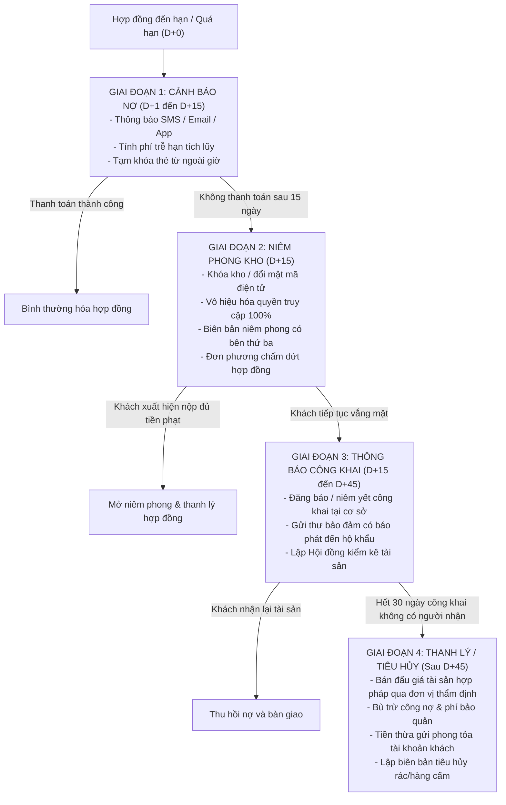

# THIẾT KẾ KỸ THUẬT: QUY TRÌNH XỬ LÝ HÀNG BỎ RƠI VÀ THU HỒI NỢ

## (T4.7 — Vietnam Legal Framework & Technical Specification)

> **Tài liệu đặc tả kỹ thuật và căn cứ pháp lý**: Hệ thống Self-Storage SSM  
> **Phạm vi**: Xử lý nợ quá hạn, khóa kho niêm phong, tài sản vô chủ/bỏ rơi và thanh lý thu hồi công nợ  
> **Căn cứ pháp lý**: Bộ luật Dân sự 2015, Nghị định 21/2021/NĐ-CP, Luật Đấu giá tài sản 2016  
> **Trạng thái**: Bản thiết kế kỹ thuật (Design Specification)

---

## 1. Căn cứ Pháp lý Việt Nam

Hệ thống cho thuê kho tự quản (Self-Storage) vận hành theo hợp đồng thuê tài sản (mặt bằng/khoang lưu trữ). Khi khách hàng vi phạm nghĩa vụ thanh toán và cố tình không liên lạc hoặc từ bỏ tài sản, doanh nghiệp phải tuân thủ nghiêm ngặt các quy định pháp luật Việt Nam để tránh rủi ro pháp lý về hành vi "xâm phạm chỗ ở", "chiếm giữ trái phép tài sản" (Điều 176 Bộ luật Hình sự) hoặc "hủy hoại tài sản" (Điều 178 Bộ luật Hình sự).

1. **Quyền cầm giữ tài sản (Điều 346 - 350 Bộ luật Dân sự 2015):**
   - Bên cho thuê kho có quyền cầm giữ tài sản của bên thuê khi bên thuê không thực hiện nghĩa vụ thanh toán tiền thuê đến hạn.
   - Bên cầm giữ có quyền yêu cầu xử lý tài sản cầm giữ theo quy định pháp luật hoặc thỏa thuận trong hợp đồng để bù trừ nghĩa vụ tài chính.
2. **Xác lập quyền sở hữu đối với tài sản bị chôn giấu, chìm đắm, tài sản bị đánh rơi, bỏ quên (Điều 228 - 230 Bộ luật Dân sự 2015):**
   - Tài sản không xác định được chủ sở hữu hoặc chủ sở hữu từ bỏ quyền sở hữu phải được thông báo công khai theo quy định.
   - Sau thời hạn thông báo công khai (1 năm đối với động sản), nếu không xác định được chủ sở hữu thì tài sản thuộc về người đang quản lý hoặc nộp ngân sách nhà nước.
3. **Thỏa thuận xử lý tài sản bảo đảm & ủy quyền xử lý (Điều 299, 303 Bộ luật Dân sự 2015):**
   - Hợp đồng dịch vụ kho quy định rõ: Khoản tiền đặt cọc và chính các tài sản gửi trong kho đóng vai trò là biện pháp bảo đảm thực hiện nghĩa vụ thanh toán.
   - Khách hàng ký cam kết thỏa thuận phương thức xử lý tài sản khi hợp đồng chấm dứt do vi phạm quá hạn thanh toán kéo dài.

---

## 2. Quy trình 4 Giai đoạn (The 4-Phase Recovery Workflow)



---

### Giai đoạn 1: Cảnh báo nợ (D+1 đến D+15)

1. **Kích hoạt tự động:**
   - Khi hợp đồng đến ngày kết thúc chu kỳ thanh toán hoặc thời hạn hợp đồng mà khách chưa thanh toán hoặc chưa gia hạn, hệ thống chuyển trạng thái sang `OVERDUE`.
   - BullMQ cron job quét hàng đêm tính phí trễ hạn theo công thức:
     $$\text{overdueFee} = \text{baseRentPerDay} \times \text{overdueDays} \times \text{overdueFeeMultiplier}$$
2. **Kênh thông báo đa phương tiện:**
   - D+1: Email và In-app Push Notification nhắc nhở nợ.
   - D+3, D+7: Gửi SMS Brandname và gọi điện thoại tự động / nhân viên CSKH gọi hỗ trợ.
   - D+10: Gửi thông báo cảnh báo pháp lý chính thức (Legal Notice 1) qua Thư bảo đảm (Certified Mail) theo địa chỉ thường trú trong hồ sơ KYC và gửi bản mềm qua Email.
3. **Kiểm soát vận hành:**
   - Khách vẫn có quyền ra vào trong giờ làm việc của nhân viên cơ sở để xử lý công nợ, nhưng khóa quyền truy cập ngoài giờ (Outside Operating Hours).

---

### Giai đoạn 2: Niêm phong kho & Chấm dứt dịch vụ (D+15)

1. **Khóa kho và Vô hiệu hóa quyền truy nhập:**
   - Đúng 00:00 ngày D+15, hệ thống tự động:
     - Khóa thẻ từ, mã PIN điện tử, mã QR mở cửa kho.
     - Đơn phương chấm dứt hợp đồng (`status = TERMINATED`, lý do `PAYMENT_DEFAULT`).
     - Tịch thu toàn bộ tiền đặt cọc (`depositStatus = FORFEITED`) để cấn trừ nợ thuê kho của 15 ngày quá hạn.
2. **Lập biên bản niêm phong (Sealing Protocol):**
   - Quản lý cơ sở (`FACILITY_MANAGER`) kết hợp với nhân viên an ninh và đại diện bên thứ ba độc lập (đơn vị bảo vệ tòa nhà hoặc đại diện Công an/Tổ dân phố địa phương) tiến hành gắn seal niêm phong vật lý lên cửa khoang lưu trữ.
   - Số hiệu seal niêm phong, hình ảnh chụp seal và biên bản có chữ ký của các bên được scan và upload lên hệ thống SSM (`evidenceFiles`).

---

### Giai đoạn 3: Thông báo công khai & Kiểm kê tài sản (D+15 đến D+45)

1. **Thông báo công khai theo luật định (30 ngày ân hạn cuối):**
   - Đăng thông báo tìm chủ sở hữu tài sản bỏ rơi trên cổng thông tin điện tử của SSM và niêm yết tại bảng tin cơ sở lưu trữ.
   - Gửi văn bản cảnh báo lần cuối qua Thư bảo đảm có báo phát (bằng chứng phát thư bưu điện lưu vết mã vận đơn).
2. **Mở niêm phong & Lập Hội đồng kiểm kê tài sản:**
   - Thành phần Hội đồng kiểm kê:
     1. Quản lý cơ sở (`FACILITY_MANAGER`).
     2. Đại diện Pháp chế doanh nghiệp (`BUSINESS_OPS_MANAGER`).
     3. Đại diện bên thứ ba độc lập (Thừa phát lại hoặc đại diện cơ quan công quyền).
   - Camera an ninh quay toàn bộ quá trình mở niêm phong:
     - Phân loại tài sản: Tài sản có giá trị thương mại, tài sản cá nhân riêng tư (giấy tờ tùy thân, album ảnh, di vật), hàng hóa độc hại/dễ phân hủy, tài sản nghi ngờ hàng cấm.
     - Lập Danh mục kiểm kê tài sản (Asset Inventory Manifest) chi tiết số lượng, tình trạng, nhãn hiệu.
     - Nếu phát hiện hàng cấm (vũ khí, chất ma túy, chất nổ): Lập tức giữ nguyên hiện trường và bàn giao cơ quan Công an thụ lý.

---

### Giai đoạn 4: Thanh lý / Bán đấu giá / Tiêu hủy (Sau D+45)

1. **Phân loại xử lý tài sản:**
   - **Tài sản có giá trị thương mại:** Chuyển giao cho tổ chức đấu giá chuyên nghiệp hoặc bán thanh lý công khai theo giá thị trường để thu hồi nợ.
   - **Tài sản riêng tư không có giá trị thương mại:** Lưu trữ niêm phong trong kho bảo quản tập trung của công ty tối thiểu 180 ngày trước khi tiêu hủy.
   - **Hàng hóa ôi thiu, hư hỏng, rác thải:** Lập biên bản tiêu hủy hợp pháp có xác nhận của đơn vị môi trường đô thị.
2. **Quyết toán tài chính sau thanh lý:**
   - Tổng số tiền thu được từ bán thanh lý tài sản ($V_{rec}$) được phân bổ theo thứ tự ưu tiên:
     1. Chi phí thanh lý, chi phí đấu giá, thừa phát lại ($C_{auction}$).
     2. Tiền thuê kho và phí phát sinh còn nợ ($D_{rent}$).
     3. Chi phí lưu kho bảo quản đặc biệt trong thời gian ân hạn ($C_{holding}$).
   - **Xử lý số tiền thặng dư:** Số tiền còn lại ($V_{rem} = V_{rec} - C_{auction} - D_{rent} - C_{holding}$) không thuộc quyền sở hữu của công ty. SSM mở tài khoản ngân hàng phong tỏa mang tên khách hàng hoặc nộp giữ hộ tại Kho bạc Nhà nước / cơ quan thi hành án dân sự.
   - **Trường hợp tiền thanh lý không đủ bù nợ:** Công ty có quyền khởi kiện yêu cầu Tòa án buộc bên thuê tiếp tục trả khoản nợ còn thiếu.

---

## 3. Kiến trúc Kỹ thuật & Data Model Đề xuất (Dành cho Phase tiếp theo)

> [!NOTE]
> Các model và endpoint dưới đây là thiết kế kiến trúc chuẩn hóa, sẽ được triển khai trong Phase chuyên biệt về Xử lý nợ & Pháp chế sau khi Hội đồng Pháp chế phê duyệt.

### 3.1 Model `AbandonedGoodsCase`

```ts
export interface IAbandonedGoodsCase {
  caseCode: string; // VD: AGC-2026-0001
  contractId: Types.ObjectId;
  facilityId: Types.ObjectId;
  storageUnitId: Types.ObjectId;
  customerId: Types.ObjectId;
  currentPhase:
    | 'WARNING'
    | 'SEALED'
    | 'PUBLIC_NOTICE'
    | 'LIQUIDATED'
    | 'DISPOSED'
    | 'SETTLED';
  overdueAmount: number;
  totalDebt: number;
  sealedAt?: Date;
  sealedWitnessName?: string;
  sealingSealNumber?: string;
  inventoryManifest?: Array<{
    itemName: string;
    quantity: number;
    estimatedValue: number;
    category: 'VALUABLE' | 'PERSONAL' | 'HAZARDOUS' | 'SCRAP';
    condition: string;
  }>;
  publicNoticePublishedAt?: Date;
  publicNoticeProofUrls?: string[];
  liquidationAmount?: number;
  surplusAmount?: number;
  escrowAccountNumber?: string;
  status: 'OPEN' | 'RESOLVED' | 'CLOSED';
}
```

### 3.2 Endpoint Roadmap

- `POST /abandoned-goods/cases`: Mở hồ sơ xử lý kho vô chủ quá hạn.
- `POST /abandoned-goods/cases/:id/seal`: Cập nhật biên bản niêm phong kho và hình ảnh seal.
- `POST /abandoned-goods/cases/:id/inventory`: Lưu biên bản kiểm kê tài sản của Hội đồng.
- `POST /abandoned-goods/cases/:id/public-notice`: Cập nhật bằng chứng công bố thông tin công khai.
- `POST /abandoned-goods/cases/:id/settle-liquidation`: Quyết toán tiền bán đấu giá và tài khoản phong tỏa.

---

**Tài liệu được lưu trữ tại `docs/agent/booking/ABANDONED_GOODS_AND_DEBT_HANDLING_DESIGN.md` theo nhiệm vụ T4.7.**
