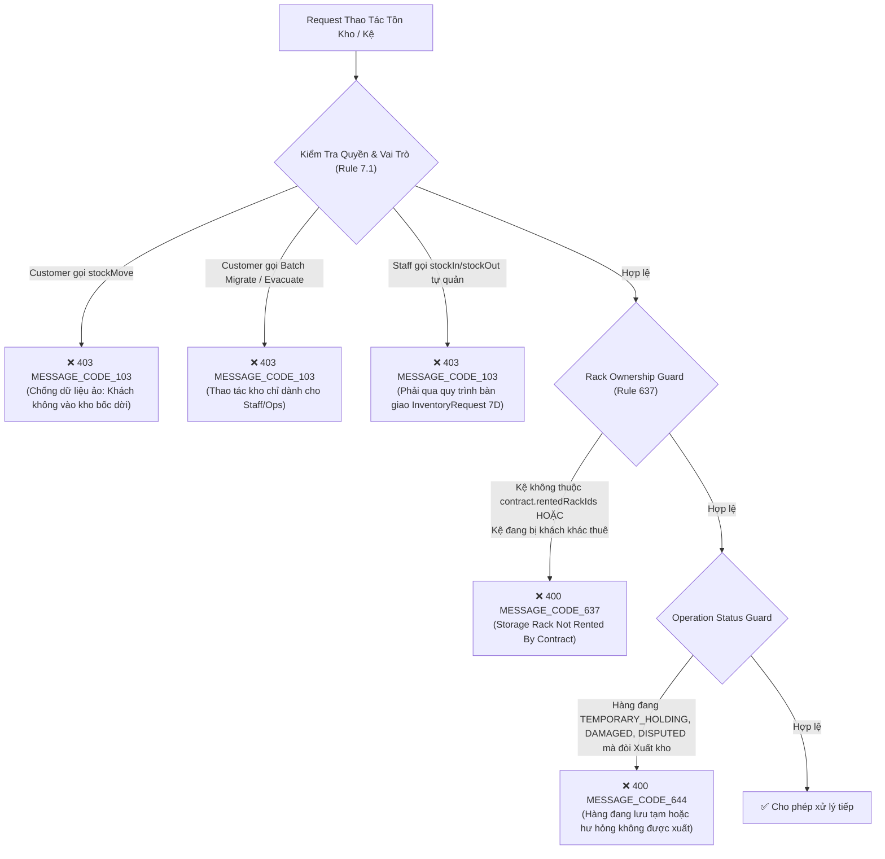
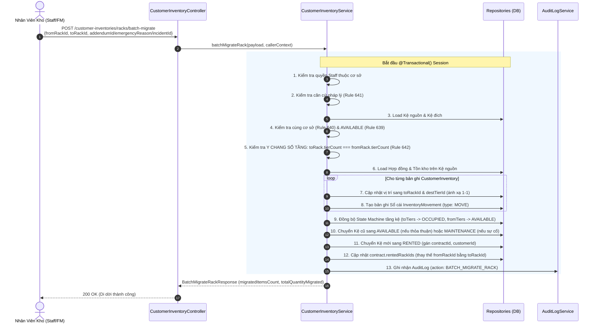
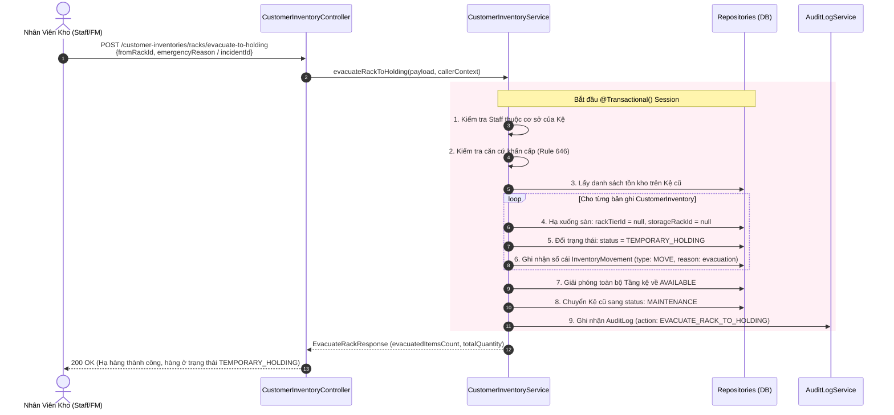

# Luồng Nghiệp Vụ Vận Hành Kho Thực Tế & Di Dời Kệ Hàng Loạt (Task 7E & 7G)

> **Tài liệu ghi chép kiến trúc nghiệp vụ, cơ chế bảo vệ và quy trình di dời kệ kho hàng loạt & quản lý trạng thái lưu tạm**
> Phân hệ: `customer-inventory` | Version: 1.1 | Cập nhật: 29/10/2026

---

## I. Bối Cảnh Thực Tế & Bài Toán Nghiệp Vụ

Trong hệ thống Self-Storage Management System, có sự phân định rõ ràng giữa hai mô hình:

1. **Kho Tự Quản Thông Thường (`Self-Storage` — Locker, Phòng nhỏ SMALL, Phòng lớn LARGE):** Khách hàng thuê trọn một phòng kho riêng biệt, toàn quyền giữ chìa khóa/mã PIN và tự quản lý đồ đạc bên trong. **Hệ thống phần mềm không quản lý danh mục SKU hay tồn kho cho mô hình này.**
2. **Kho Kệ Dùng Chung Có Phục Vụ (`Warehouse Rack`):** Một phòng kho diện tích lớn (18m² – 50m²) được lắp đặt nhiều dãy Kệ kho công nghiệp (`StorageRack`), mỗi kệ chia làm 3 – 5 tầng (`RackTier`). Khách hàng thuê theo từng Kệ riêng lẻ (`rentedRackIds`). **Toàn bộ phân hệ quản lý danh mục SKU và vị trí tồn kho (`customer-inventory`) chỉ phục vụ duy nhất mô hình này. 100% hàng hóa bắt buộc phải nằm trên kệ tầng; không có khái niệm hàng để sàn tự do trong vận hành thông thường.**

### Sự Cố Vận Hành Thực Tế & Nhu Cầu Di Dời Kệ

Trong quá trình khách hàng thuê kệ nhiều tháng:

- **Trường hợp 1 (Sự cố kỹ thuật khẩn cấp):** Kệ kho bị cong vênh thanh giằng giàn chịu lực, chân kệ bị ẩm mục, hệ thống điện/nước phía trên kệ bị rò rỉ đe dọa an toàn hàng hóa. Chi nhánh bắt buộc phải di dời toàn bộ hàng hóa sang một kệ trống khác ngay lập tức.
- **Trường hợp 2 (Quy hoạch mặt bằng chi nhánh):** Ban Quản trị cơ sở sắp xếp lại sơ đồ lối đi Aisle-Bay để tối ưu hóa lộ trình xe nâng/xe đẩy, hoặc gom cụm các kệ cùng nhóm ngành hàng.
- **Trường hợp 3 (Thỏa thuận hợp đồng):** Khách hàng ký Phụ lục hợp đồng (`ContractAddendum`) thỏa thuận đổi sang vị trí kệ mới thuận tiện hơn cho xe tải bốc dỡ.

### Thách Thức Kỹ Thuật

Trên Kệ cũ đang chứa hàng chục SKU và hàng trăm kiện hàng phân bổ ở các tầng. Nếu bắt nhân viên thực hiện xuất thủ công từng món ra sàn rồi nhập thủ công từng món sang kệ mới:

- Dễ gây thất thoát, nhầm lẫn số lượng và sai lệch vị trí tầng.
- Tốn kém thời gian vận hành.
- Có nguy cơ hàng bị "rớt sàn" nếu kệ mới không đủ số tầng hoặc không tương thích.

$\rightarrow$ **Giải pháp:**

1. **Di Dời Kệ Hàng Loạt 1-Click (`Batch Rack Migration` - Task 7E):** Áp dụng khi có Kệ trống cùng loại (`toRack.tierCount === fromRack.tierCount`).
2. **Hạ Hàng Xuống Khu Lưu Tạm (`Evacuate to Holding Area` - Task 7G):** Áp dụng khi kệ gặp sự cố nhưng chi nhánh **không có sẵn kệ cùng loại** để dời 1-Click, chuyển hàng về trạng thái lưu tạm `TEMPORARY_HOLDING` chờ khách đàm phán hợp đồng mới.
3. **Chuyển quyền Dời Hàng Lẻ (`stockMove` - Task 7G) sang cho Staff:** Chặn khách hàng thao tác trên app để tránh tạo "dữ liệu ảo"; nhân viên kho sau khi bốc xếp thực tế sẽ cập nhật vị trí lên hệ thống.

---

## II. Các Lớp Bảo Vệ Cốt Lõi (Guards)



### 1. Khóa Sở Hữu Kệ (`Rack Ownership Guard` - Rule 637)

- **Nguyên tắc:** Mỗi hợp đồng kho kệ (`WAREHOUSE_RACK`) chỉ được phép thao tác tồn kho trên đúng danh sách các Kệ mà hợp đồng đó đứng tên thuê (`contract.rentedRackIds`).
- **Phạm vi kiểm soát:**
  - Áp dụng trên **quy trình Dời Hàng của Nhân viên (`stockMove`):** Kệ nguồn và kệ đích phải thuộc danh sách kệ khách đã thuê hoặc khu vực để sàn được phép.
  - Áp dụng trên **quy trình Putaway của Nhân viên:** `putawayInboundRequest` (Task 7D) khi nhân viên xếp hàng từ khu đệm (Staging Area) lên kệ tầng.
- **Cơ chế kiểm tra trong Service:**
  ```ts
  const rentedRackIds = (contract.rentedRackIds || []).map((id) => toId(id));
  if (rentedRackIds.length > 0 && !rentedRackIds.includes(storageRackId)) {
    throw new AppError(400, MESSAGE_CODE.MESSAGE_CODE_637);
  }
  if (
    rack.currentContractId &&
    toId(rack.currentContractId) !== toId(contract._id)
  ) {
    throw new AppError(400, MESSAGE_CODE.MESSAGE_CODE_637);
  }
  ```
- **Ý nghĩa:** Chặn đứng hoàn toàn lỗi chọn nhầm kệ chưa thuê hoặc can thiệp trái phép vào kệ của khách hàng khác.

### 2. Phân Định Quyền Hạn Thực Tế Giữa Khách Hàng & Nhân Viên (Sổ Tay Mục 7.1)

Hệ thống phân định rạch ròi trách nhiệm nhằm đảm bảo **tính toàn vẹn dữ liệu so với hiện trường kho**:

| Nghiệp vụ                                  |     Khách hàng (`CUSTOMER`)      | Nhân viên chi nhánh (`STAFF`, `FM`) | Lý do vận hành                                                                                                |
| :----------------------------------------- | :------------------------------: | :---------------------------------: | :------------------------------------------------------------------------------------------------------------ |
| **Tạo/Xem danh mục SKU**                   |          ✅ Toàn quyền           |  👁️ Hỗ trợ tạo tại quầy (Task 7C)   | Khách sở hữu danh mục; Staff hỗ trợ khi khách không rành công nghệ                                            |
| **Dời vị trí hàng (`stockMove`)**          |       ❌ **BỊ CHẶN (403)**       |  ✅ **Thực hiện sau khi bốc xếp**   | Khách không vào kho; khách bấm trên app chỉ là "dữ liệu ảo". Staff bốc dời thực tế xong mới cập nhật hệ thống |
| **Xuất / Nhập hàng kho kệ**                | 📝 Tạo phiếu yêu cầu (`Request`) |   📦 Bàn giao đối soát & Putaway    | Bắt tay kép có ảnh đối chứng & mã OTP/QR token (Task 7D)                                                      |
| **Di dời Kệ hàng loạt (`Batch Migrate`)**  |         ❌ Bị chặn (403)         | ✅ Thực hiện khi có căn cứ pháp lý  | Nghiệp vụ kỹ thuật tài sản kho bãi                                                                            |
| **Hạ hàng xuống Khu lưu tạm (`Evacuate`)** |         ❌ Bị chặn (403)         |  ✅ Thực hiện khi kệ hỏng khẩn cấp  | Nghiệp vụ ứng phó sự cố kho bãi                                                                               |

---

## III. Vòng Đời Trạng Thái Hàng Hóa (`InventoryItemStatusEnum`)

Hệ thống bổ sung trường `status` trên từng bản ghi tồn kho `CustomerInventory` để theo dõi chính xác trạng thái vật lý của hàng:

1. **`NORMAL` (Bình thường / Sẵn sàng):**
   - Hàng hóa lưu trữ ổn định trên kệ tầng hoặc sàn kho.
   - Cho phép xuất kho, dời vị trí, kiểm kê.
2. **`TEMPORARY_HOLDING` (Lưu tạm / Chờ bố trí lại kệ):**
   - Hàng hóa vừa được hạ khẩn cấp từ kệ hỏng xuống sàn kho hoặc khu đệm chi nhánh.
   - Chưa có vị trí kệ cố định (`rackTierId: null`).
   - **Bị khóa không cho Xuất kho:** Tránh tài xế hoặc nhân viên lấy nhầm hàng đang trong diện di tản.
   - Sẽ tự động chuyển về `NORMAL` khi Staff dùng lệnh `stockMove` xếp hàng lên Kệ mới sau khi khách ký phụ lục hợp đồng.
3. **`DAMAGED` (Hư hỏng / Chờ giám định bồi thường):**
   - Hàng hóa bị phát hiện biến dạng, móp méo, ngập nước, mối mọt.
   - Gắn liền với mã sự cố `relatedIncidentId` (Module 5A).
   - **Khóa tuyệt đối:** Không cho xuất kho, không cho dời đi nơi khác nhằm bảo toàn hiện trường giám định bồi thường (`damageFee`).
4. **`DISPUTED` (Tranh chấp / Phong tỏa kiểm kê):**
   - Áp dụng khi hợp đồng nợ tiền quá hạn (`OVERDUE`) bị niêm phong tài sản, hoặc khách khiếu nại giao nhận sai lệch số lượng lúc bắt tay kép.
   - Đóng băng toàn diện: Không được xuất, không được dời, không được chỉnh sửa số lượng.

---

## IV. Chi Tiết Luồng Di Dời Kệ Hàng Loạt 1-Click (`Batch Rack Migration`)

### 1. Điều Kiện & Ràng Buộc Tiên Quyết

Để thực hiện thành công 1 lệnh di dời Kệ 1-Click (`POST /customer-inventories/racks/batch-migrate`), hệ thống kiểm tra 4 điều kiện nghiêm ngặt:

1. **Phân quyền người thực hiện:**
   - Chỉ chấp nhận `FACILITY_STAFF`, `FACILITY_MANAGER` (thuộc đúng chi nhánh quản lý `assignedFacilityId`), `BUSINESS_OPS_MANAGER` hoặc `SYSTEM_ADMIN`.
   - Nếu Staff chi nhánh khác can thiệp $\rightarrow$ Ném `403 MESSAGE_CODE_103`.
2. **Căn cứ pháp lý bắt buộc (Rule 641):**
   - Bắt buộc phải có **1 trong 3 căn cứ**:
     - `incidentId`: Mã báo cáo sự cố hư hỏng (mức độ `HIGH`/`CRITICAL` hoặc cờ `requiresRelocation: true`).
     - `emergencyReason`: Lý do sự cố kỹ thuật khẩn cấp (chuỗi ký tự $\ge 10$ chữ, ví dụ: `"Thanh giằng tầng 2 bị nứt gãy đe dọa sập kệ"`).
     - `addendumId`: ID Phụ lục hợp đồng đổi kệ đang ở trạng thái `ACTIVE`.
   - Nếu thiếu cả ba $\rightarrow$ Ném `400 MESSAGE_CODE_641`.
3. **Trạng thái & Chi nhánh Kệ đích (Rule 639 & 640):**
   - Kệ đích phải cùng chi nhánh cơ sở với Kệ nguồn $\rightarrow$ Nếu khác chi nhánh ném `400 MESSAGE_CODE_640`.
   - Kệ đích phải đang ở trạng thái hoàn toàn trống `AVAILABLE` và chưa ai thuê $\rightarrow$ Nếu đang có người thuê ném `400 MESSAGE_CODE_639`.
4. **Quy tắc Kệ Cùng Loại — Y Chang Số Tầng (Rule 642):**
   - Kệ đích bắt buộc phải có số lượng tầng giống hệt Kệ nguồn (`toRack.tierCount === fromRack.tierCount`).
   - Tự động ánh xạ 1-1 theo tầng: Tầng 1 sang Tầng 1, Tầng 2 sang Tầng 2...
   - Nếu lệch số tầng $\rightarrow$ Ném `400 MESSAGE_CODE_642` (Chuyển sang luồng Hạ hàng xuống khu lưu tạm bên dưới).

### 2. Quy Trình Thực Thi Giao Dịch Nguyên Tử (`@Transactional`)

Toàn bộ quá trình di dời diễn ra trong 1 transaction duy nhất của MongoDB. Nếu có bất kỳ bước nào thất bại, toàn bộ dữ liệu tự động rollback về nguyên trạng.



### 3. Chi Tiết Biến Đổi Dữ Liệu Sau Khi Di Dời Thành Công:

1. **Vị trí tồn kho (`CustomerInventory`):**
   - Mọi bản ghi hàng hóa trên Kệ cũ được chuyển thẳng sang Kệ mới, giữ nguyên số lượng và mã SKU.
   - Hàng hóa ở Tầng $k$ của Kệ cũ nằm đúng ở Tầng $k$ của Kệ mới.
2. **Sổ cái biến động (`InventoryMovement`):**
   - Mỗi mặt hàng được sinh một mã biến động `IM-...` với loại giao dịch là `MOVE`.
   - Lưu trữ rõ ràng `reason`: Tham chiếu đến mã phụ lục hợp đồng hoặc lý do sự cố khẩn cấp (kèm `incidentId`).
3. **Trạng thái tài sản Kệ kho (`StorageRack`):**
   - **Kệ cũ (`fromRack`):**
     - **Nếu di dời do Sự cố khẩn cấp (`incidentId` hoặc `emergencyReason`):** Chuyển sang trạng thái `MAINTENANCE` (được phong tỏa để sửa chữa, bảo trì, tuyệt đối không cho khách khác thuê).
     - **Nếu di dời theo Thỏa thuận dân sự (`addendumId`):** Trở về trạng thái `AVAILABLE` $\rightarrow$ Sẵn sàng cho khách hàng khác thuê lại.
     - Cả 2 trường hợp đều xóa gán hợp đồng: `currentContractId: null`, `currentCustomerId: null`.
   - **Kệ mới (`toRack`):** Chuyển sang trạng thái `RENTED`, gán `currentContractId` và `currentCustomerId` của khách.
4. **Hợp đồng thuê (`Contract`):**
   - Mảng `contract.rentedRackIds` được cập nhật tự động: ID của Kệ cũ bị loại bỏ và thay thế bằng ID của Kệ mới.
   - Khách hàng không bị gián đoạn hợp đồng, ngày bắt đầu và kết thúc giữ nguyên.
5. **Hành vi sau di dời:**
   - Nhân viên tiếp tục thao tác Nhập/Xuất/Dời kho trên Kệ mới bình thường.
   - Nếu ai cố tình gửi request lên Kệ cũ $\rightarrow$ Hệ thống lập tức từ chối với lỗi `400 MESSAGE_CODE_637`.

---

## V. Luồng Hạ Hàng Khẩn Cấp Xuống Khu Lưu Tạm (`Evacuate to Holding Area`)

Áp dụng khi kệ gặp sự cố kỹ thuật khẩn cấp nhưng **kho không còn kệ cùng loại** (lệch số tầng hoặc hết sạch kệ trống).



### Quy Trình Sau Khi Hạ Hàng Xuống Khu Lưu Tạm:

1. Hàng hóa nằm an toàn tại khu đệm của chi nhánh, trên hệ thống hiển thị nhãn: **"Đang ở khu lưu tạm — Chờ sắp xếp vị trí mới"**.
2. Quản lý chi nhánh liên hệ khách hàng thương thảo ký Phụ lục hợp đồng (`addendum`) đổi sang loại kệ khác hoặc điều chỉnh diện tích/giá thuê.
3. Sau khi ký xong, Nhân viên kho bốc hàng lên kệ mới và gọi API `POST /customer-inventories/move` $\rightarrow$ Hệ thống tự động chuyển trạng thái hàng từ `TEMPORARY_HOLDING` về lại `NORMAL`.

---

## VI. Bảng So Sánh Các Luồng Điều Chuyển Hàng Hóa

| Tiêu Chí So Sánh        | Dời Hàng Lẻ (`stockMove`)                                            | Di Dời Kệ 1-Click (`batchMigrateRack`)                   | Hạ Hàng Lưu Tạm (`evacuateToHolding`)                            |
| :---------------------- | :------------------------------------------------------------------- | :------------------------------------------------------- | :--------------------------------------------------------------- |
| **Người thực hiện**     | **Nhân viên chi nhánh (`STAFF`, `FM`), Ops, Admin** (Chặn Customer)  | **Nhân viên chi nhánh (`STAFF`, `FM`), Ops, Admin**      | **Nhân viên chi nhánh (`STAFF`, `FM`), Ops, Admin**              |
| **Mục đích**            | Bốc dời lẻ từng món/tầng theo yêu cầu khách hoặc dồn chỗ tối ưu kho  | Dời toàn bộ 1 kệ sang 1 kệ mới khi có sẵn kệ tương thích | Hạ khẩn cấp toàn bộ kệ xuống sàn khi kệ hỏng mà hết kệ cùng loại |
| **Căn cứ bắt buộc**     | `reason` ($\ge 5$ ký tự, ví dụ: theo ticket hỗ trợ)                  | `addendumId`, `incidentId` hoặc `emergencyReason`        | `incidentId` hoặc `emergencyReason` ($\ge 10$ ký tự)             |
| **Ràng buộc Kệ đích**   | Kệ thuộc hợp đồng của khách hoặc sàn kho                             | Kệ trống `AVAILABLE` và **Y CHANG SỐ TẦNG**              | Không cần kệ đích (đưa về sàn/khu lưu tạm `rackTierId: null`)    |
| **Trạng thái Hàng hóa** | `NORMAL` (hoặc chuyển từ `TEMPORARY_HOLDING` $\rightarrow$ `NORMAL`) | Giữ nguyên trạng thái của hàng                           | Chuyển toàn bộ sang **`TEMPORARY_HOLDING`**                      |
| **Trạng thái Kệ cũ**    | Không đổi trạng thái kệ                                              | `MAINTENANCE` (sự cố) hoặc `AVAILABLE` (phụ lục)         | Chuyển sang **`MAINTENANCE`** để phong tỏa sửa chữa              |
| **Hợp đồng thuê**       | Không đổi hợp đồng                                                   | Đổi ID kệ trên hợp đồng (`rentedRackIds`)                | Giữ nguyên hợp đồng, chờ đàm phán ký phụ lục mới                 |

---

## VII. Danh Mục Mã Lỗi Nghiệp Vụ Liên Quan (Error Codes)

| Mã Lỗi             | HTTP Code | Ý Nghĩa Nghiệp Vụ                                                                                                                   |
| :----------------- | :-------: | :---------------------------------------------------------------------------------------------------------------------------------- |
| `MESSAGE_CODE_103` |   `403`   | Customer gọi API `stockMove`, `batchMigrateRack`, `evacuateToHolding` HOẶC Staff thao tác ngoài cơ sở phụ trách                     |
| `MESSAGE_CODE_637` |   `400`   | Kệ thao tác không nằm trong danh sách thuê của hợp đồng (`contract.rentedRackIds`)                                                  |
| `MESSAGE_CODE_638` |   `400`   | Kệ đích trùng với Kệ nguồn (không thể di dời sang chính nó)                                                                         |
| `MESSAGE_CODE_639` |   `400`   | Kệ đích không ở trạng thái trống (`AVAILABLE`)                                                                                      |
| `MESSAGE_CODE_640` |   `400`   | Kệ đích không cùng chi nhánh cơ sở với Kệ nguồn                                                                                     |
| `MESSAGE_CODE_641` |   `400`   | Thiếu căn cứ pháp lý di dời (phải có `addendumId`, `incidentId` hoặc `emergencyReason`)                                             |
| `MESSAGE_CODE_642` |   `400`   | Kệ đích không tương thích số tầng (`toRack.tierCount !== fromRack.tierCount`) $\rightarrow$ Hướng dẫn dùng `evacuate-to-holding`    |
| `MESSAGE_CODE_643` |   `400`   | Báo cáo sự cố không đủ điều kiện di dời khẩn cấp (Sự cố đã đóng/hủy, sai cơ sở, sai kệ)                                             |
| `MESSAGE_CODE_644` |   `400`   | Trạng thái mặt hàng không cho phép thao tác này (Hàng đang `TEMPORARY_HOLDING`, `DAMAGED` hoặc `DISPUTED` không được phép xuất kho) |
| `MESSAGE_CODE_645` |   `400`   | Chuyển trạng thái mặt hàng tồn kho không hợp lệ                                                                                     |
| `MESSAGE_CODE_646` |   `400`   | Hạ hàng xuống khu lưu tạm khẩn cấp bắt buộc có lý do khẩn cấp hoặc sự cố                                                            |
