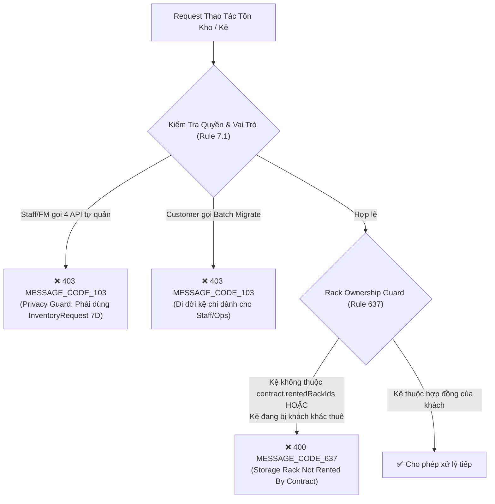
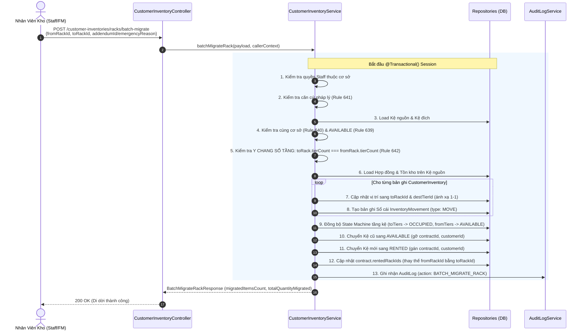

# Luồng Nghiệp Vụ Vận Hành Kho Thực Tế & Di Dời Kệ Hàng Loạt (Task 7E)

> **Tài liệu ghi chép kiến trúc nghiệp vụ, cơ chế bảo vệ và quy trình di dời kệ kho hàng loạt**
> Phân hệ: `customer-inventory` | Version: 1.0 | Ngày hoàn thành: 26/10/2026

---

## I. Bối Cảnh Thực Tế & Bài Toán Nghiệp Vụ

Trong hệ thống Self-Storage Management System, có sự phân định rõ ràng giữa hai mô hình:

1. **Kho Tự Quản Thông Thường (`Self-Storage`):** Khách hàng thuê trọn một phòng kho riêng biệt (Locker, Studio, Phòng lớn). Khách toàn quyền giữ chìa khóa/mã PIN và tự quản lý hàng hóa bên trong.
2. **Kho Kệ Dùng Chung Có Phục Vụ (`Warehouse Rack`):** Một phòng kho diện tích lớn (18m² – 50m²) được lắp đặt nhiều dãy Kệ kho công nghiệp (`StorageRack`), mỗi kệ chia làm 3 – 5 tầng (`RackTier`). Khách hàng thuê theo từng Kệ riêng lẻ (`rentedRackIds`).

### Sự Cố Vận Hành Thực Tế & Nhu Cầu Di Dời Kệ

Trong quá trình khách hàng thuê kệ nhiều tháng:

- **Trường hợp 1 (Sự cố kỹ thuật khẩn cấp):** Kệ kho bị cong vênh thanh giằng giàn chịu lực, chân kệ bị ẩm mục, hệ thống điện/nước phía trên kệ bị rò rỉ đe dọa an toàn hàng hóa. Chi nhánh bắt buộc phải di dời toàn bộ hàng hóa sang một kệ trống khác ngay lập tức.
- **Trường hợp 2 (Quy hoạch mặt bằng chi nhánh):** Ban Quản trị cơ sở sắp xếp lại sơ đồ lối đi Aisle-Bay để tối ưu hóa lộ trình xe nâng/xe đẩy, hoặc gom cụm các kệ cùng nhóm ngành hàng.
- **Trường hợp 3 (Thỏa thuận hợp đồng):** Khách hàng ký Phụ lục hợp đồng (`ContractAddendum`) thỏa thuận đổi sang vị trí kệ mới thuận tiện hơn cho xe tải bốc dỡ.

### Thách Thức Kỹ Thuật

Trên Kệ cũ đang chứa hàng chục SKU và hàng trăm kiện hàng phân bổ ở các tầng. Nếu bắt nhân viên thực hiện xuất thủ công từng món ra sàn rồi nhập thủ công từng món sang kệ mới:

- Dễ gây thất thoát, nhầm lẫn số lượng và sai lệch vị trí tầng.
- Tốn kém thời gian vận hành.
- Có nguy cơ hàng bị "rớt sàn" nếu kệ mới không đủ số tầng hoặc không tương thích.

$\rightarrow$ **Giải pháp của Task 7E:** Cung cấp tính năng **Di Dời Kệ Hàng Loạt 1-Click (`Batch Rack Migration`)** an toàn tuyệt đối về mặt pháp lý, nguyên tử trong giao dịch CSDL và chuẩn xác đối xứng về mặt vật lý.

---

## II. Hai Lớp Bảo Vệ Cốt Lõi (Guards)



### 1. Khóa Sở Hữu Kệ (`Rack Ownership Guard` - Rule 637)

- **Nguyên tắc:** Mỗi hợp đồng kho kệ (`WAREHOUSE_RACK`) chỉ được phép thao tác tồn kho trên đúng danh sách các Kệ mà hợp đồng đó đứng tên thuê (`contract.rentedRackIds`).
- **Phạm vi kiểm soát:**
  - Áp dụng trên cả **4 API tự quản của Khách hàng:** `stockIn`, `stockOut`, `stockMove`, `stockAdjust`.
  - Áp dụng trên **quy trình Putaway của Nhân viên:** `putawayInboundRequest` (Task 7D) khi nhân viên xếp hàng từ khu đệm (Staging Area) lên kệ tầng.
- **Cơ chế kiểm tra trong Service:**
  ```ts
  const rentedRackIds = (contract.rentedRackIds || []).map((id) => toId(id));
  if (rentedRackIds.length > 0 && !rentedRackIds.includes(storageRackId)) {
    throw new AppError(400, MESSAGE_CODE.MESSAGE_CODE_637);
  }
  if (
    rack.currentContractId &&
    toId(rack.currentContractId) !== toId(contract._id)
  ) {
    throw new AppError(400, MESSAGE_CODE.MESSAGE_CODE_637);
  }
  ```
- **Ý nghĩa:** Chặn đứng hoàn toàn lỗi chọn nhầm kệ chưa thuê hoặc can thiệp trái phép vào kệ của khách hàng khác.

### 2. Bảo Vệ Quyền Riêng Tư Self-Storage (Sổ Tay Mục 7.1)

Hệ thống phân định rạch ròi trách nhiệm giữa Khách hàng và Nhân viên:

| Phân hệ / Nghiệp vụ                    | Mô hình Self-Storage (Kho Thường)                                                                               | Mô hình Warehouse Rack (Kệ Dùng Chung)                                                                                                         |
| :------------------------------------- | :-------------------------------------------------------------------------------------------------------------- | :--------------------------------------------------------------------------------------------------------------------------------------------- |
| **Nhập / Xuất / Đảo hàng nội bộ**      | Khách hàng toàn quyền tự quản lý qua 4 API tự quản. **Staff và FM bị chặn tuyệt đối (`403 MESSAGE_CODE_103`).** | Khách hàng tự thao tác trên kệ của mình. Staff bị chặn 4 API tự quản. Nếu khách nhờ hỗ trợ $\rightarrow$ Bắt buộc qua `InventoryRequest` (7D). |
| **Di dời vị trí Kệ (Rack Relocation)** | Không áp dụng (phòng kho cố định).                                                                              | Dành riêng cho **Staff, FM, Ops, Admin**. Khách hàng bị chặn `403` vì không có thẩm quyền kỹ thuật dời tài sản kho.                            |

---

## III. Chi Tiết Luồng Di Dời Kệ Hàng Loạt (`Batch Rack Migration`)

### 1. Điều Kiện & Ràng Buộc Tiên Quyết

Để thực hiện thành công 1 lệnh di dời Kệ (`POST /customer-inventories/racks/batch-migrate`), hệ thống kiểm tra 4 điều kiện nghiêm ngặt:

1. **Phân quyền người thực hiện:**
   - Chỉ chấp nhận `FACILITY_STAFF`, `FACILITY_MANAGER` (thuộc đúng chi nhánh quản lý `assignedFacilityId`), `BUSINESS_OPS_MANAGER` hoặc `SYSTEM_ADMIN`.
   - Nếu Staff chi nhánh khác can thiệp $\rightarrow$ Ném `403 MESSAGE_CODE_103`.
2. **Căn cứ pháp lý bắt buộc (Rule 641):**
   - Hợp đồng thuê là văn bản pháp lý đã ký giữa 2 bên, nhân viên không được tự ý đổi vị trí kệ của khách.
   - Bắt buộc phải có **1 trong 2 căn cứ**:
     - `addendumId`: ID Phụ lục hợp đồng đổi kệ đang ở trạng thái `ACTIVE`.
     - `emergencyReason`: Lý do sự cố kỹ thuật khẩn cấp (chuỗi ký tự $\ge 10$ chữ, ví dụ: `"Thanh giằng tầng 2 bị nứt gãy đe dọa sập kệ"`).
   - Nếu thiếu cả hai $\rightarrow$ Ném `400 MESSAGE_CODE_641`.
3. **Trạng thái & Chi nhánh Kệ đích (Rule 639 & 640):**
   - Kệ đích phải cùng chi nhánh cơ sở với Kệ nguồn $\rightarrow$ Nếu khác chi nhánh ném `400 MESSAGE_CODE_640`.
   - Kệ đích phải đang ở trạng thái hoàn toàn trống `AVAILABLE` và chưa ai thuê $\rightarrow$ Nếu đang có người thuê ném `400 MESSAGE_CODE_639`.
4. **Quy tắc Kệ Cùng Loại — Y Chang Số Tầng (Rule 642):**
   - Kệ đích bắt buộc phải có số lượng tầng giống hệt Kệ nguồn (`toRack.tierCount === fromRack.tierCount`).
   - **Lý do kỹ thuật & vận hành:**
     - Cho phép hệ thống tự động ánh xạ đối xứng 1-1 theo thứ tự tầng: Tầng 1 sang Tầng 1, Tầng 2 sang Tầng 2...
     - Triệt tiêu hoàn toàn nguy cơ **hàng dư (leftovers)** bị văng ra sàn do kệ đích ít tầng hơn kệ cũ.
     - Giữ nguyên cấu trúc phân bổ hàng hóa của khách hàng mà không làm xáo trộn sơ đồ lưu trữ.
   - Nếu lệch số tầng $\rightarrow$ Ném `400 MESSAGE_CODE_642` và hướng dẫn nhân viên phải kiểm đếm, điều chuyển thủ công từng món.

---

## IV. Quy Trình Thực Thi Giao Dịch Nguyên Tử (`@Transactional`)

Toàn bộ quá trình di dời diễn ra trong 1 transaction duy nhất của MongoDB. Nếu có bất kỳ bước nào thất bại, toàn bộ dữ liệu tự động rollback về nguyên trạng.



### Chi Tiết Biến Đổi Dữ Liệu Sau Khi Di Dời Thành Công:

1. **Vị trí tồn kho (`CustomerInventory`):**
   - Mọi bản ghi hàng hóa trên Kệ cũ được chuyển thẳng sang Kệ mới, giữ nguyên số lượng và mã SKU.
   - Hàng hóa ở Tầng $k$ của Kệ cũ nằm đúng ở Tầng $k$ của Kệ mới.
2. **Sổ cái biến động (`InventoryMovement`):**
   - Mỗi mặt hàng được sinh một mã biến động `IM-...` với loại giao dịch là `MOVE`.
   - Lưu trữ rõ ràng `reason`: Tham chiếu đến mã phụ lục hợp đồng hoặc lý do sự cố khẩn cấp.
3. **Trạng thái tài sản Kệ kho (`StorageRack`):**
   - **Kệ cũ (`fromRack`):** Trở về trạng thái `AVAILABLE`, `currentContractId: null`, `currentCustomerId: null` $\rightarrow$ Sẵn sàng cho khách hàng khác thuê lại sau khi khắc phục sự cố.
   - **Kệ mới (`toRack`):** Chuyển sang trạng thái `RENTED`, gán `currentContractId` và `currentCustomerId` của khách.
4. **Hợp đồng thuê (`Contract`):**
   - Mảng `contract.rentedRackIds` được cập nhật tự động: ID của Kệ cũ bị loại bỏ và thay thế bằng ID của Kệ mới.
   - Khách hàng không bị gián đoạn hợp đồng, ngày bắt đầu và kết thúc giữ nguyên.
5. **Hành vi sau di dời:**
   - Khách hàng tiếp tục thao tác Nhập/Xuất kho trên Kệ mới bình thường.
   - Nếu khách hàng hoặc phần mềm cũ cố tình gửi request lên Kệ cũ $\rightarrow$ Hệ thống lập tức từ chối với lỗi `400 MESSAGE_CODE_637`.

---

## V. Bảng So Sánh Hai Luồng Chuyển Hàng

| Tiêu Chí So Sánh       | Đảo Hàng Tự Quản (`stockMove`)                                | Di Dời Kệ Hàng Loạt (`batchMigrateRack`)                                |
| :--------------------- | :------------------------------------------------------------ | :---------------------------------------------------------------------- |
| **Người thực hiện**    | Khách hàng (`CUSTOMER`)                                       | Nhân viên chi nhánh (`STAFF`, `FM`), Ops Manager, Admin                 |
| **Phạm vi áp dụng**    | Chuyển lẻ từng món giữa các tầng kệ mà **khách hàng đã thuê** | Dời **toàn bộ tài sản và hàng hóa** từ Kệ cũ sang một Kệ hoàn toàn mới  |
| **Ảnh hưởng Hợp đồng** | Không thay đổi hợp đồng, không cần phụ lục                    | Thay đổi tài sản thuê trên hợp đồng (`contract.rentedRackIds`)          |
| **Căn cứ pháp lý**     | Không cần (khách tự sắp xếp tài sản cá nhân)                  | **Bắt buộc:** Phụ lục hợp đồng `ACTIVE` hoặc Lý do sự cố $\ge 10$ ký tự |
| **Ràng buộc Kệ đích**  | Phải là kệ nằm trong hợp đồng của khách                       | Phải là kệ trống `AVAILABLE` và **Y CHANG SỐ TẦNG**                     |
| **Sổ cái sinh ra**     | 1 bản ghi `MOVE` cho món hàng chuyển                          | $N$ bản ghi `MOVE` cho toàn bộ các mặt hàng trên kệ                     |
| **Giải phóng Kệ**      | Không giải phóng kệ                                           | Giải phóng Kệ cũ về `AVAILABLE`, khóa Kệ mới sang `RENTED`              |

---

## VI. Danh Mục Mã Lỗi Nghiệp Vụ Liên Quan (Error Codes)

| Mã Lỗi             | HTTP Code | Ý Nghĩa Nghiệp Vụ                                                                                                                     |
| :----------------- | :-------: | :------------------------------------------------------------------------------------------------------------------------------------ |
| `MESSAGE_CODE_103` |   `403`   | Vi phạm quyền riêng tư Self-Storage (Staff gọi API tự quản) HOẶC Customer gọi API di dời kệ HOẶC Staff thao tác ngoài cơ sở phụ trách |
| `MESSAGE_CODE_637` |   `400`   | Kệ thao tác không nằm trong danh sách thuê của hợp đồng (`contract.rentedRackIds`) hoặc đang thuộc hợp đồng khác                      |
| `MESSAGE_CODE_638` |   `400`   | Kệ đích trùng với Kệ nguồn (không thể di dời sang chính nó)                                                                           |
| `MESSAGE_CODE_639` |   `400`   | Kệ đích không ở trạng thái trống (`AVAILABLE`)                                                                                        |
| `MESSAGE_CODE_640` |   `400`   | Kệ đích không cùng chi nhánh cơ sở với Kệ nguồn                                                                                       |
| `MESSAGE_CODE_641` |   `400`   | Thiếu căn cứ pháp lý di dời (phải có `addendumId` hoặc `emergencyReason`)                                                             |
| `MESSAGE_CODE_642` |   `400`   | Kệ đích không tương thích: Số lượng tầng của kệ đích phải giống hệt kệ nguồn (`toRack.tierCount === fromRack.tierCount`)              |
