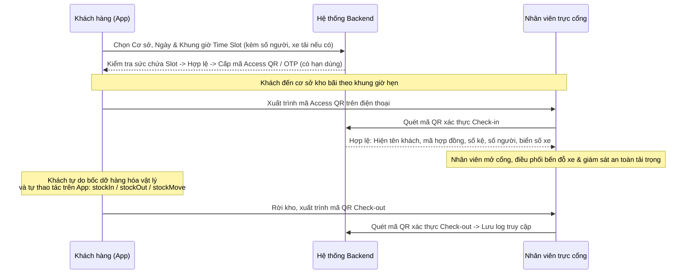
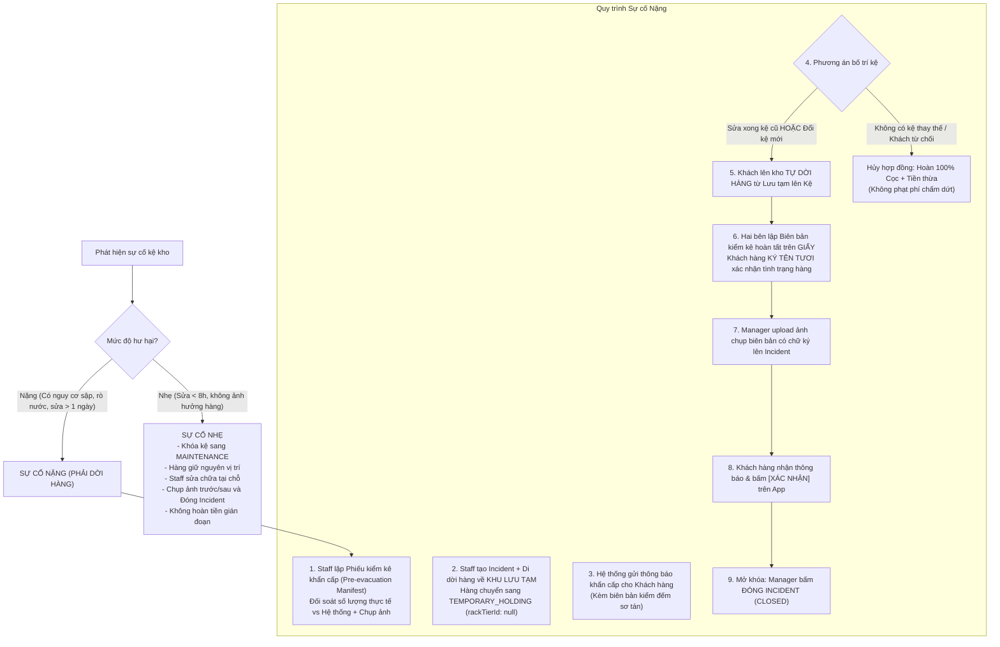

# ĐẶC TẢ TOÀN DIỆN: LUỒNG NGHIỆP VỤ KHO KỆ TỰ QUẢN (SELF-MANAGED WAREHOUSE RACK)

> **Tài liệu chuẩn hóa nghiệp vụ sau tinh chỉnh**  
> **Áp dụng cho:** Loại kho lớn trang bị kệ tầng công nghiệp (`WAREHOUSE_RACK`)  
> **Cập nhật ngày:** 03/11/2026

---

## I. TRIẾT LÝ VẬN HÀNH CỐT LÕI

Hệ thống chuyển dịch hoàn toàn từ mô hình **Kho dịch vụ đầy đủ (Full-Service 3PL)** sang mô hình **Thuần cho thuê diện tích khoang chứa có kệ tự quản (Self-Managed Rack Storage)**:

1. **Khách hàng tự quản lý 100% (`Customer Self-Management`):**
   - Khách hàng tự mang hàng đến, tự bốc dỡ xếp lên kệ của mình, tự dời tầng và tự khai báo cập nhật tồn kho trên App/Web.
   - Khách hàng chịu trách nhiệm hoàn toàn về số lượng và chất lượng hàng hóa cá nhân trong điều kiện vận hành bình thường.
2. **Nhân viên không bốc xếp thường ngày (`Zero-Touch Staff Policy`):**
   - Nhân viên chi nhánh (`FACILITY_STAFF`) **tuyệt đối không bốc xếp, không kiểm đếm, không xuất/nhập hàng thay khách**.
   - **Mục đích:** Triệt tiêu 100% rủi ro quy kết trách nhiệm (không thể đổ lỗi nhân viên làm móp méo, tráo đổi hay làm mất hàng).
3. **Giám sát an ninh & Tải trọng kho chung (`Security & Safety Oversight`):**
   - Nhân viên chỉ đóng vai trò: Quét mã kiểm soát vào/ra tại cổng, giám sát an ninh camera, hướng dẫn vị trí kệ và **giám sát trực tiếp quá trình khách xếp hàng để ngăn chặn xếp quá tải trọng tối đa của kệ**.
4. **Trách nhiệm khi có sự cố kỹ thuật cơ sở (`Facility Incident Liability`):**
   - Khi kệ kho gặp sự cố do lỗi kỹ thuật/bảo trì của cơ sở (cong vênh, sập kệ, rò nước), **cơ sở chịu 100% trách nhiệm** bảo vệ tài sản, hỗ trợ sơ tán khẩn cấp, bố trí kệ thay thế và bồi thường thiệt hại (nếu có).

---

## II. QUY TRÌNH RA VÀO KHO THƯỜNG NGÀY (`ACCESS SCHEDULE`)

Hệ thống **bỏ hoàn toàn** cơ chế _"Tạo yêu cầu xin duyệt xuất/nhập/dời từng SKU"_ (`InventoryRequest` cũ). Thay vào đó là quy trình **Đăng ký lịch vào kho (`AccessSchedule`)** kế thừa hạ tầng bảo mật mã QR / OTP:



### 1. Chi tiết các bước vận hành:

1. **Khách chọn Time Slot:** Khách chọn ngày đến và chọn một khung giờ cố định (`timeSlotId`) từ danh mục ca hoạt động của cơ sở (Ví dụ: `08:00 - 10:00`, `10:00 - 12:00`, `13:30 - 15:30`, `15:30 - 17:30`).
2. **Khai báo số lượng người & Phương tiện (Đặc thù Kho lớn):**
   - **Số lượng người đi kèm (`numberOfPeople`):** Cho phép chọn linh hoạt từ **1 đến 8 (hoặc tối đa 10) người** để đáp ứng đoàn bốc vác, tài xế, nhân viên kiểm đếm của khách thuê kho lớn thương mại.
   - **Thông tin phương tiện (`Vehicle Info` - Tùy chọn):** Khách có thể đăng ký loại xe (`vehicleType`: Xe ba gác, xe tải 1.5T, xe tải 2.5T...) và biển số xe (`vehiclePlate`) để bảo vệ chi nhánh chuẩn bị trước vị trí đỗ tại ram dốc/cửa bốc dỡ (Loading Dock/Bay), tránh xung đột ùn tắc xe tải.
3. **Sinh mã vào cổng:** Hệ thống kiểm tra sức chứa khả dụng của ca (`availableCapacity > 0`) $\rightarrow$ Khóa giữ 1 lượt và cấp **Mã Access QR / OTP** bảo mật gắn liền với khung giờ đã chọn.
4. **Check-in có đối soát:** Nhân viên quét mã xác nhận đúng chủ hợp đồng, đúng số lượng người và biển số xe đăng ký. Cổng mở cho xe và người vào kho.
5. **Tự do thao tác tồn kho:**
   - Khách lấy hàng ra khỏi kho $\rightarrow$ Khách tự bấm `stockOut` trên app.
   - Khách xếp hàng mới lên kệ $\rightarrow$ Khách tự bấm `stockIn` trên app.
   - Khách đảo hàng giữa các tầng kệ mình thuê $\rightarrow$ Khách tự bấm `stockMove` trên app.
6. **Check-out ghi log:** Khách quét mã ra về, hệ thống lưu vết toàn bộ thời gian lưu lại kho làm bằng chứng khách quan.

### 2. Các quy tắc nghiệp vụ cốt lõi của Access Schedule:

- **Kiểm soát sức chứa ca (`Slot Capacity Control`):**
  - Khái niệm `maxCapacity` trong mỗi `FacilityTimeSlot` là **số lượng đoàn khách / lượt xe tải tối đa** được phép đặt cùng 1 ca (Ví dụ: `maxCapacity = 3` tức tối đa 3 khách hàng khác nhau được vào cùng 1 lúc để tránh kẹt lối đi Aisle trong kho).
  - Slot hết chỗ (`availableCapacity <= 0`) sẽ tự động hiển thị trạng thái **FULL (Đầy)** và bị vô hiệu hóa trên App.
- **Thời hạn hiệu lực của Mã QR (`Grace Period & Expiration`):**
  - **Quét sớm:** Cho phép quét Check-in trước giờ bắt đầu ca tối đa **15 phút** (`startTime - 15m`).
  - **Ân hạn trễ:** Khách đến muộn trong vòng **30 phút đầu của ca** (`startTime + 30m`) vẫn được phép quét mã vào kho.
  - **Quá hạn / Hủy hẹn tự động (`NO_SHOW`):** Sau `startTime + 30m` mà khách vẫn chưa quét Check-in, hệ thống tự động hủy mã QR, chuyển trạng thái lịch hẹn sang **`NO_SHOW`** và giải phóng slot trống cho khách khác.
- **Quy định Hủy lịch hẹn (`Cancellation Policy`):**
  - Khách hàng được quyền tự hủy lịch hẹn trên App trước giờ bắt đầu ca tối thiểu **1 – 2 tiếng**.
  - Sau khi hủy, slot tự động tăng lại +1 capacity cho người khác đặt.

---

## III. MA TRẬN PHÂN QUYỀN HỆ THỐNG MỚI (RBAC)

| Nhóm chức năng               | Thao tác                      |      Khách hàng (`CUSTOMER`)      | Nhân viên (`FACILITY_STAFF`) |  Quản lý (`FACILITY_MANAGER`)   | Quản trị (`OPS` / `ADMIN`) |
| :--------------------------- | :---------------------------- | :-------------------------------: | :--------------------------: | :-----------------------------: | :------------------------: |
| **Tồn kho thường ngày**      | `stockIn` (Nhập hàng)         |      ✅ Tự làm trên kệ mình       |       ❌ Bị chặn (403)       |        ❌ Bị chặn (403)         |       ✅ Toàn quyền        |
|                              | `stockOut` (Xuất hàng)        |      ✅ Tự làm trên kệ mình       |       ❌ Bị chặn (403)       |        ❌ Bị chặn (403)         |       ✅ Toàn quyền        |
|                              | `stockMove` (Dời tầng/kệ)     |       ✅ Trong kệ hợp đồng        |       ❌ Bị chặn (403)       |        ❌ Bị chặn (403)         |       ✅ Toàn quyền        |
|                              | `stockAdjust` (Tự kiểm kê)    |      ✅ Tự cân đối hàng mình      |       ❌ Bị chặn (403)       |        ❌ Bị chặn (403)         |       ✅ Toàn quyền        |
| **Tra cứu dữ liệu (READ)**   | Xem tồn kho & Sơ đồ cây       |        ✅ Hàng/kệ của mình        |  👁️ **Được xem cơ sở mình**  |   👁️ **Được xem cơ sở mình**    |       ✅ Toàn quyền        |
|                              | Xem lịch sử di chuyển (Logs)  |        ✅ Lịch sử của mình        |  👁️ **Được xem cơ sở mình**  |   👁️ **Được xem cơ sở mình**    |       ✅ Toàn quyền        |
|                              | Xem danh mục SKU              |          ✅ SKU của mình          |  👁️ **Được xem cơ sở mình**  |   👁️ **Được xem cơ sở mình**    |       ✅ Toàn quyền        |
|                              | Bảng thống kê Summary         |         ✅ Của riêng mình         |       ❌ Bị chặn (403)       |     👁️ Xem khách tại cơ sở      |     ✅ Tra cứu theo ID     |
| **Quản lý danh mục SKU**     | Tạo / Sửa / Xóa SKU           |      ✅ Tự quản lý SKU mình       |       ❌ Bị chặn (403)       |        ❌ Bị chặn (403)         |       ✅ Toàn quyền        |
| **Kiểm soát cổng vào**       | Tạo lịch hẹn `AccessSchedule` |        ✅ Đăng ký cho mình        |              ❌              |               ❌                |         ✅ Tạo hộ          |
|                              | Quét QR Check-in / Check-out  |        ❌ (Chỉ xuất trình)        |  ✅ Quét xác thực tại cổng   |    ✅ Quét xác thực tại cổng    |       ✅ Toàn quyền        |
| **Ứng phó sự cố (Incident)** | Báo cáo sự cố kệ              |      ✅ Báo cáo kệ mình thuê      |     ✅ Báo cáo sự cố kho     |           ✅ Báo cáo            |       ✅ Toàn quyền        |
|                              | Sơ tán hàng khẩn cấp          |                ❌                 |    ✅ Thực hiện theo lệnh    |       ✅ Điều hành sơ tán       |       ✅ Toàn quyền        |
|                              | Ký biên bản bàn giao sau sửa  | ✍️ **Ký giấy tay + Xác nhận App** |    ❌ (Chỉ lập biên bản)     |     📤 Upload ảnh biên bản      |        ✅ Can thiệp        |
|                              | Đóng hồ sơ sự cố (`CLOSED`)   |                ❌                 |    ❌ Maker-checker chặn     | ✅ **Đóng sau khi khách duyệt** |       ✅ Toàn quyền        |

> 💡 **Ghi chú về quyền READ của Staff:** Nhân viên được phép xem danh mục SKU và vị trí hàng hóa tại cơ sở mình phụ trách vì hàng hóa nằm trên kệ mở trong không gian chung. Việc này phục vụ công tác an toàn PCCC, ứng phó cứu hộ và xử lý sự cố khẩn cấp.

---

## IV. QUY TRÌNH XỬ LÝ SỰ CỐ KỆ KHO HỎNG HÓC

Tùy theo mức độ nghiêm trọng, sự cố được xử lý theo 2 nhánh:



### 1. Sự cố Nhẹ (Sửa chữa tại chỗ $< 8$ giờ)

- Kệ tạm khóa sang `MAINTENANCE` (không nhận thêm hàng mới).
- Hàng hóa của khách **giữ nguyên trên kệ**, nhân viên gia cố bu-lông, thanh giằng hoặc xử lý vết bẩn.
- Nhân viên chụp ảnh bằng chứng trước/sau sửa chữa.
- Sự cố đóng nhanh (`CLOSED`), không phát sinh hoàn tiền gián đoạn.

### 2. Sự cố Nặng (Kệ hư hỏng nặng, nguy cơ sập / ngấm nước)

- **Giai đoạn 1 — Sơ tán khẩn cấp & Kiểm kê ban đầu:**
  - Hai nhân viên cùng kiểm đếm thực tế đối chiếu với số liệu hệ thống.
  - Lập **Phiếu kiểm kê sơ tán (`preEvacuationManifest`)** ghi nhận số lượng thực tế, số lượng DB, sai lệch (nếu có) và hình ảnh hiện trường.
  - Tạo hồ sơ `Incident` gắn liền với hành động chuyển toàn bộ hàng về **Khu lưu tạm (`TEMPORARY_HOLDING`)**, đưa `rackTierId: null`.
- **Giai đoạn 2 — Chính sách hàng hóa tại Khu lưu tạm:**
  - **Cho phép `stockOut`:** Khách hàng **hoàn toàn có quyền lấy hàng về** bất kỳ lúc nào nếu cần hàng gấp.
  - **Chặn `stockIn`, `stockMove`, `stockAdjust`:** Không cho nhập thêm hoặc dời chỗ linh tinh khi chưa có kệ chính thức.
- **Giai đoạn 3 — Phương án kệ thay thế:**
  - _Kệ cũ sửa xong:_ Đưa kệ về `ACTIVE`.
  - _Đổi sang kệ mới (cùng zone hoặc nâng cấp zone tốt hơn miễn phí):_ Ký Phụ lục hợp đồng **`RACK_CHANGE`** cập nhật `rentedRackIds` mới.
  - _Hết kệ tương đương / Khách không đồng ý:_ Khách được quyền **chấm dứt hợp đồng ngay lập tức**. Cơ sở hoàn trả 100% tiền cọc + hoàn tiền tiền thuê ngày chưa sử dụng, **không thu bất kỳ phí phạt nào**.
- **Giai đoạn 4 — Bàn giao lại hàng & Ký biên bản giấy (Nghiệm thu 2 lớp):**
  - Khách hàng đặt lịch `AccessSchedule` đến kho, tự tay kiểm tra đồ và dời từ khu lưu tạm lên kệ mới/kệ sửa xong.
  - Hai bên lập **Biên bản kiểm kê hoàn tất sự cố (`postRestorationManifest`) trên giấy**. Khách hàng **ký tươi xác nhận** đã nhận lại đủ hàng hóa hoặc ghi nhận hư hại (nếu có).
  - Manager chụp ảnh/scan biên bản giấy upload lên Incident (`restorationManifestDocUrl`).
  - Khách hàng mở App xem lại ảnh biên bản và bấm nút **"Xác nhận nghiệm thu"** (`customerAcknowledgedAt`).
  - **Chỉ sau khi khách đã xác nhận trên App, Manager mới được quyền bấm Đóng sự cố (`CLOSED`)**.

---

## V. CHÍNH SÁCH TÀI CHÍNH, BỒI THƯỜNG & QUYẾT TOÁN

Để tránh việc chi trả lắt nhắt nhiều lần gây phiền hà cho kế toán và khách hàng, **toàn bộ các khoản bồi thường và hoàn tiền sự cố sẽ được kết chuyển và quyết toán chung một lần khi thanh lý hợp đồng**:

```
Tổng tiền hoàn trả cuối hợp đồng =
    Tiền đặt cọc ban đầu (Deposit)
  + Tiền hoàn ngày gián đoạn do sự cố (Interrupted Days Refund)
  + Tiền cơ sở đền bù hàng hư hại (Facility Damage Fee - nếu có)
  - Công nợ tiền thuê / dịch vụ còn thiếu (nếu có)
```

### 1. Cách tính Hoàn tiền Ngày gián đoạn (`Interrupted Days`)

- **Thời gian gián đoạn:** Tính từ lúc hàng bị hạ xuống lưu tạm (`TEMPORARY_HOLDING`) đến khi khách hàng hoàn tất dời hàng lên kệ và ký biên bản.
- **Mức hoàn tiền:**
  - Dưới 8 giờ: **0 ngày** (miễn trừ theo thỏa thuận bảo trì sự cố nhẹ).
  - Từ 8 giờ đến 24 giờ: Tính tròn **1 ngày thuê**.
  - Mỗi 24 giờ tiếp theo: Cộng thêm **1 ngày thuê tương ứng**.
- **Công thức tiền hoàn:**
  $$\text{interruptedRefund} = \left(\frac{\text{Giá thuê kệ/tháng}}{30}\right) \times \text{Số ngày gián đoạn}$$

### 2. Tiền đền bù hàng hóa hư hại (`Facility Damage Fee`)

- Nếu trong quá trình nhân viên sơ tán khẩn cấp làm đổ vỡ, hư hỏng đồ của khách:
- Hai bên thỏa thuận giá trị thiệt hại và ghi rõ vào Biên bản nghiệm thu.
- Trong Incident ghi nhận: `liableParty: FACILITY`, giá trị đền bù: `damageFee`.
- Khoản này là tiền **Cơ sở trả thêm cho Khách hàng**, tự động tích lũy vào hồ sơ hợp đồng để hoàn trả khi thanh lý.

---

## VI. BẢNG DANH MỤC THAY ĐỔI KỸ THUẬT (DEVELOPMENT SCOPE)

### 1. Code cần XÓA BỎ / KHÔNG SỬ DỤNG

- ❌ `POST /customer-inventories/racks/batch-migrate`: Xóa bỏ endpoint di dời kệ tự động vì khách tự dời vật lý.
- ❌ `POST /customer-inventories/racks/evacuate-to-holding`: Xóa bỏ endpoint độc lập, đưa nghiệp vụ này vào bên trong Incident.
- ❌ Toàn bộ các API tạo đơn xin duyệt SKU của `InventoryRequest` (`createOutboundRequest`, `createInboundRequest`, `putawayInboundRequest`, `completeOutboundHandover`).

### 2. Code cần ĐIỀU CHỈNH (Refactor)

- 🔄 **`customerInventory.service.ts`:**
  - Mở quyền `stockIn`, `stockOut`, `stockMove`, `stockAdjust` cho `CUSTOMER` (với điều kiện kệ thuộc hợp đồng khách thuê).
  - Chặn toàn bộ quyền ghi (mutate) của `FACILITY_STAFF` và `FACILITY_MANAGER` đối với tồn kho thường ngày.
  - Mở quyền READ tồn kho & SKU cho Staff và FM theo phạm vi cơ sở phụ trách.
  - Cho phép gọi `stockOut` đối với các mặt hàng đang có trạng thái `TEMPORARY_HOLDING`.
- 🔄 **Chuyển đổi `InventoryRequest` $\rightarrow$ `AccessSchedule`:**
  - Lược bỏ trường `items: [{skuId, qty}]`.
  - Giữ nguyên logic bảo mật: Mã hóa QR Token, HMAC OTP, hàm verify kiểm tra thời hạn và đối soát check-in/out tại cổng.

### 3. Code cần BỔ SUNG MỚI

- 🆕 **Module `Incident`:**
  - Bổ sung subdocument `preEvacuationManifest` (lưu biên bản kiểm kê lúc bắt đầu sơ tán).
  - Thêm endpoint `POST /incidents/:id/evacuate-rack`: Chuyển hàng kệ hỏng sang `TEMPORARY_HOLDING` và khóa kệ `MAINTENANCE`.
  - Thêm endpoint `POST /incidents/:id/restoration-manifest`: Manager upload ảnh biên bản giấy đã có chữ ký của khách.
  - Thêm endpoint `POST /incidents/:id/customer-acknowledge`: Khách hàng bấm xác nhận nghiệm thu trên App.
  - Bổ sung điều kiện chặn trong `closeIncident`: Bắt buộc phải có `customerAcknowledgedAt` mới cho phép chuyển sang trạng thái `CLOSED`.
- 🆕 **Module `Contract` & `Billing`:**
  - Bổ sung loại phụ lục hợp đồng mới: `RACK_CHANGE` trong `ContractAddendumTypeEnum`.
  - Bổ sung trường `accumulatedInterruptedRefund` và `accumulatedFacilityDamageFee` vào `Contract` để tự động cộng dồn hoàn tiền cọc khi kết thúc hợp đồng.

---

_Tài liệu này là căn cứ kiến trúc thống nhất, đã giải quyết triệt để rủi ro quy trách nhiệm cho nhân viên, phản ánh đúng bản chất kho cho thuê diện tích tự quản và sẵn sàng chuyển giao cho giai đoạn lập kế hoạch chi tiết (Planning)._
