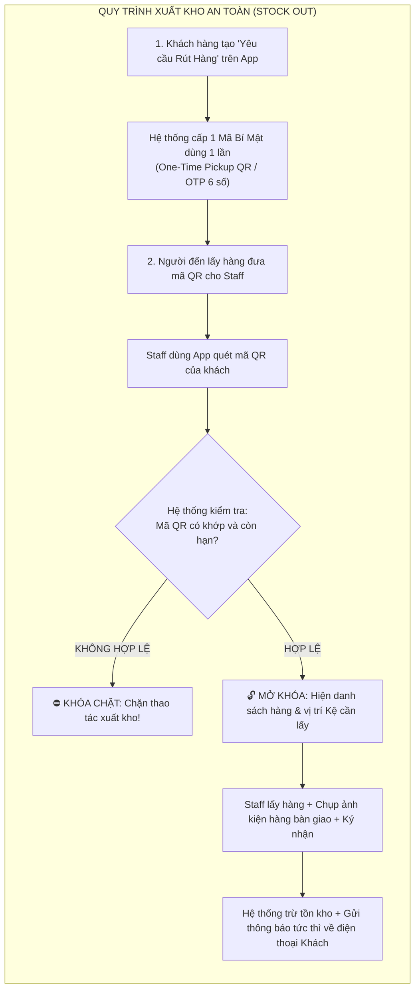
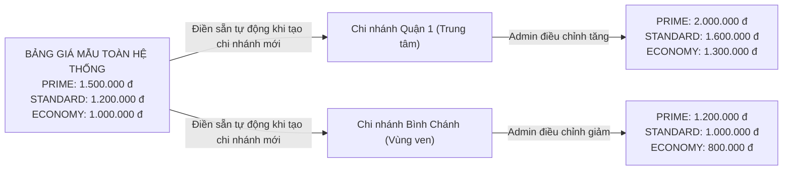

# TÀI LIỆU TOÀN DIỆN: MÔ HÌNH THUÊ KHO THEO KỆ (SHARED WAREHOUSE RACK RENTAL)

## ĐẶC TẢ NGHIỆP VỤ, QUY TRÌNH AN TOÀN XUẤT NHẬP & KIẾN TRÚC FE / BE

> **Phạm vi áp dụng:** Loại kho lớn có hệ thống kệ (`WAREHOUSE_RACK`) trong hệ thống Self-Storage.  
> **Bản chất mô hình:** Kho chia sẻ có dịch vụ bốc xếp (Full-Service Shared Warehouse).  
> **Nguyên tắc vận hành cốt lõi:**
>
> - Khách thuê theo từng **Kệ (`StorageRack`)** hoặc cụm kệ kế nhau trong 1 kho lớn chung.
> - **Nhân viên (`FACILITY_STAFF`)** chịu trách nhiệm bốc xếp vật lý, khai báo SKU, kiểm đếm hàng hóa.
> - **Khách hàng (`CUSTOMER`)** giám sát minh bạch 100% trên App/Web cá nhân.
> - **An toàn hàng hóa:** Không tự ý xuất/nhập; mọi thao tác phải qua **Lệnh + Mã xác thực 2 chiều (One-Time Pickup QR / OTP) + Bằng chứng hình ảnh**.

---

## MỤC LỤC

1. [Ma trận Phân vai & Trách nhiệm (RACI Matrix)](#i-ma-trận-phân-vai--trách-nhiệm-raci-matrix)
2. [Quy trình An toàn Tuyệt đối khi Xuất & Nhập Hàng (Security & Dual Handshake)](#ii-quy-trình-an-toàn-tuyệt-đối-khi-xuất--nhập-hàng-security--dual-handshake)
3. [Chiến lược Định giá theo Phân khu & Quản lý theo Chi nhánh](#iii-chiến-lược-định-giá-theo-phân-khu--quản-lý-theo-chi-nhánh)
4. [Giải pháp Thuê Kệ Liền Kề & Sắp xếp / Dời Hàng Hóa](#iv-giải-pháp-thuê-kệ-liền-kề--sắp-xếp--dời-hàng-hóa)
5. [Giải pháp Quét Mã (Barcode/QR) & Nhập tay Thủ công phục vụ Demo](#v-giải-pháp-quét-mã-barcodeqr--nhập-tay-thủ-công-phục-vụ-demo)
6. [Đặc tả Giao diện Frontend (Frontend UI/UX Specification)](#vi-đặc-tả-giao-diện-frontend-frontend-uiux-specification)
7. [Đặc tả Kỹ thuật Backend (Backend Architecture & APIs)](#vii-đặc-tả-kỹ-thuật-backend-backend-architecture--apis)
8. [Kịch bản Demo Từng Bước Cho Buổi Báo Cáo](#viii-kịch-bản-demo-từng-bước-cho-buổi-báo-cáo)

---

## I. Ma trận Phân vai & Trách nhiệm (RACI Matrix)

| Hành động                            |      Khách hàng (`CUSTOMER`)      |     Nhân viên kho (`FACILITY_STAFF`)     |  Quản lý (`FACILITY_MANAGER`)   | Ghi chú kiểm soát hệ thống                 |
| :----------------------------------- | :-------------------------------: | :--------------------------------------: | :-----------------------------: | :----------------------------------------- |
| **Khai báo Mã hàng (`CustomerSku`)** |   ✅ Tự tạo trước ở nhà qua App   | ✅ Tạo giúp khách khi nhận hàng tại kho  | 👁️ Xem danh mục khách tại cơ sở | SKU gắn với `customerId` của khách         |
| **Đặt thuê Kệ**                      |    ✅ Chọn kệ trên Sơ đồ Grid     |                    ❌                    |               ❌                | Kệ chuyển `AVAILABLE` ➔ `RENTED`           |
| **Tạo Yêu cầu Xuất/Nhập hàng**       | ✅ **Chủ động tạo lệnh trên App** |      ❌ Không được tự tạo lệnh xuất      |               ❌                | Bắt buộc sinh mã OTP / Pickup QR           |
| **Thực hiện Nhập kho (`Stock In`)**  | ❌ (Chỉ bàn giao hàng & ký nhận)  |    ✅ **Kiểm đếm, chụp ảnh, xếp kệ**     |           ✅ Giám sát           | Chặn tuyệt đối nếu xếp nhầm kệ khách khác  |
| **Thực hiện Xuất kho (`Stock Out`)** |    ❌ (Chỉ quét QR nhận hàng)     | ✅ **Quét QR khách, lấy hàng, bàn giao** |           ✅ Giám sát           | **Phải có mã QR từ khách mới mở khóa**     |
| **Dời tầng/kệ (`Stock Move`)**       |                ❌                 |       ✅ **Thực hiện bốc chuyển**        |          ✅ Thực hiện           | Ghi sổ cái `InventoryMovement` loại `MOVE` |
| **Kiểm kê (`Stock Adjust`)**         |                ❌                 |         ✅ **Kiểm đếm thực tế**          |    ✅ Giám sát & Duyệt lệch     | Bắt buộc nhập lý do điều chỉnh             |
| **Xem Tồn kho & Thẻ Kệ**             |  ✅ Xem trực quan 100% minh bạch  |          ✅ Xem phục vụ bốc xếp          |       ✅ Toàn quyền cơ sở       | Real-time đồng bộ qua Web/Mobile           |

---

## II. Quy trình An toàn Tuyệt đối khi Xuất & Nhập Hàng (Security & Dual Handshake)

Hàng hóa là tiền bạc của khách hàng. Để **loại bỏ 100% rủi ro nhân viên tự tiện xuất hàng, giao nhầm người hoặc thất thoát**, hệ thống áp dụng nguyên tắc: **"KHÔNG LỆNH - KHÔNG THAO TÁC"**.



### 1. Quy trình Xuất hàng (Stock Out)

1. **Khách tạo lệnh trên App:** Chọn mặt hàng, số lượng cần rút, thông tin người đến nhận. App sinh ra **Mã QR Nhận Hàng (Pickup QR)** có hiệu lực trong vòng 24h.
2. **Xác thực 2 chiều tại quầy:** Người nhận xuất trình mã QR. Staff dùng app quét mã QR này ➔ Hệ thống kiểm tra hợp lệ mới mở khóa lệnh xuất kho.
3. **Bằng chứng bàn giao (Proof of Handover):** Staff chụp ảnh kiện hàng bàn giao tại quầy + Người nhận ký điện tử trên màn hình ➔ Trừ tồn kho và gửi hóa đơn/ảnh về máy khách.

### 2. Quy trình Nhập hàng (Stock In)

1. **Khách tạo yêu cầu gửi hàng hoặc mang hàng đến kho.**
2. **Kiểm đếm & Chụp ảnh hiện trạng:** Staff cùng người giao đồng kiểm. Nếu thùng hàng bị rách, móp méo, Staff chụp ảnh lưu vết.
3. **Biên bản Nhận Hàng Điện tử (Digital Goods Receipt Note):** Staff nhập số lượng thực nhận. Hệ thống đẩy biên bản kèm ảnh sang máy khách: _"Đã nhận 98 kiện nguyên vẹn, 2 kiện móp vỏ"_. Khách bấm **Xác nhận** ➔ Lúc này hàng mới chính thức được ghi nhận tồn kho và xếp lên kệ.

---

## III. Chiến lược Định giá theo Phân khu & Quản lý theo Chi nhánh

### 1. Phân tích: Có nên dùng chung 1 mức giá cho tất cả chi nhánh?

- **Thực tế:** Chi phí thuê mặt bằng ở trung tâm (Quận 1 TP.HCM, Cầu Giấy Hà Nội) đắt gấp đôi, gấp ba vùng ven (Bình Chánh, Long Biên). Nếu ép cứng 1 giá chung, cơ sở trung tâm sẽ bị lỗ, còn cơ sở ngoại ô sẽ quá đắt.
- **Giải pháp:** **"Bảng giá Mẫu chung (Global Template) + Từng Chi nhánh tự điều chỉnh"**.



### 2. Định giá Kệ theo 3 Phân khu (Zone-based Pricing)

Trong mỗi chi nhánh, mặt bằng kho lớn được chia thành 3 khu vực:

1. **Phân khu VIP / Mặt tiền (`ZONE_PRIME` - Dãy A, B):** Gần cửa xuất nhập, xe nâng vào lấy hàng chỉ mất vài giây. Thích hợp hàng luân chuyển nhanh ➔ Giá cao nhất.
2. **Phân khu Tiêu chuẩn (`ZONE_STANDARD` - Dãy C, D):** Khu vực giữa kho, lối đi rộng ➔ Mức giá chuẩn.
3. **Phân khu Tiết kiệm (`ZONE_ECONOMY` - Dãy E, F):** Góc sâu trong kho, thích hợp lưu kho dài hạn ➔ Mức giá tiết kiệm nhất.
4. **Kệ đặc biệt (Override riêng):** Kệ nào bị vướng cột nhà hoặc góc khuất có thể cấu hình trường `customPrice` để giảm giá riêng.

---

## IV. Giải pháp Thuê Kệ Liền Kề & Sắp xếp / Dời Hàng Hóa

### 1. Chuẩn hóa Mã Kệ theo Tọa độ Dãy - Cột (Aisle - Bay Grid)

- **Mã Kệ:** `{Dãy}-{Cột}` (Ví dụ: `A-01, A-02, A-03...`).
  - `A-01` và `A-02` là **2 kệ sát vách nhau**.
  - `A-01` và `B-01` là **2 kệ đối diện nhau qua lối đi**.
- **Sơ đồ Mặt bằng Kệ (Grid Map):** Hiển thị trực quan dạng lưới 2D trên Web/App (giống chọn ghế rạp chiếu phim).
- **Thuật toán Gợi ý Tự động:** Khi khách chọn muốn thuê $N$ kệ (ví dụ $N=2$), hệ thống tự động quét và highlight cụm 2 kệ trống liền kề trong cùng dãy hoặc đối diện.

### 2. Xử lý Di dời & Mở rộng Kệ (Rack Relocation)

- **Tình huống:** Khách đang thuê `A-01`, muốn thuê thêm 1 kệ kế bên nhưng kệ `A-02` đã bị người khác thuê.
- **Cách giải quyết:**
  1. Hệ thống tìm cho khách cụm 2 kệ trống mới (ví dụ `B-05` và `B-06`).
  2. Ký phụ lục chuyển đổi hợp đồng sang cụm kệ mới.
  3. Staff di dời hàng vật lý sang kệ mới.
  4. Staff bấm nút **"Xác nhận dời toàn bộ hàng từ A-01 sang B-05"** trên App ➔ Hệ thống tự động chuyển toàn bộ dữ liệu tồn kho sang vị trí mới và giải phóng kệ cũ `A-01` thành `AVAILABLE`.

---

## V. Giải pháp Quét Mã (Barcode/QR) & Nhập tay Thủ công phục vụ Demo

Hệ thống hỗ trợ **song song 2 phương thức nhập liệu (Dual Input)** trên mọi màn hình:

```
[ 📷 Quét mã Barcode / QR ]  HOẶC  [ ⌨️ Nhập tay mã số / Tìm kiếm tên hàng ]
```

### 1. Định dạng Dữ liệu trong Mã (Payloads)

- **Mã vạch Hàng hóa (SKU Barcode):** Mã vạch in sẵn trên bao bì (`8934673...`) hoặc mã định danh `SKU:VINAMILK-180`.
- **Mã QR Tầng Kệ (Rack Tier QR):** `TIER:HN01-A-01-T2` (Cơ sở HN01 - Kệ A-01 - Tầng 2).
- **Mã QR Nhận Hàng (Pickup QR):** `PICKUP:OUT-20261024-001:OTP982341`.

### 2. Cách Render và Chuẩn bị Demo

- Frontend dùng thư viện `qrcode.react` và `jsbarcode` để vẽ mã.
- **Trang In Tem Nhãn (Admin Label Sheet):** Quản lý mở trang này hiển thị lưới các mã QR của các kệ (`A-01-T1`, `A-01-T2`...).
- **Khi Demo:**
  - Có thể đưa điện thoại lên quét trực tiếp mã QR trên màn hình laptop hoặc nhãn in trên giấy.
  - Nếu phòng học tối hoặc camera bị mờ, nhân viên chỉ việc **gõ mã `A-01-T2` vào ô nhập tay** ➔ Cực kỳ nhanh gọn, không lo sự cố!

---

## VI. Đặc tả Giao diện Frontend (Frontend UI/UX Specification)

### 1. Màn hình Khách hàng — Đặt thuê Kệ (Visual Booking Map)

- **Thành phần:**
  - Ô chọn số lượng kệ muốn thuê + Nút `[ ✨ Gợi ý 2 kệ kế nhau ]`.
  - Sơ đồ Lưới 2D hiển thị các Dãy A, B, C...
  - Màu sắc theo Phân khu: Viền vàng (Mặt tiền - 1.5tr), Viền xanh dương (Tiêu chuẩn - 1.2tr), Viền xanh lá (Tiết kiệm - 1.0tr). Kệ đã thuê tô màu xám mờ.
  - Khách click chọn 2 ô kế nhau ➔ Thanh tóm tắt bên dưới tự động tính tổng tiền.

### 2. Màn hình Khách hàng — Thẻ Kệ Ảo & Giám sát Tồn kho (Customer Portal)

- **Thành phần:**
  - Danh sách Kệ đang thuê: `[ Kệ A-01 ] [ Kệ A-02 ]`.
  - Mô phỏng trực quan Kệ 4 tầng: Tầng nào đang chứa SKU gì, số lượng bao nhiêu, hình ảnh bao bì.
  - Nút `[ 📦 Tạo Yêu cầu Rút Hàng ]` ➔ Chọn hàng, số lượng ➔ Hiện Mã QR Nhận Hàng.
  - Sổ cái kiểm toán: Ghi rõ ngày giờ, tên nhân viên bốc xếp, kèm ảnh chụp lúc bàn giao.

### 3. Màn hình Nhân viên kho — Máy quét Bốc xếp & Tiếp nhận (Staff WMS Mobile)

- **Thành phần:**
  - **Khi Xuất kho:** Nút quét mã QR của khách ➔ Quét đúng mới hiện danh sách hàng cần lấy ➔ Chụp ảnh bàn giao ➔ Bấm xác nhận.
  - **Khi Nhập kho:**
    - Bước 1: Quét/chọn mã SKU (có nút tạo nhanh SKU mới chụp ảnh bao bì).
    - Bước 2: Quét mã QR Tầng Kệ (hoặc gõ tay mã `A-01-T2`).
    - **Hiệu ứng bảo vệ an toàn:** Nếu quét nhầm kệ của khách khác ➔ Màn hình đỏ nhấp nháy, rung cảnh báo: _"LỖI: Kệ này thuộc khách hàng khác!"_.
    - Bước 3: Nhập số lượng ➔ Bấm Lưu.

### 4. Màn hình Quản lý — Thiết lập Giá & In Tem Nhãn (Admin Portal)

- Thiết lập bảng giá 3 Phân khu cho Chi nhánh (có sẵn nút _"Điền giá mẫu"_).
- Xuất trang in tem nhãn QR hàng loạt cho toàn bộ Kệ trong kho để dán lên thanh kệ.

---

## VII. Đặc tả Kỹ thuật Backend (Backend Architecture & APIs)

### 1. Cập nhật Model MongoDB

#### A. Model `StorageRack`

```ts
export interface IStorageRack extends SoftDeleteDocument {
  facilityId: Types.ObjectId;
  storageUnitId: Types.ObjectId; // ID phòng kho lớn
  rackCode: string; // "A-01"
  aisle: string; // "A" (Dãy)
  bay: number; // 1 (Thứ tự cột)
  zone: 'PRIME' | 'STANDARD' | 'ECONOMY'; // Phân khu
  customPrice?: number | null; // Giá ghi đè riêng nếu có
  tierCount: number; // Mặc định 4 tầng
  status: RackStatusEnum; // AVAILABLE | RESERVED | RENTED | MAINTENANCE
  currentContractId?: Types.ObjectId | null;
  currentCustomerId?: Types.ObjectId | null;
}
```

#### B. Model `FacilityUnitTypeOffering` (Bảng giá theo Chi nhánh)

```ts
export interface IFacilityUnitTypeOffering extends SoftDeleteDocument {
  facilityId: Types.ObjectId;
  unitTypeId: Types.ObjectId;
  // Bổ sung bảng giá theo 3 phân khu cho loại kho kệ:
  rackZonePricing?: {
    PRIME: number; // VD: 1.500.000
    STANDARD: number; // VD: 1.200.000
    ECONOMY: number; // VD: 1.000.000
  };
}
```

#### C. Model `Reservation` & `Contract`

```ts
rentedRackIds?: Types.ObjectId[]; // Danh sách các Kệ được thuê
```

### 2. Danh sách APIs Cần Điều Chỉnh & Thêm Mới

| Method | Endpoint                                                |           Quyền           | Mục đích                                                               |
| :----- | :------------------------------------------------------ | :-----------------------: | :--------------------------------------------------------------------- |
| `GET`  | `/storage-units/{id}/rack-grid`                         | Public / Customer / Staff | Lấy sơ đồ toàn bộ kệ trong kho lớn (tọa độ, phân khu, giá, trạng thái) |
| `GET`  | `/storage-units/{id}/suggest-adjacent-racks?quantity=N` |     Customer / Staff      | Thuật toán quét và gợi ý cụm $N$ kệ trống liền kề                      |
| `POST` | `/customer-skus`                                        |   Customer & **Staff**    | Khách hoặc Staff tạo SKU (Staff tạo thay khách gắn `customerId`)       |
| `POST` | `/customer-inventories/outbound-requests`               |       **Customer**        | Khách tạo yêu cầu rút hàng ➔ Sinh mã Pickup QR/OTP                     |
| `POST` | `/customer-inventories/verify-pickup-qr`                |         **Staff**         | Staff quét mã QR của khách ➔ Mở khóa lệnh xuất kho                     |
| `POST` | `/customer-inventories/in`                              |         **Staff**         | Nhập hàng lên kệ. **Kiểm tra bắt buộc: Kệ phải thuộc hợp đồng khách**  |
| `POST` | `/customer-inventories/out`                             |         **Staff**         | Thực hiện xuất hàng sau khi đã xác thực QR của khách                   |
| `POST` | `/customer-inventories/racks/batch-migrate`             |      Staff & Manager      | Dời toàn bộ hàng từ Kệ cũ sang Kệ mới khi đổi vị trí                   |

---

## VIII. Kịch bản Demo Từng Bước Cho Buổi Báo Cáo

1. **Bước 1 — Khách đặt thuê 2 Kệ kế nhau:**
   - Mở màn hình Khách hàng ➔ Bấm nút `[ ✨ Gợi ý 2 kệ kế nhau ]` ➔ Bản đồ tự động chọn `A-01` và `A-02` (Khu Mặt tiền gần cửa, 1.5tr/kệ). Bấm thanh toán đặt thuê.
2. **Bước 2 — Nhân viên nhập hàng (Thao tác quét mã / nhập tay):**
   - Mở giao diện Staff trên mobile ➔ Chọn khách hàng ➔ Bấm tạo SKU Sữa Vinamilk.
   - Quét mã QR Kệ `A-01-T2` (hoặc gõ tay `A-01-T2`) ➔ Nhập 20 thùng ➔ Xếp lên kệ thành công.
3. **Bước 3 — Cố tình quét sai kệ để demo tính năng an toàn:**
   - Thử quét mã Kệ `B-03` (kệ của khách khác) ➔ Hệ thống hiện **Cảnh báo Đỏ**: _"Từ chối: Kệ B-03 không thuộc hợp đồng của khách này!"_.
4. **Bước 4 — Khách tạo Lệnh Rút hàng & Nhân viên quét QR đối soát:**
   - Khách mở App tạo lệnh rút 5 thùng sữa ➔ App khách hiện **Mã QR Nhận Hàng**.
   - Nhân viên dùng điện thoại quét mã QR từ máy khách ➔ Hệ thống báo hợp lệ, mở khóa lệnh xuất kho ➔ Xuất hàng và cập nhật tồn kho tức thì.
