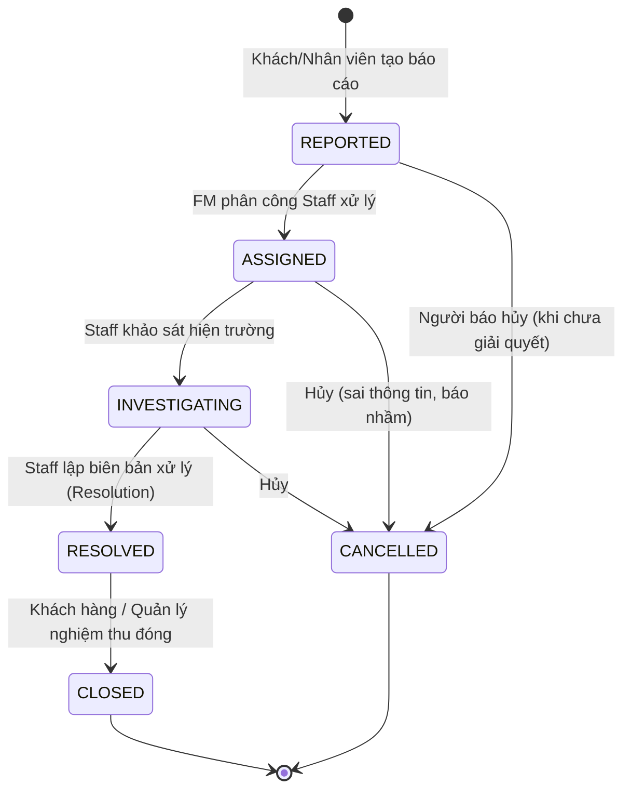
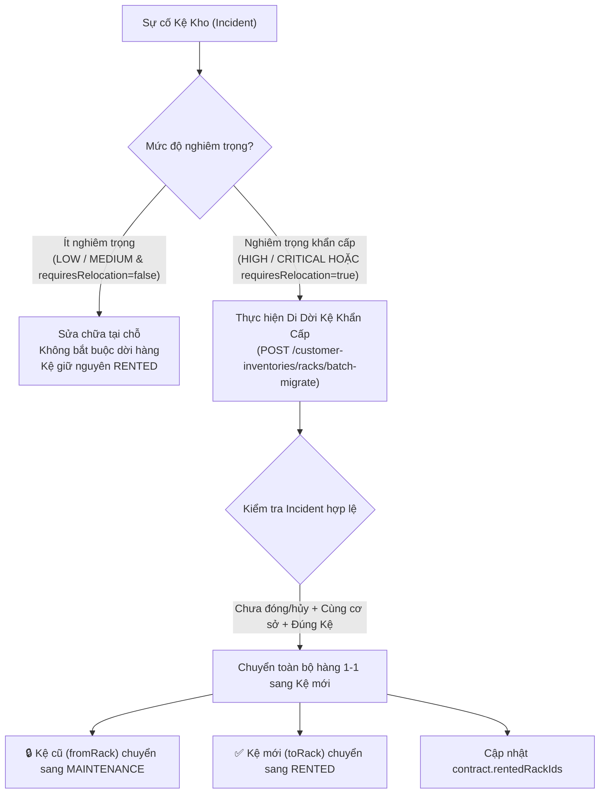

# Kiến Trúc Nghiệp Vụ & Luồng Xử Lý Sự Cố Kho Bãi (Phân Hệ 5A - Incident)

> **Tài liệu tổng hợp kiến trúc phân hệ, vòng đời sự cố, tích hợp bảo trì kho và liên kết di dời kệ khẩn cấp**
> Phân hệ: `incident` & liên thông `customer-inventory` | Version: 1.0 | Ngày hoàn thành: 27/10/2026

---

## I. Tổng Quan & Bối Cảnh Nghiệp Vụ

Trong quá trình vận hành kho Self-Storage và Kho Kệ chung (Warehouse Rack), các sự cố vật lý (nứt tường, thấm dột, chập điện, biến dạng chân kệ, hỏng khóa, mối mọt, hỏa hoạn...) có thể xảy ra bất cứ lúc nào.

Hệ thống cung cấp phân hệ **Quản lý Sự cố (`incident`)** nhằm:

1. Cho phép **Khách hàng (`CUSTOMER`)** hoặc **Nhân viên chi nhánh (`FACILITY_STAFF`)** gửi báo cáo sự cố kèm hình ảnh hiện trường trực quan.
2. Thiết lập quy trình phân công điều phối chuẩn xác từ **Quản lý cơ sở (`FACILITY_MANAGER`)** tới Nhân viên phụ trách.
3. Cung cấp cơ chế **Lập biên bản xử lý & bồi thường hư hỏng nhúng (`resolution`)** có xác định lỗi (`liableParty`), chi phí sửa chữa (`repairCost`), và phí phạt tổn thất (`damageFee`).
4. **Liên thông trực tiếp với Di dời Kệ khẩn cấp (Task 7E):** Khi kệ hàng bị hư hỏng nghiêm trọng, cho phép dời toàn bộ hàng hóa sang kệ mới và tự động chuyển Kệ cũ sang chế độ bảo trì `MAINTENANCE`.

---

## II. Vòng Đời Trạng Thái Sự Cố (Incident State Machine)

### Chi tiết các bước trong vòng đời:

1. **`REPORTED` (Đã tiếp nhận):**
   - Khách hàng báo sự cố phòng mình thuê hoặc Nhân viên báo sự cố chung của cơ sở.
   - Hệ thống tự sinh mã định danh duy nhất `incidentCode` dạng `INC-YYMMDD-XXXX`.
   - Gửi thông báo In-app và Email cho toàn bộ Ban Quản lý chi nhánh (`FACILITY_MANAGER`).
2. **`ASSIGNED` (Đã phân công):**
   - Quản lý chi nhánh (`FACILITY_MANAGER`) gán một nhân viên cụ thể (`assignedStaffId`) tại cơ sở phụ trách.
   - Gửi thông báo giao việc tới nhân viên được phân công.
3. **`INVESTIGATING` (Đang khảo sát / xử lý):**
   - Nhân viên đến hiện trường kiểm tra, ghi nhận `investigationNotes`.
   - **Tùy chọn Khóa bảo trì kho (`putUnitUnderMaintenance`):** Nếu phòng kho đang trống (`AVAILABLE`), hệ thống tự động khóa sang `UNDER_MAINTENANCE` để ngăn khách hàng mới đặt thuê nhầm.
   - **Đánh giá di dời hàng (`requiresRelocation`):** Ghi nhận cờ khẩn cấp nếu sự cố đe dọa trực tiếp đến an toàn hàng hóa.
4. **`RESOLVED` (Đã xử lý & Lập biên bản):**
   - Nhân viên đăng tải hình ảnh bằng chứng sau khi khắc phục (`staffEvidenceImages`) và ghi chú giải pháp (`resolutionNotes`).
   - Nhúng subdocument `resolution`: Ghi nhận `liableParty` (CUSTOMER, FACILITY, THIRD_PARTY, FORCE_MAJEURE), `repairCost`, và `damageFee` (chỉ phạt khi lỗi thuộc về CUSTOMER).
   - Nếu phòng kho từng bị đưa vào `UNDER_MAINTENANCE`, hệ thống tự động hoàn trả về `AVAILABLE`.
5. **`CLOSED` (Nghiệm thu & Đóng):**
   - Khách hàng nghiệm thu sự cố của mình hoặc Quản lý chi nhánh đóng sự cố. Sự cố kết thúc, không thể chỉnh sửa thêm.

---

## III. Ma Trận Phân Quyền 2 Lớp (Rule 14)

| Endpoint                            | Quyền hạn vai trò (Role Gate)                                                            | Phạm vi tài nguyên trong Service (Resource Scope)                                                                |
| :---------------------------------- | :--------------------------------------------------------------------------------------- | :--------------------------------------------------------------------------------------------------------------- |
| `POST /incidents`                   | `CUSTOMER`, `FACILITY_STAFF`, `FACILITY_MANAGER`, `BUSINESS_OPS_MANAGER`, `SYSTEM_ADMIN` | Customer chỉ báo cho phòng/kệ đang thuê (`contract.rentedRackIds`); Staff/FM chỉ báo trong `assignedFacilityId`. |
| `GET /incidents`                    | Đăng nhập hệ thống                                                                       | Customer chỉ xem sự cố của mình; Staff/FM chỉ xem trong cơ sở của mình; Ops/Admin xem toàn hệ thống.             |
| `GET /incidents/{id}`               | Đăng nhập hệ thống                                                                       | Customer xem sự cố mình báo hoặc kho mình thuê; Staff/FM xem trong cơ sở; Ops/Admin xem toàn bộ.                 |
| `PATCH /incidents/{id}/assign`      | `FACILITY_MANAGER`, `BUSINESS_OPS_MANAGER`, `SYSTEM_ADMIN`                               | FM chỉ phân công nhân viên thuộc cùng cơ sở quản lý.                                                             |
| `PATCH /incidents/{id}/investigate` | `FACILITY_STAFF`, `FACILITY_MANAGER`, `BUSINESS_OPS_MANAGER`, `SYSTEM_ADMIN`             | Nhân viên được phân công (`assignedStaffId`), FM cơ sở, hoặc Ops/Admin.                                          |
| `POST /incidents/{id}/resolve`      | `FACILITY_STAFF`, `FACILITY_MANAGER`, `BUSINESS_OPS_MANAGER`, `SYSTEM_ADMIN`             | Nhân viên được phân công, FM cơ sở, hoặc Ops/Admin.                                                              |
| `PATCH /incidents/{id}/close`       | `CUSTOMER`, `FACILITY_MANAGER`, `BUSINESS_OPS_MANAGER`, `SYSTEM_ADMIN`                   | Customer (người báo) hoặc FM cơ sở.                                                                              |
| `PATCH /incidents/{id}/cancel`      | Người báo sự cố, FM cơ sở, Ops/Admin                                                     | Chặn hủy khi sự cố đã ở trạng thái `RESOLVED` hoặc `CLOSED`.                                                     |

---

## IV. Tích Hợp Di Dời Kệ Khẩn Cấp (Incident $\leftrightarrow$ Task 7E)

Khi sự cố xảy ra đối với Kệ kho (`StorageRack`), ranh giới xử lý được phân định như sau:

### Quy tắc kỹ thuật di dời khẩn cấp:

1. **Căn cứ pháp lý:** Cho phép truyền `incidentId` vào `batchMigrateRackRequest`.
2. **Điều kiện Incident:**
   - Phải còn hiệu lực (không ở trạng thái `CLOSED` hay `CANCELLED`).
   - Phải có tính chất khẩn cấp: `requiresRelocation === true` hoặc `severity` đạt mức `HIGH` / `CRITICAL`. Ngược lại hệ thống từ chối với lỗi `400 MESSAGE_CODE_643`.
   - Phải cùng cơ sở và đúng Kệ bị báo cáo sự cố.
3. **Quy tắc đổi trạng thái Kệ cũ (`fromRack.status`):**
   - **Di dời khẩn cấp (`incidentId` hoặc `emergencyReason`):** Kệ cũ chuyển ngay sang `status: MAINTENANCE` để phong tỏa bảo trì.
   - **Di dời phụ lục (`addendumId`):** Kệ cũ trở về `status: AVAILABLE` để tái sử dụng.
